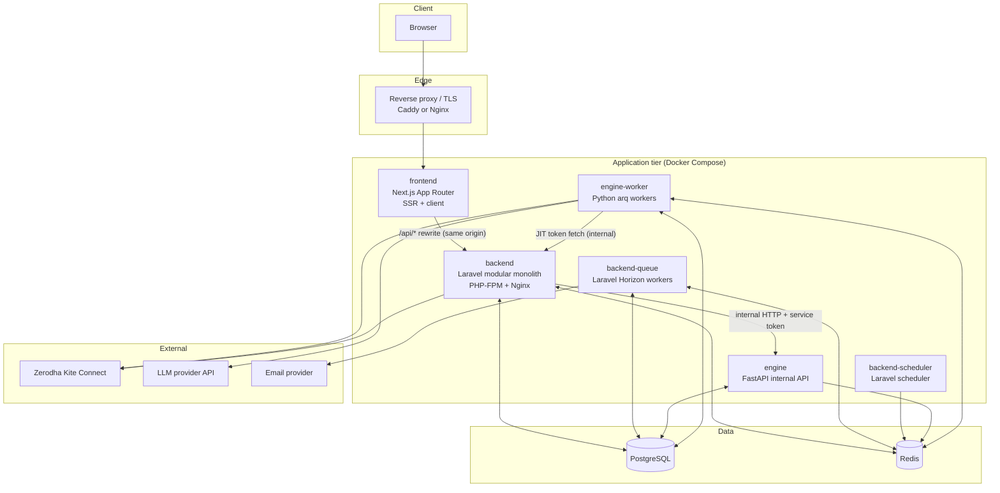
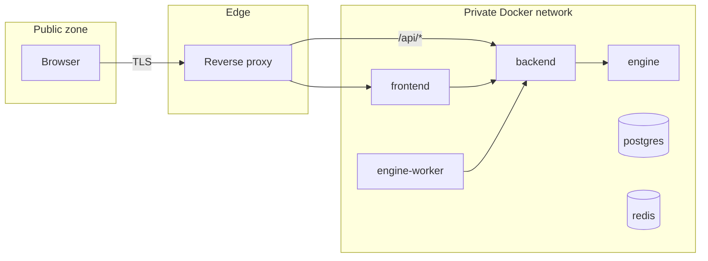

# System Architecture

| Field | Value |
|---|---|
| Document ID | ARC-01 |
| Version | 0.1.0 |
| Status | Specification ready |
| Owner | Solution Architect |
| Last updated | 2026-11-15 |
| Related | [ARC-02 Tech stack](02_TECHNOLOGY_STACK.md) · [ARC-03 Database](03_DATABASE_DESIGN.md) · [ARC-04 API](04_API_SPECIFICATION.md) · [ARC-05 Data flow](05_DATA_FLOW.md) · [ARC-06 Security](06_SECURITY_ARCHITECTURE.md) · [ARC-08 Integration](08_INTEGRATION_ARCHITECTURE.md) · [ADR-004](../adr/ADR-004-MODULAR-MONOLITH.md) |

## 1. Purpose and scope

Describes the runtime components of PriceAction AI, their responsibilities, how they communicate, where data lives and how errors propagate. Applies to all environments (local, CI, staging, production); environment differences are in [OPS-02](../operations/02_ENVIRONMENT_CONFIGURATION.md).

**Current state (2026-11-15):** only the Next.js frontend exists, serving sample data through a mock `DataSource` adapter. Everything else in this document is **specified, not built**.

## 2. Architectural style

A **modular monolith** (Laravel) plus **one separate Python quantitative service** (FastAPI API + worker processes sharing one codebase). Rationale summarised (full reasoning in [ADR-004](../adr/ADR-004-MODULAR-MONOLITH.md)):

- One developer initially; a single deployable for business logic minimises operational overhead.
- The Python split is justified by a real capability boundary: numerical/scientific ecosystem (pandas/numpy, pytest-hypothesis), deterministic engine isolation, and long-running CPU work (backtests) that must not block web requests.
- Clear module boundaries inside Laravel keep later extraction possible without paying microservice costs now.
- Explicitly **not** introduced: Kafka, Kubernetes, service mesh, separate per-domain services, GraphQL gateway.

## 3. Component view

## 4. Component responsibilities

| Component | Responsibilities | Explicitly not responsible for |
|---|---|---|
| **frontend** (Next.js) | Rendering, routing, forms, client-side validation for UX, chart rendering (Lightweight Charts), calling `/api/v1/*` through the `DataSource` adapter, showing data-mode badges | Authoritative calculations, storing secrets or broker tokens, talking to the engine or Kite directly |
| **backend** (Laravel) | Identity, sessions, tenants, authorization policies, onboarding, preferences, risk profiles, watchlists, trade plans, paper/actual trade records, journal, notifications, entitlements, audit logging, public REST API, Kite OAuth connect flow & token custody, orchestration of engine jobs | Market-structure or risk math (delegated to engine), LLM prompting |
| **backend-queue** (Horizon) | Laravel jobs: notifications, emails, audit fan-out, handling engine domain events (`POST /internal/v1/events`) | CPU-heavy analysis; chaining EOD pipeline steps (the engine-worker chains ingest → analyse → paper EOD itself, see ARC-05 §2) |
| **backend-scheduler** | Cron triggers: EOD pipeline kick-off, token-expiry sweeps, retention jobs | — |
| **engine** (FastAPI) | Internal synchronous endpoints: single-instrument analysis, risk calculation, explanation request, job submission/status; owns the deterministic domain library | Authentication of end users, user-facing API |
| **engine-worker** (arq) | Async jobs: instrument master sync, candle ingestion, universe analysis batches, backtests, paper-trade EOD processing, LLM explanations | Accepting public traffic |
| **PostgreSQL** | System of record for all persistent data | Caching, queues |
| **Redis** | Cache, Laravel queues/Horizon, arq queues, rate-limit counters, sessions | Durable data of record (everything in Redis is reconstructable) |

## 5. Laravel module boundaries

Modules live under `backend/app/Modules/<Module>` (structure in [ENG-03](../engineering/03_BACKEND_ARCHITECTURE.md)).

| Module | Owns tables | Depends on |
|---|---|---|
| Identity | tenants, users, tenant_memberships, user_profiles, audit_logs | — |
| Onboarding | onboarding_progress | Identity, Preferences, Risk, MarketData |
| Preferences | trading_preferences | Identity |
| Risk | risk_profiles | Identity, Engine client |
| Entitlements | subscription_entitlements | Identity |
| Integrations | provider_connections, data_sources, data_source_selections | Identity, Entitlements |
| MarketData | instruments, instrument_provider_refs, instrument_snapshots, universes, universe_memberships, candles (read), corporate_actions, ingestion_runs (read) | Integrations |
| Analysis | ruleset_versions, analysis_batches, analysis_runs & children (read), ai_explanations (read) | MarketData, Engine client |
| Watchlists | watchlists, watchlist_items | MarketData |
| Trading | trade_plans, paper_accounts, paper_trades, paper_trade_events, actual_trades, actual_trade_fills | Analysis, Risk |
| Journal | journal_entries | Trading |
| Backtesting | backtest_runs, backtest_trades (read) | Analysis, Engine client |
| Notifications | notifications | Identity |

Rule: a module accesses another module's tables only through that module's service interface, never by direct Eloquent queries. Enforced by an architecture test (Pest arch tests / deptrac) in CI.

## 6. Data ownership (writers)

| Data | Writer | Readers |
|---|---|---|
| Users, tenants, plans, trades, journal, watchlists, preferences | Laravel | Laravel; engine-worker reads plans/trades for EOD paper processing |
| Instruments, candles, ingestion runs, data quality issues | engine-worker | Laravel (read-only), engine |
| Candle snapshots, analysis runs and children | engine / engine-worker | Laravel (read-only) |
| Paper trade fills/exits (EOD) | engine-worker (via domain function) | Laravel |
| AI explanations | engine-worker | Laravel |
| Backtest runs | Laravel creates row (QUEUED); engine-worker updates status/results | Laravel |
| Provider tokens | Laravel only | engine-worker via JIT internal endpoint (never persisted outside Laravel) |

The shared database is a deliberate trade-off (simpler than synchronising two databases). **Each table has one owning component** (its migrations, schema and primary writer), documented as "Writer" in ARC-03, and the Postgres role used by each component is granted only the privileges it needs ([ARC-06 §6](06_SECURITY_ARCHITECTURE.md)).

Documented shared-write exceptions (all on trading tables, all protected by optimistic locking or idempotency keys):

| Table | Laravel writes | engine-worker writes |
|---|---|---|
| `trade_plans` | create, user edits, cancel | EOD status transitions only (`status`, `status_reason`, `triggered_on`, `lock_version`) |
| `paper_trades`, `paper_trade_events` | user commands: stop move up, close request (`current_stop`, `exit_requested_on`) | fills, exits, P&L |
| `journal_entries` | user edits | creation of `DRAFT` entries on trade close |
| `backtest_runs` | create (`QUEUED`), cancel request | status, progress, results |

No other table is written by more than one component.

## 7. Communication patterns

| From → To | Protocol | Auth | Pattern |
|---|---|---|---|
| Browser → frontend | HTTPS | Session cookie | Request/response, SSR |
| frontend → backend | HTTP(S) `/api/v1` (Next.js rewrite; server components call the backend over the internal network, forwarding the user's cookies) | Laravel Sanctum SPA session cookie + CSRF (XSRF-TOKEN) | REST JSON |
| backend → engine | HTTP on internal Docker network only, `/internal/v1/*` | Bearer service token (`ENGINE_SERVICE_TOKEN`), rotated; plus network isolation | Sync for ≤ 2 s operations (single analysis lookups, risk calc); async job submission otherwise |
| engine → engine-worker | Redis (arq) | Redis ACL user | Job queue |
| engine-worker → backend | HTTP internal `/internal/v1/provider-connections/{id}/access-token` | Service token (separate `BACKEND_INTERNAL_TOKEN`) | JIT credential fetch |
| backend → Kite | HTTPS | Kite api_key + secret (token exchange only) | OAuth-style redirect + session token exchange |
| engine-worker → Kite | HTTPS | api_key + user access token | Historical data, instruments |
| engine-worker → LLM | HTTPS | Provider API key | Request/response with timeout |
| Status updates to UI | Polling `/api/v1/jobs/{id}` (MVP) | Session | Server-Sent Events are future scope |

Contracts for internal endpoints live in [ARC-08](08_INTEGRATION_ARCHITECTURE.md).

## 8. Authentication boundaries

- Only the reverse proxy is exposed. `engine`, `postgres` and `redis` publish no host ports outside local development.
- End-user identity terminates at Laravel. The engine never sees end-user credentials; requests carry `tenant_id`/`user_id` as asserted context from Laravel and the engine trusts them only because the service token authenticates Laravel.

## 9. Error propagation

| Origin | Handling |
|---|---|
| Engine validation error (e.g. `INSUFFICIENT_HISTORY`) | Returned as a domain result (HTTP 200 with `status`), not an exception; Laravel maps to API response with `analysis.status`. |
| Engine rejects input (schema) | HTTP 422 from engine → Laravel logs and returns 502 `ENGINE_CONTRACT_ERROR` (indicates a bug). |
| Engine unavailable / timeout (2 s sync budget) | Laravel returns 503 `ENGINE_UNAVAILABLE` with `Retry-After`; UI shows retry state. Previously persisted analysis remains readable. |
| Kite errors | Normalised by the adapter into `PROVIDER_AUTH_EXPIRED`, `PROVIDER_RATE_LIMITED`, `PROVIDER_UNAVAILABLE`, `PROVIDER_DATA_ERROR` ([ARC-08 §4](08_INTEGRATION_ARCHITECTURE.md)). Auth expiry flips connection to `EXPIRED` and notifies the user. |
| LLM errors | Never block analysis. Fallback to deterministic template text ([ARC-07 §8](07_AI_AND_LLM_ARCHITECTURE.md)). |
| Async job failure | Job row status `FAILED` with `error_code`; retried per policy ([ENG-06](../engineering/06_ERROR_HANDLING_AND_LOGGING.md)); user-visible jobs surface the code. |

Every request carries `X-Request-Id` generated at the edge (or by Laravel) and propagated to the engine and workers for log correlation.

## 10. Scaling considerations

| Pressure | First response | Later |
|---|---|---|
| EOD analysis of NIFTY 500 (~500 instruments) | arq worker concurrency (CPU count); per-instrument analysis expected well under 1 s (assumption, to be benchmarked in M4) | More worker containers on the same host |
| Backtests (long CPU) | Dedicated `backtest` queue with concurrency 1–2 so EOD jobs are never starved | Separate worker host |
| API read load | Redis cache for latest scanner results per (data_source, as_of_date); HTTP caching headers | Read replica |
| Candle volume | ~500 instruments × 250 days × years per data source ⇒ low millions of rows; plain indexed table | Range partitioning by year if > 50M rows |
| Multi-tenant SaaS | Licensed data source is shared across tenants (one ingestion), personal sources are per-tenant | Per-tenant quotas via entitlements |

## 11. Deployment topology

Single Docker host per environment, Docker Compose, images built by GitHub Actions ([ENG-10](../engineering/10_GITHUB_ACTIONS_CI_CD.md), [OPS-01](../operations/01_DEPLOYMENT_GUIDE.md)). Managed PostgreSQL is preferred for production when available (backups, PITR); otherwise the Postgres container with volume + scheduled backups ([OPS-04](../operations/04_DATA_RETENTION_AND_BACKUP.md)).

## 12. Open questions

| ID | Question |
|---|---|
| OQ-ARC-01 | Managed Postgres vs container in production (cost vs operational safety). |
| OQ-ARC-02 | Should the frontend move to SSE for job progress in M9? |
| OQ-ARC-03 | Python job library: arq (chosen) vs Celery vs RQ — revisit if scheduling/priority needs grow. |
