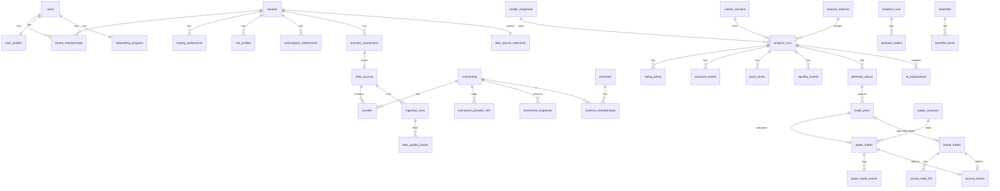

# Database Design

| Field | Value |
|---|---|
| Document ID | ARC-03 |
| Version | 0.4.0 |
| Status | Specification ready · **partially implemented:** §4–§7 migrated (M1, T-101a..c); §8 pending |
| Owner | Solution Architect / Backend Lead |
| Last updated | 2026-11-16 |
| Related | [ARC-01 Data ownership](01_SYSTEM_ARCHITECTURE.md#6-data-ownership-writers) · [ARC-04 API](04_API_SPECIFICATION.md) · [ARC-06 Security](06_SECURITY_ARCHITECTURE.md) · [OPS-04 Retention](../operations/04_DATA_RETENTION_AND_BACKUP.md) · [ADR-005](../adr/ADR-005-POSTGRESQL-DATABASE.md) · [ADR-011](../adr/ADR-011-DATA-MODES-AND-TENANT-ISOLATION.md) |

## 1. Purpose

Implementation-ready relational schema for PostgreSQL. Each table lists purpose, columns, keys, constraints, indexes, relationships, writer and retention. Migrations are authored in Laravel (single migration history) in M1; the Python engine never runs DDL.

## 2. Conventions

| Topic | Convention |
|---|---|
| Primary keys | `uuid`, generated application-side as time-ordered UUIDv7 (Laravel `HasUuids` ordered UUIDs; Python `uuid6`/stdlib equivalent). Exceptions: natural composite keys for `candles`, `bigint identity` for `audit_logs`. |
| Timestamps | `created_at`, `updated_at` `timestamptz NOT NULL DEFAULT now()`. Trading dates are `date` (exchange calendar). |
| Enums | `text` + `CHECK (col IN (...))`. Rationale: easier to extend in migrations than native PG enums. Values match [TRD-01 §7](../trading/01_TRADING_METHODOLOGY.md#7-outputs-and-vocabulary). |
| Money | `numeric(14,2)` INR. Prices `numeric(12,2)`. Percentages `numeric(6,3)`. Ratios `numeric(8,4)`. |
| Soft delete | Only `users` (`deleted_at`). Trading records are never soft-deleted; they change status. |
| Tenant scoping | Every tenant-owned table has `tenant_id uuid NOT NULL REFERENCES tenants(id)` and an index leading with `tenant_id`. |
| Naming | snake_case plural tables; FK `<entity>_id`; indexes `ix_<table>__<cols>`; uniques `uq_<table>__<cols>`. |
| JSONB | Only for engine outputs that are read as a whole (evidence, metrics, parameters) or truly schemaless metadata. Anything filtered or joined is a column. |
| Extensions | `citext`, `btree_gist`, `pgcrypto`. |

Legend for "Writer": **L** = Laravel, **E** = engine/engine-worker.

### 2.1 Implementation notes (as migrated)

Migrations are raw SQL in `backend/database/migrations` so constraints match this document exactly. Implemented: §4–§8 and the §12 seeders for the daily M1 schema; the intraday target is §2.2 (ADR-015). Files: (`0001_01_01_000000_create_users_table`, `2026_11_16_000001`–`000005`) plus an extensions migration and the role grants (`000006`). Deviations and decisions:

- `users` has no `name` column (the display name is `user_profiles.display_name`) and there is no `sessions` table (Redis).
- `trading_preferences.universe_id` is a plain `uuid` until `universes` exists (§6.4); its FK is added in T-101b.
- `audit_logs`: `UPDATE`, `DELETE` and `TRUNCATE` are revoked from `app_backend` and `app_engine` when those roles exist (production/dev). CI has no such roles, so that grant is not exercised there.
- `subscription_entitlements` also has `CHECK (valid_to IS NULL OR valid_to > valid_from)` (not in the original text).
- §6 (`2026_11_16_000003_create_market_data_tables`) deviations and clarifications:
  - `candles.ingestion_run_id` is `NOT NULL` (every candle has provenance), so seeders and demo data create an ingestion run first.
  - `instrument_provider_refs.provider` is restricted to `DEMO`, `ZERODHA_KITE`, `LICENSED_VENDOR` (the spec says "ZERODHA_KITE, ..."), matching `data_sources.provider`.
  - Added integrity checks not spelled out above: positive `tick_size`/`lot_size`, `effective_to/valid_to > effective_from/valid_from`, ratios both null or both positive, `ingestion_runs` counters and range, `market_calendar` holidays have no session times and `session_close > session_open`.
  - The duplicate-run guard on `ingestion_runs` only covers runs with a `trade_date`; runs without one (e.g. `BACKFILL`) are not constrained, because NULLs are distinct in a unique index.
  - Extra indexes: `candles (instrument_id, trade_date)`, `universe_memberships (instrument_id)`, `data_quality_issues (ingestion_run_id)`.
- §7 (`2026_11_16_000004_create_analysis_tables`) deviations and clarifications:
  - **Immutability is enforced by triggers**, which also bind the table owner, rather than only by revoking `UPDATE`: `candle_snapshots`, `analysis_runs`, `swing_points`, `structure_events`, `price_zones`, `liquidity_events` and `detected_setups` reject every `UPDATE` (ARC-03 §11, C-08). `DELETE` stays possible for the retention job and cascades. `ruleset_versions` rejects changes to `ruleset_code`, `version`, `parameters`, `parameters_hash` and `score_version`, and reverting to `DRAFT`, once the row has left `DRAFT` (the spec named only `parameters`). The role grants for these tables (e.g. no `DELETE` on `candle_snapshots` for application roles) are still to be added in T-101d.
  - `analysis_runs.primary_setup_id` is `DEFERRABLE INITIALLY DEFERRED`, so the engine pre-generates the setup id and inserts the run and its setups in one transaction without any `UPDATE`.
  - `analysis_runs.signal_state` is `NOT NULL` (failed or insufficient-history runs use `NO_TRADE`). `result_hash` is nullable, but required when `status = 'COMPLETED'`. `as_of_date` and `duration_ms` are `NOT NULL` (the latter defaults to 0).
  - `analysis_runs.tenant_id = data_sources.tenant_id` for PERSONAL sources is a cross-table rule; it is not expressible as a `CHECK` and is left to the engine and tests.
  - Added integrity checks: SemVer-shaped `version`; 64-hex hashes; `activated_at` required unless `DRAFT`; `swing_points` labels must match `kind` and a pivot is confirmed no earlier than its bar (no look-ahead, C-09); zone `low <= high`; setup `status_changed_date >= detected_at_date`; for `LONG` setups `stop < entry < target` when those are present (§13), in addition to `SHORT ⇒ informational` (C-12); `analysis_batches` completed + failed ≤ total.
  - `ai_explanations`: a `question` exists exactly for `CHART_QA`; `tenant_id` and `user_id` are both set or both null, and `CHART_QA` needs an owner; model fields are required unless `status = 'FALLBACK'`; the foreign key to `analysis_runs` is `RESTRICT`, so a referenced run cannot be deleted (retention rule in §7.4).
  - Child tables referencing each other (`structure_events.level_swing_point_id`, `detected_setups.anchor_*`) use `ON DELETE CASCADE`, so deleting a run removes all of its rows regardless of constraint ordering.
  - `analysis_batches` also has `created_at`. Extra indexes: `candle_snapshots (instrument_id, to_date)`, `analysis_runs (analysis_batch_id)`, `ai_explanations (analysis_run_id)`.
- §8 (`2026_11_16_000005_create_trading_tables`) deviations and clarifications:
  - `plan_number` is a plain `NOT NULL integer > 0` with the per-tenant unique; the counter mechanism stays open (OQ-DB-03) and is the application's job.
  - Integrity checks beyond the spec: engine levels, when present, also satisfy `stop < entry < target`; a `MANUAL` plan has no engine levels; `trade_plans` amounts and `rr` are positive; `setup_key` is 64-hex.
  - `paper_trades`: `OPEN` has no exit facts, `CLOSED` requires `exit_date`, `exit_price`, `exit_reason`, `gross_pnl` and `net_pnl`; exit and close-request dates are not before `entry_date`. `paper_trade_events` has no uniqueness rule yet (the EOD idempotency key lives in the engine, TRD/ARC-03 §10).
  - `actual_trades`: `CLOSED` implies `quantity_open = 0` and `closed_at`; `OPEN` has no `closed_at`. The cumulative SELL ≤ BUY rule is not expressible as a `CHECK` and stays an application rule with a test (ARC-03 §10 locking).
  - `backtest_runs` needs a `universe_id` or `instrument_ids`. `backtest_trades.entry_date` must be after `signal_date` (signal at close *t* fills at *t+1*, C-09); `FILLED` needs entry facts with `stop < entry < target`; `SKIPPED` needs a `skip_reason` and no entry or exit.
  - `notifications.type` is constrained to an upper-snake shape rather than a closed list, because the spec gives examples only. Extra indexes: `watchlist_items (instrument_id)`, `trade_plans (instrument_id)`, `trade_plans (analysis_run_id)`, `paper_trades (paper_account_id)`, `actual_trades (instrument_id)`, `actual_trades (trade_plan_id)`, `backtest_trades (instrument_id)`.
- Role grants (`2026_11_16_000006_apply_role_grants`, function `apply_role_grants()`), when `app_backend` and `app_engine` exist (they do not in CI's plain Postgres, where it is a no-op):
  - Each table has one runtime writer (ARC-01 §6). Laravel owns identity, configuration, `data_sources`, `universes`, `market_calendar`, `ruleset_versions`, watchlists, plans, paper accounts, actual trades, journal edits, notifications. The engine owns market data, candle snapshots, analysis tables, `ai_explanations`, `backtest_trades`. `universes` and `market_calendar` are marked "E/L" in this document; Laravel is the runtime writer because they are seeded, while `universe_memberships` is the engine's.
  - Shared writes are column-level `UPDATE` grants: the engine updates `trade_plans (status, status_reason, triggered_on, lock_version, updated_at)` and the `backtest_runs` result columns; Laravel updates `paper_trades (current_stop, exit_requested_on, updated_at)` and `backtest_runs (status)`. The engine can `INSERT` journal drafts but not edit them.
  - `candle_snapshots` has `INSERT`/`SELECT` only for both roles (no `UPDATE`, no `DELETE`); retention deletes run as the schema owner. Analysis runs and children have no `UPDATE` (a trigger enforces this regardless). `audit_logs` is `INSERT`/`SELECT` only.
  - `provider_connections` is not readable by the engine (tokens reach it through the just-in-time endpoint only).
  - Default privileges for both roles are removed, so a new table is **closed** until its migration lists it in `apply_role_grants()` and re-runs it. Laravel's `migrations` table is no longer accessible to the runtime roles; migrations run as `app_migrator`.
  - Engine `notifications` writes are not granted: the spec lists it as Laravel-written, so engine events reach users through Laravel.
- Seeders (T-102; `backend/database/seeders`, run as the schema owner with `make seed`; `DatabaseSeeder` → `DemoSeeder` → `RulesetSeeder` + `UniverseSeeder`). All ids are UUIDv5 and inserts use `ON CONFLICT DO NOTHING`, so re-running changes nothing (an `ACTIVE` ruleset is never rewritten):
  - **Ruleset** `pa-core 0.1.0` is `ACTIVE` / `HYPOTHESIS`, `score_version` `paqs-0.1.0`, parameters from `database/seeders/data/pa-core-0.1.0.json` (the 29 TRD-01 §6 defaults, flat dotted keys). `parameters_hash` is sha256 of canonical JSON: sorted keys, no whitespace, floats keep `.0` (the form Python's `json.dumps` produces), so the engine can reproduce it. ENG-04 §5 expects the same file at `python-engine/rulesets/pa-core/0.1.0.json`. The backend container cannot see `python-engine/`, so the backend keeps its own byte-identical copy and `contracts/scripts/check_ruleset_hash.py` (run by `contracts-ci.yml`, T-105) fails CI if the two differ, or if either differs from the TRD-01 §6 registry. `SeedersTest` pins the canonical hash, which Python and PHP compute identically.
  - **Universes:** all six codes are created. Only `DEMO` has members (the 36 demo equities, effective from 2000-01-01). The real NIFTY universes stay empty until the M2 universe loader fills them.
  - **DEMO data:** one global `DEMO` data source; 36 equities and 3 NSE index instruments (`NIFTY 50`, `NIFTY BANK`, `INDIA VIX`), all `is_demo`, no ISIN, each with a `DEMO` provider ref and an instrument snapshot (tick 0.05 equities, 0.01 indices); one completed `BACKFILL` ingestion run (240 trading days to 2026-11-13); 8,640 daily candles for the equities. The generator is a port of `frontend/src/mocks/demo-series.ts`, and a parity test compares every series with a fixture exported from the TypeScript source.
  - **Deliberate gaps:** SENSEX is BSE, which `instruments.exchange` does not allow, so it is not seeded. Index instruments have no candles (the dashboard strip keeps using its own sample trend until a decision on DEMO index series). Sector and index-membership attributes of the sample universe have no column and are not stored.
  - **M2 risk:** demo equities use real tickers (`RELIANCE`, …) as `ACTIVE`, and `uq_instruments__active_symbol` makes those unique per exchange. The M2 instrument-master sync must adopt or replace the demo rows (for example match by symbol and flip `is_demo`), or a real sync will conflict with them.
- Tests: `backend/tests/Feature/Database/` assert the constraints against a real PostgreSQL; the grant tests use `has_table_privilege`/`has_column_privilege` and skip when the roles do not exist.

### 2.2 Intraday time model (ADR-015, to be implemented in I1)

[ADR-015](../adr/ADR-015-INTRADAY-TIME-AND-SNAPSHOT-MODEL.md) changes the time model for the intraday direction ([ADR-014](../adr/ADR-014-PERSONAL-INTRADAY-WORKSTATION.md)). The sections below §3 still describe the M1 (daily) schema as migrated; this table is the target for the I1 expand migrations (task T-I09) and wins where they disagree.

| Table | Change |
|---|---|
| `candles` | Add `bar_start timestamptz NOT NULL` (UTC; IST session alignment). Primary key `(data_source_id, instrument_id, timeframe, bar_start)`. `timeframe` CHECK `('1m','5m','15m','1D')`. `trade_date` stays as the IST session date; index `(instrument_id, timeframe, trade_date)`. Check that `bar_start` falls inside the session for intraday timeframes is done by ingestion, not by a constraint. |
| `candle_revisions` (new) | Append-only copy of a bar's previous values when it is corrected: `(data_source_id, instrument_id, timeframe, bar_start, revision, open, high, low, close, volume, replaced_at)`. Engine-written; no `UPDATE`/`DELETE` for the runtime roles. |
| `candle_snapshots` | Drop `payload`. Add `from_bar_start`, `to_bar_start` (timestamptz) and `max_revision`; keep `bar_count`, `content_hash` (sha256 over the canonical bars at the revisions used), immutability trigger and the unique `(data_source_id, content_hash)`. `timeframe` CHECK as for `candles`. |
| `analysis_run_inputs` (new) | `(analysis_run_id, role, candle_snapshot_id)`, role CHECK `('PRIMARY_5M','CONTEXT_15M','DAILY_CONTEXT')`, primary key `(analysis_run_id, role)`. Immutable like its run. |
| `analysis_runs` | Add `as_of_ts timestamptz NOT NULL` (end of the last 5m bar used). Drop `candle_snapshot_id` after the inputs table is filled. `as_of_date` stays (session date). Uniqueness by `(data_source_id, instrument_id, ruleset_version_id, as_of_ts)`. |
| `analysis_batches` | Add `as_of_ts`; one batch per data source and 5m close. |
| `swing_points`, `structure_events`, `price_zones`, `liquidity_events`, `detected_setups` | Add the source timeframe and bar timestamps beside the existing indexes and dates (for example `swing_points.bar_start`, `confirmed_at_bar_start`, `timeframe`); no-look-ahead check `confirmed_at_bar_start >= bar_start`. |
| `detected_setups` | `setup_type` CHECK becomes the `pa-intraday` vocabulary of TRD-01 §7 (`OPENING_RANGE_BREAKOUT`, `PREV_DAY_HIGH_BREAK`, `PREV_DAY_LOW_BREAK`, `BREAKOUT_RETEST`, `TREND_CONTINUATION`, `LIQUIDITY_SWEEP_REVERSAL`); add `signal_at`, `valid_until`. Same change for `ai_explanations` and `backtest_runs.setup_types`. |
| `ruleset_versions` | Seed `pa-intraday 0.1.0` as `ACTIVE`; set `pa-core 0.1.0` to `RETIRED`. |
| `ingestion_runs` | Add `timeframe` and `bar_start` (the bar close being fetched) for intraday runs; duplicate-run guard on `(data_source_id, kind, timeframe, bar_start)` while queued or running. Kind `INTRADAY_BARS` added. |
| `market_calendar` | Seeded with NSE sessions and holidays (special sessions as rows with their own times). |
| `trade_plans` | Add `triggered_at timestamptz`; `valid_until timestamptz` (setup expiry inside the session). |
| `paper_trades` | Add `entry_at`, `exit_at` (timestamptz); `exit_reason` adds `SESSION_END`. Checks move to timestamps (exit after entry). |
| `backtest_trades` | Add `signal_at`, `entry_at`, `exit_at`; check `entry_at > signal_at` (fill on a later bar, C-09). |
| `risk_profiles` | Add `max_position_value`, `daily_loss_limit`, `max_consecutive_losses`, `max_open_risk` (money or count; values are owner settings, defaults HYPOTHESIS per TRD-05). |
| `daily_risk_state` (new) | Per tenant and session date and book: realised P&L, open risk, losing streak, `blocked_reason`. Engine and Laravel derive it from trades; single writer to be fixed in TRD-05 (T-I06). |
| Retention | Intraday analysis runs not referenced by a plan, trade or journal entry are deleted after a configurable number of days (OPS-04). |

## 3. Entity-relationship overview

## 4. Identity and access

### 4.1 `tenants` (Writer L · Retention: life of account + 90 days)

Purpose: isolation boundary. In personal-first mode each user gets one `PERSONAL` tenant at registration.

| Column | Type | Constraints |
|---|---|---|
| id | uuid | PK |
| name | text | NOT NULL |
| slug | citext | NOT NULL, UNIQUE |
| kind | text | NOT NULL, CHECK IN (`PERSONAL`,`ORGANIZATION`) |
| status | text | NOT NULL DEFAULT `ACTIVE`, CHECK IN (`ACTIVE`,`SUSPENDED`,`CLOSED`) |
| created_at, updated_at | timestamptz | |

### 4.2 `users` (L · soft delete; PII purged 30 days after deletion request)

| Column | Type | Constraints |
|---|---|---|
| id | uuid | PK |
| email | citext | NOT NULL, UNIQUE |
| password | text | NOT NULL (Argon2id/bcrypt hash via Laravel `Hash`) |
| email_verified_at | timestamptz | NULL |
| status | text | CHECK IN (`ACTIVE`,`SUSPENDED`,`DELETED`) |
| is_platform_admin | boolean | NOT NULL DEFAULT false |
| last_login_at | timestamptz | NULL |
| remember_token | varchar(100) | NULL |
| created_at, updated_at, deleted_at | timestamptz | |

Laravel framework tables also created: `password_reset_tokens`, `failed_jobs`. Sessions and cache use Redis (no DB tables).

### 4.3 `tenant_memberships` (L)

| Column | Type | Constraints |
|---|---|---|
| id | uuid | PK |
| tenant_id | uuid | FK tenants ON DELETE CASCADE |
| user_id | uuid | FK users ON DELETE CASCADE |
| role | text | CHECK IN (`OWNER`,`ADMIN`,`MEMBER`,`VIEWER`) |
| created_at | timestamptz | |

Unique `(tenant_id, user_id)`. Index `(user_id)`.

**Roles and permissions:** roles are a fixed enum; the role→permission matrix is defined in code ([ARC-06 §3](06_SECURITY_ARCHITECTURE.md)). Separate `roles`/`permissions` tables are **deliberately not created** in MVP (single-user tenants). Revisit when organization tenants with custom roles are needed.

### 4.4 `user_profiles` (L)

| Column | Type | Constraints |
|---|---|---|
| user_id | uuid | PK, FK users ON DELETE CASCADE |
| display_name | text | NOT NULL |
| experience_level | text | NULL, CHECK IN (`NEW`,`INTERMEDIATE`,`ADVANCED`) |
| timezone | text | NOT NULL DEFAULT `Asia/Kolkata` |
| locale | text | NOT NULL DEFAULT `en-IN` |
| updated_at | timestamptz | |

### 4.5 `onboarding_progress` (L)

Stores progress, not answers. Answers go to their owning tables (profile, preferences, risk profile, data-source selection) — see [PRD-05](../product/05_ONBOARDING_SPECIFICATION.md).

| Column | Type | Constraints |
|---|---|---|
| user_id | uuid | PK, FK users |
| tenant_id | uuid | FK tenants |
| flow_version | smallint | NOT NULL DEFAULT 1 |
| status | text | CHECK IN (`NOT_STARTED`,`IN_PROGRESS`,`COMPLETED`) |
| current_step | text | CHECK IN (`WELCOME`,`EXPERIENCE`,`STYLE`,`UNIVERSE`,`DATA_SOURCE`,`RISK`,`DONE`) |
| completed_steps | text[] | NOT NULL DEFAULT '{}' |
| skipped_steps | text[] | NOT NULL DEFAULT '{}' |
| started_at, completed_at, updated_at | timestamptz | |

### 4.6 `audit_logs` (L, also E for service actions · append-only · retention 2 years online, then archive)

| Column | Type | Constraints |
|---|---|---|
| id | bigint | PK, GENERATED ALWAYS AS IDENTITY |
| occurred_at | timestamptz | NOT NULL DEFAULT now() |
| tenant_id | uuid | NULL (system events) |
| actor_type | text | CHECK IN (`USER`,`SYSTEM`,`SERVICE`) |
| actor_id | uuid | NULL |
| action | text | NOT NULL, e.g. `trade_plan.updated`, `provider_connection.connected` |
| entity_type | text | NULL |
| entity_id | uuid | NULL |
| request_id | text | NULL |
| ip | inet | NULL |
| user_agent | text | NULL |
| changes | jsonb | NULL — before/after with secrets redacted |
| metadata | jsonb | NULL |

Indexes: `(tenant_id, occurred_at DESC)`, `(entity_type, entity_id)`. DB role for application has `INSERT, SELECT` only (no `UPDATE/DELETE`). Monthly range partitioning on `occurred_at` when volume justifies (not at M1).

## 5. Trading configuration

### 5.1 `trading_preferences` (L)

| Column | Type | Constraints |
|---|---|---|
| id | uuid | PK |
| tenant_id | uuid | FK |
| user_id | uuid | FK |
| trading_styles | text[] | values ⊂ {`SWING`,`POSITIONAL`,`BREAKOUT`,`PULLBACK`} (validated in app) |
| default_timeframe | text | DEFAULT `1D`, CHECK IN (`1D`) for MVP |
| universe_id | uuid | FK universes, NULL ⇒ NIFTY 500 default |
| direction_preference | text | CHECK IN (`LONG_ONLY`,`LONG_AND_REFERENCE`) DEFAULT `LONG_ONLY` |
| notification_settings | jsonb | NOT NULL DEFAULT '{}' — `{triggers, invalidations, daily_digest, email, push}` |
| updated_at | timestamptz | |

Unique `(tenant_id, user_id)`.

### 5.2 `risk_profiles` (L · versioned, never updated in place)

| Column | Type | Constraints |
|---|---|---|
| id | uuid | PK |
| tenant_id, user_id | uuid | FK |
| version | integer | NOT NULL |
| is_current | boolean | NOT NULL |
| trading_capital | numeric(14,2) | CHECK ≥ 10000 |
| risk_per_trade_pct | numeric(6,3) | CHECK 0.1–2.0 |
| max_open_positions | smallint | CHECK 1–20 |
| max_portfolio_heat_pct | numeric(6,3) | CHECK 1–10 |
| max_position_pct | numeric(6,3) | CHECK 5–100 |
| min_rr | numeric(8,4) | NULL ⇒ ruleset value; app enforces ≥ ruleset `risk.min_rr` |
| max_entry_gap_pct | numeric(6,3) | NULL ⇒ ruleset value; app enforces ≤ ruleset value |
| created_at | timestamptz | |

Unique `(tenant_id, user_id, version)`; partial unique `(tenant_id, user_id) WHERE is_current`. Trade plans reference the version used. Ranges come from [TRD-01 §6](../trading/01_TRADING_METHODOLOGY.md#6-ruleset-parameter-registry-authoritative).

### 5.3 `subscription_entitlements` (L)

| Column | Type | Constraints |
|---|---|---|
| id | uuid | PK |
| tenant_id | uuid | FK |
| plan_code | text | CHECK IN (`DEMO`,`PERSONAL`,`PRO`) — commercial plans are future scope |
| features | jsonb | e.g. `{"max_watchlists":10,"ai_explanations_per_day":20,"backtests_per_day":5,"data_modes":["DEMO","PERSONAL"]}` |
| status | text | CHECK IN (`ACTIVE`,`EXPIRED`,`CANCELLED`) |
| source | text | CHECK IN (`DEFAULT`,`MANUAL`,`BILLING`) |
| valid_from | timestamptz | NOT NULL |
| valid_to | timestamptz | NULL |

Exclusion constraint (btree_gist) preventing overlapping `ACTIVE` rows per tenant.

### 5.4 `provider_connections` (L · tokens purged on disconnect)

| Column | Type | Constraints |
|---|---|---|
| id | uuid | PK |
| tenant_id, user_id | uuid | FK |
| provider | text | CHECK IN (`ZERODHA_KITE`) |
| provider_user_id | text | NULL until connected |
| status | text | CHECK IN (`PENDING`,`CONNECTED`,`EXPIRED`,`REVOKED`,`ERROR`) |
| access_token_encrypted | text | NULL — Laravel `Crypt` (AES-256-GCM via app key or dedicated `PROVIDER_TOKEN_KEY`) |
| token_expires_at | timestamptz | NULL |
| key_version | smallint | encryption key generation for rotation |
| oauth_state_hash | text | NULL — hashed CSRF state during connect |
| last_connected_at, last_error_at | timestamptz | |
| last_error_code | text | NULL |
| created_at, updated_at | timestamptz | |

Unique `(tenant_id, provider, provider_user_id)`. **Never stored:** Zerodha password, TOTP/2FA, PIN, `request_token` (used once and discarded). See [ARC-06 §5](06_SECURITY_ARCHITECTURE.md).

### 5.5 `data_sources` (L creates; E reads)

Purpose: the unit of market-data licensing and isolation ([ADR-011](../adr/ADR-011-DATA-MODES-AND-TENANT-ISOLATION.md)).

| Column | Type | Constraints |
|---|---|---|
| id | uuid | PK |
| mode | text | CHECK IN (`DEMO`,`PERSONAL`,`LICENSED`) |
| provider | text | CHECK IN (`DEMO`,`ZERODHA_KITE`,`LICENSED_VENDOR`) |
| tenant_id | uuid | FK, NULL |
| provider_connection_id | uuid | FK provider_connections, NULL |
| name | text | NOT NULL |
| status | text | CHECK IN (`ACTIVE`,`DISABLED`) |
| created_at | timestamptz | |

Check constraints: `mode = 'PERSONAL'` ⇔ `tenant_id IS NOT NULL AND provider_connection_id IS NOT NULL`; `mode IN ('DEMO','LICENSED')` ⇒ `tenant_id IS NULL`. Unique `(provider_connection_id)`; partial unique `(mode, provider) WHERE tenant_id IS NULL`.

### 5.6 `data_source_selections` (L)

| Column | Type | Constraints |
|---|---|---|
| tenant_id | uuid | PK, FK |
| data_source_id | uuid | FK data_sources |
| selected_by | uuid | FK users |
| selected_at | timestamptz | |

App rule: a tenant may select only a global source it is entitled to, or a `PERSONAL` source with the same `tenant_id`.

## 6. Market data

### 6.1 `instruments` (E · retained indefinitely)

| Column | Type | Constraints |
|---|---|---|
| id | uuid | PK |
| exchange | text | CHECK IN (`NSE`) for MVP (BSE future) |
| segment | text | CHECK IN (`EQ`,`INDEX`) — `INDEX` rows (e.g. NIFTY 50) feed the dashboard index strip and are never tradable |
| trading_symbol | text | NOT NULL |
| isin | text | NULL (demo instruments may lack ISIN) |
| name | text | NOT NULL |
| status | text | CHECK IN (`ACTIVE`,`SUSPENDED`,`DELISTED`) |
| listed_on, delisted_on | date | NULL |
| is_demo | boolean | NOT NULL DEFAULT false |
| created_at, updated_at | timestamptz | |

Unique `(exchange, isin) WHERE isin IS NOT NULL`; index `(exchange, trading_symbol)`; partial unique `(exchange, trading_symbol) WHERE status = 'ACTIVE'` (symbols can be reused after delisting).

### 6.2 `instrument_provider_refs` (E)

| Column | Type | Constraints |
|---|---|---|
| id | uuid | PK |
| instrument_id | uuid | FK |
| provider | text | `ZERODHA_KITE`, ... |
| provider_token | text | NOT NULL (Kite `instrument_token`) |
| exchange_token | text | NULL |
| valid_from | date | NOT NULL |
| valid_to | date | NULL |

Unique `(provider, provider_token, valid_from)`; index `(instrument_id, provider)`.

### 6.3 `instrument_snapshots` (E · effective-dated)

Records attribute changes needed for point-in-time correctness (tick size, lot size, name).

| Column | Type | Constraints |
|---|---|---|
| instrument_id | uuid | FK |
| effective_from | date | |
| effective_to | date | NULL |
| name | text | |
| tick_size | numeric(8,4) | NOT NULL |
| lot_size | integer | NOT NULL DEFAULT 1 |
| status | text | |

PK `(instrument_id, effective_from)`. Exclusion constraint: no overlapping ranges per instrument.

### 6.4 `universes` and `universe_memberships` (E/L · retained indefinitely)

`universes`: `id uuid PK, code text UNIQUE (NIFTY500, NIFTY50, NIFTY100, NIFTY200, NIFTYMIDCAP150, DEMO), name, source text, is_demo bool`.

`universe_memberships`:

| Column | Type | Constraints |
|---|---|---|
| id | uuid | PK |
| universe_id | uuid | FK |
| instrument_id | uuid | FK |
| effective_from | date | NOT NULL |
| effective_to | date | NULL (open) |
| source_ref | text | e.g. reconstitution notice id |

Exclusion constraint `EXCLUDE USING gist (universe_id WITH =, instrument_id WITH =, daterange(effective_from, effective_to, '[)') WITH &&)`. Index `(universe_id, effective_from, effective_to)`. Point-in-time query: `effective_from ≤ d AND (effective_to IS NULL OR effective_to > d)`.

### 6.5 `candles` (E · retained indefinitely for LICENSED/PERSONAL; DEMO regenerable)

| Column | Type | Constraints |
|---|---|---|
| data_source_id | uuid | FK data_sources |
| instrument_id | uuid | FK instruments |
| timeframe | text | CHECK IN (`1D`) |
| trade_date | date | |
| open, high, low, close | numeric(12,2) | CHECK > 0 and `low ≤ least(open,close)` and `greatest(open,close) ≤ high` |
| volume | bigint | CHECK ≥ 0 |
| ingestion_run_id | uuid | FK ingestion_runs |
| revision | smallint | NOT NULL DEFAULT 1 (incremented on correction) |
| updated_at | timestamptz | |

PK `(data_source_id, instrument_id, timeframe, trade_date)`. Stored **raw (unadjusted)**; adjusted series are produced when building a candle snapshot using `corporate_actions`. No partitioning initially (see ARC-01 §10).

### 6.6 `corporate_actions` (E)

| Column | Type | Constraints |
|---|---|---|
| id | uuid | PK |
| instrument_id | uuid | FK |
| action_type | text | CHECK IN (`SPLIT`,`BONUS`,`DIVIDEND`,`RIGHTS`,`MERGER`,`DEMERGER`,`SYMBOL_CHANGE`) |
| ex_date | date | NOT NULL |
| ratio_from, ratio_to | numeric(12,4) | NULL (e.g. 1:2 split → from 1, to 2) |
| cash_amount | numeric(12,4) | NULL |
| source | text | NOT NULL |

Unique `(instrument_id, action_type, ex_date)`.

### 6.7 `ingestion_runs` (E · retention 1 year)

| Column | Type | Constraints |
|---|---|---|
| id | uuid | PK |
| data_source_id | uuid | FK |
| kind | text | CHECK IN (`INSTRUMENT_MASTER`,`DAILY_CANDLES`,`BACKFILL`,`CORPORATE_ACTIONS`,`UNIVERSE`) |
| trade_date | date | NULL |
| range_from, range_to | date | NULL |
| status | text | CHECK IN (`QUEUED`,`RUNNING`,`COMPLETED`,`PARTIAL`,`FAILED`) |
| requested_by | uuid | NULL (system) |
| instruments_total, instruments_succeeded, instruments_failed | integer | |
| rows_inserted, rows_updated | integer | |
| quality_issue_count | integer | |
| error_summary | jsonb | |
| started_at, finished_at, created_at | timestamptz | |

Index `(data_source_id, kind, created_at DESC)`. Partial unique `(data_source_id, kind, trade_date) WHERE status IN ('QUEUED','RUNNING')` to prevent concurrent duplicate runs.

### 6.8 `data_quality_issues` (E · retention 1 year)

`id uuid PK, ingestion_run_id FK, instrument_id FK NULL, trade_date date NULL, issue_type CHECK IN (MISSING_SESSION, OHLC_INVALID, DUPLICATE, PRICE_SPIKE, ZERO_VOLUME, STALE_DATA, PROVIDER_GAP), severity CHECK IN (INFO, WARN, ERROR), details jsonb, resolved_at timestamptz NULL`. Index `(instrument_id, trade_date)`.

### 6.9 `market_calendar` (E/L seeded · retained indefinitely)

| Column | Type | Constraints |
|---|---|---|
| exchange | text | `NSE` |
| calendar_date | date | |
| is_trading_day | boolean | NOT NULL |
| session_open, session_close | time | NULL on holidays (normal session 09:15–15:30 IST) |
| note | text | e.g. holiday name, special session |

PK `(exchange, calendar_date)`. Source: exchange holiday list, loaded yearly (manual seed + review). Used by ingestion gap detection and by `GET /api/v1/market/session` (replaces the frontend's clock-only `useMarketSession`, which ignores holidays).

## 7. Analysis

### 7.1 `ruleset_versions` (L seeds via migration/seeder · immutable once `ACTIVE`)

| Column | Type | Constraints |
|---|---|---|
| id | uuid | PK |
| ruleset_code | text | e.g. `pa-core` |
| version | text | semver |
| parameters | jsonb | full registry values (TRD-01 §6) |
| parameters_hash | text | sha256 of canonical JSON |
| score_version | text | e.g. `paqs-0.1.0` |
| status | text | CHECK IN (`DRAFT`,`ACTIVE`,`RETIRED`) |
| validation_status | text | CHECK IN (`HYPOTHESIS`,`VALIDATED`) |
| created_at, activated_at, retired_at | timestamptz | |

Unique `(ruleset_code, version)`. A trigger rejects `UPDATE` of `parameters` when `status <> 'DRAFT'`.

### 7.2 `candle_snapshots` (E · immutable · retained while referenced)

| Column | Type | Constraints |
|---|---|---|
| id | uuid | PK |
| data_source_id | uuid | FK |
| instrument_id | uuid | FK |
| timeframe | text | |
| from_date, to_date | date | |
| bar_count | integer | |
| price_basis | text | CHECK IN (`ADJUSTED`) |
| content_hash | text | sha256 over canonical serialisation of bars + adjustment factors |
| payload | bytea | zstd-compressed columnar arrays (dates, O, H, L, C, V, adj_factor) |
| created_at | timestamptz | |

Unique `(data_source_id, content_hash)` — identical inputs dedupe. No `UPDATE`/`DELETE` privilege for application roles (deletion only by the retention job when unreferenced). ~500 bars ≈ tens of KB uncompressed; acceptable.

### 7.3 `analysis_batches` (E)

`id uuid PK, data_source_id FK, universe_id FK, as_of_date date, ruleset_version_id FK, trigger CHECK IN (SCHEDULED_EOD, MANUAL), status CHECK IN (QUEUED, RUNNING, COMPLETED, PARTIAL, FAILED), instruments_total/completed/failed int, started_at, finished_at`. Unique `(data_source_id, universe_id, as_of_date, ruleset_version_id)`. Backs "last scan" metadata on `/market-scanner`.

### 7.4 `analysis_runs` (E · retention: latest per instrument indefinitely; history 2 years unless referenced by a plan/explanation)

The "analysis snapshot": one immutable evaluation of one instrument.

| Column | Type | Constraints |
|---|---|---|
| id | uuid | PK |
| tenant_id | uuid | NULL; equals `data_sources.tenant_id` for PERSONAL sources |
| data_source_id | uuid | FK |
| analysis_batch_id | uuid | FK NULL (on-demand runs) |
| instrument_id | uuid | FK |
| candle_snapshot_id | uuid | FK NOT NULL (constraint C-08) |
| ruleset_version_id | uuid | FK NOT NULL (constraint C-08) |
| engine_version | text | NOT NULL |
| as_of_date | date | last bar date |
| status | text | CHECK IN (`COMPLETED`,`INSUFFICIENT_HISTORY`,`INVALID_INPUT`,`FAILED`) |
| structure_state | text | CHECK IN (`BULLISH`,`BEARISH`,`SIDEWAYS`,`TRANSITION`) NULL |
| transition_direction | text | NULL, CHECK IN (`UP`,`DOWN`) |
| signal_state | text | CHECK IN (`NO_TRADE`,`BUY_WATCH`,`ENTRY_CONFIRMED`) |
| primary_setup_id | uuid | NULL (FK detected_setups, deferrable) |
| summary | jsonb | nearest support/resistance, protected levels, counts, reason codes |
| result_hash | text | sha256 of canonical output (determinism check) |
| error_code | text | NULL |
| duration_ms | integer | |
| created_at | timestamptz | |

Unique `(data_source_id, instrument_id, candle_snapshot_id, ruleset_version_id)` (idempotency). Indexes: `(data_source_id, as_of_date, signal_state)`, `(instrument_id, as_of_date DESC)`.

### 7.5 Analysis child tables (E · same retention as parent, `ON DELETE CASCADE`)

All have `id uuid PK`, `analysis_run_id uuid FK NOT NULL` and index `(analysis_run_id)`.

| Table | Columns |
|---|---|
| `swing_points` | kind (`HIGH`,`LOW`), bar_index int, bar_date date, price numeric(12,2), label (`HH`,`LH`,`EQH`,`HL`,`LL`,`EQL`,`NONE`), confirmed_at_index int, confirmed_at_date date, broken_at_date date NULL |
| `structure_events` | event_type (`BOS`,`CHOCH`,`WICK_BREACH`), direction (`UP`,`DOWN`), level_price, level_swing_point_id FK swing_points, break_date, break_close, close_inside_buffer bool |
| `price_zones` | role (`SUPPORT`,`RESISTANCE`), low, high, touches smallint, strength_score smallint, strength_bucket (`WEAK`,`MODERATE`,`STRONG`), status (`ACTIVE`,`BROKEN_FLIPPED`,`RETIRED`), role_reversed bool, formed_at_date, broken_at_date NULL, member_swing_point_ids uuid[], distance_pct numeric(6,3) |
| `liquidity_events` | event_type (`EQUAL_HIGHS`,`EQUAL_LOWS`,`SWEEP_HIGH`,`SWEEP_LOW`), level_price, first_date, last_date, refs jsonb |

### 7.6 `detected_setups` (E · immutable per run)

| Column | Type | Constraints |
|---|---|---|
| id | uuid | PK |
| analysis_run_id | uuid | FK CASCADE |
| instrument_id | uuid | FK (denormalised for querying) |
| setup_key | text | stable identity of the same setup across daily runs: sha256(type, direction, anchor id/price, detected_at_date) |
| setup_type | text | CHECK IN (`BREAKOUT_RETEST`,`SUPPORT_REJECTION`,`TREND_PULLBACK`,`LIQUIDITY_SWEEP_REVERSAL`) |
| direction | text | CHECK IN (`LONG`,`SHORT`) |
| informational | boolean | NOT NULL; CHECK `direction <> 'SHORT' OR informational` |
| status | text | CHECK IN (`FORMING`,`AWAITING_CONFIRMATION`,`ENTRY_CONFIRMED`,`INVALIDATED`,`EXPIRED`) |
| detected_at_date, status_changed_date | date | |
| trigger_price, entry_price, stop_price, target_price | numeric(12,2) | NULL when not applicable |
| target_source | text | `SETUP_SPECIFIC`,`ZONE`,`SWING_HIGH`,`MEASURED_MOVE` |
| rr | numeric(8,4) | NULL |
| rr_below_min | boolean | |
| entry_window_open | boolean | |
| paqs_score | smallint | 0–100 |
| paqs_version | text | |
| paqs_components | jsonb | five components with `points`, `max`, `missing`, `reason` |
| anchor_zone_id | uuid | FK price_zones NULL |
| anchor_swing_point_id | uuid | FK swing_points NULL |
| evidence | jsonb | ordered evidence items (TRD-04 §8) |
| reason_codes | text[] | |

Indexes: `(analysis_run_id)`, `(setup_key)`, `(instrument_id, status)`.

### 7.7 `ai_explanations` (E · retention 1 year)

| Column | Type | Constraints |
|---|---|---|
| id | uuid | PK |
| tenant_id | uuid | NULL for shared summaries of global runs |
| user_id | uuid | NULL for shared summaries |
| analysis_run_id | uuid | FK |
| detected_setup_id | uuid | FK NULL |
| kind | text | CHECK IN (`SETUP_SUMMARY`,`CHART_QA`) |
| question | text | NULL (CHART_QA only) |
| prompt_version | text | |
| model_provider, model_id | text | |
| context_hash | text | sha256 of the structured context sent |
| output | jsonb | validated structured output ([ARC-07 §5](07_AI_AND_LLM_ARCHITECTURE.md)) |
| status | text | CHECK IN (`COMPLETED`,`REJECTED_VALIDATION`,`FAILED`,`FALLBACK`) |
| validation_errors | jsonb | |
| input_tokens, output_tokens, latency_ms | integer | |
| cost_usd | numeric(10,6) | |
| created_at | timestamptz | |

Partial unique `(analysis_run_id, detected_setup_id, kind, prompt_version, model_id) WHERE kind = 'SETUP_SUMMARY' AND status = 'COMPLETED'` (cache). Index `(tenant_id, user_id, created_at DESC)` for quota checks.

## 8. Trading

### 8.1 `watchlists` / `watchlist_items` (L)

`watchlists`: `id, tenant_id, user_id, name text (1–60 chars), sort_order smallint, created_at, updated_at`; unique `(tenant_id, user_id, name)`.

`watchlist_items`: `watchlist_id FK CASCADE, instrument_id FK, sort_order, added_at`; PK `(watchlist_id, instrument_id)`.

### 8.2 `trade_plans` (L creates/edits; E updates status in EOD processing)

| Column | Type | Constraints |
|---|---|---|
| id | uuid | PK |
| tenant_id, user_id | uuid | FK |
| plan_number | integer | per-tenant sequence; displayed as `TP-<n>` |
| instrument_id | uuid | FK |
| analysis_run_id | uuid | FK NOT NULL |
| detected_setup_id | uuid | FK NULL |
| setup_key | text | NULL — used by EOD to follow the setup across runs |
| source | text | CHECK IN (`ENGINE`,`MANUAL`) |
| direction | text | CHECK (`direction = 'LONG'`) — C-12 |
| status | text | CHECK IN (`PENDING`,`TRIGGERED`,`FILLED`,`SKIPPED`,`INVALIDATED`,`EXPIRED`,`CANCELLED`) |
| status_reason | text | NULL |
| entry_price, stop_price, target_price | numeric(12,2) | CHECK `stop_price < entry_price AND target_price > entry_price` |
| engine_entry_price, engine_stop_price, engine_target_price | numeric(12,2) | NULL for MANUAL |
| levels_overridden | boolean | |
| quantity | integer | CHECK > 0 |
| risk_budget, risk_amount, position_value | numeric(14,2) | |
| rr | numeric(8,4) | |
| binding_constraint | text | |
| risk_profile_id | uuid | FK risk_profiles |
| ruleset_version_id | uuid | FK |
| paper_tracking | boolean | DEFAULT true |
| note | text | NULL (≤ 2000 chars) |
| triggered_on | date | NULL |
| lock_version | integer | optimistic locking |
| created_at, updated_at | timestamptz | |

Unique `(tenant_id, plan_number)`. Indexes: `(tenant_id, user_id, status)`, `(setup_key) WHERE status IN ('PENDING','TRIGGERED')`.

### 8.3 `paper_accounts` (L)

`id, tenant_id, user_id, starting_capital numeric(14,2), reset_generation int, is_current bool, created_at`. Unique `(tenant_id, user_id, reset_generation)`; partial unique `(tenant_id, user_id) WHERE is_current`.

### 8.4 `paper_trades` (E writes fills/exits; L reads, allows stop-up and manual close requests)

| Column | Type | Constraints |
|---|---|---|
| id | uuid | PK |
| tenant_id, user_id | uuid | FK |
| paper_account_id | uuid | FK |
| trade_plan_id | uuid | FK UNIQUE |
| instrument_id | uuid | FK |
| status | text | CHECK IN (`OPEN`,`CLOSED`) |
| entry_date | date | |
| entry_price | numeric(12,2) | fill incl. slippage |
| quantity | integer | > 0 |
| initial_stop, current_stop, target_price | numeric(12,2) | CHECK `current_stop ≥ initial_stop` |
| exit_requested_on | date | NULL (manual close / structure exit pending) |
| exit_date | date | NULL |
| exit_price | numeric(12,2) | NULL |
| exit_reason | text | `STOP`,`STOP_GAP`,`STOP_COLLISION`,`TARGET`,`TARGET_GAP`,`STRUCTURE_EXIT`,`MANUAL`,`CORPORATE_ACTION_EXIT` |
| gross_pnl, charges, net_pnl | numeric(14,2) | NULL until closed (charges accrue at entry) |
| r_multiple | numeric(8,4) | |
| cost_schedule_version | text | |
| created_at, updated_at | timestamptz | |

Index `(tenant_id, user_id, status)`, `(status, instrument_id)` for EOD.

`paper_trade_events`: `id, paper_trade_id FK CASCADE, event_type CHECK IN (FILLED, STOP_MOVED, EXIT_SIGNALLED, CLOSED), event_date date, data jsonb, created_at`.

### 8.5 `actual_trades` / `actual_trade_fills` (L)

`actual_trades`:

| Column | Type | Constraints |
|---|---|---|
| id | uuid | PK |
| tenant_id, user_id | uuid | FK |
| instrument_id | uuid | FK |
| trade_plan_id | uuid | FK NULL |
| direction | text | CHECK = `LONG` |
| status | text | CHECK IN (`OPEN`,`CLOSED`) — derived from fills, maintained transactionally |
| quantity_open | integer | ≥ 0 |
| avg_entry_price, avg_exit_price | numeric(12,4) | |
| realized_pnl, charges | numeric(14,2) | |
| source | text | CHECK IN (`MANUAL`,`BROKER_IMPORT`) — import is future scope |
| opened_at, closed_at | timestamptz | |

`actual_trade_fills`: `id, actual_trade_id FK CASCADE, side CHECK IN (BUY, SELL), quantity int > 0, price numeric(12,2) > 0, executed_at timestamptz, broker_order_id text NULL, broker_trade_id text NULL, fees numeric(14,2) NULL`. Partial unique `(actual_trade_id, broker_trade_id) WHERE broker_trade_id IS NOT NULL`. App rule: cumulative SELL qty ≤ cumulative BUY qty (no shorting).

### 8.6 `journal_entries` (L; E creates drafts on close)

| Column | Type | Constraints |
|---|---|---|
| id | uuid | PK |
| tenant_id, user_id | uuid | FK |
| trade_kind | text | CHECK IN (`PAPER`,`ACTUAL`) |
| paper_trade_id | uuid | FK UNIQUE NULL |
| actual_trade_id | uuid | FK UNIQUE NULL |
| status | text | CHECK IN (`DRAFT`,`COMPLETE`) |
| followed_plan | boolean | system-computed, user may override (both stored: `followed_plan_system`, `followed_plan`) |
| notes | text | ≤ 10,000 chars |
| tags, emotions, mistakes | text[] | |
| lessons | text | NULL |
| rating | smallint | 1–5 NULL |
| created_at, updated_at | timestamptz | |

CHECK: `(trade_kind = 'PAPER' AND paper_trade_id IS NOT NULL AND actual_trade_id IS NULL) OR (trade_kind = 'ACTUAL' AND actual_trade_id IS NOT NULL AND paper_trade_id IS NULL)`. Trade facts (prices, P&L, R) are **joined**, not duplicated.

### 8.7 `backtest_runs` (L creates `QUEUED`; E updates · retention: 1 year for `USER` purpose; indefinite for `OOS`/`HOLDOUT`)

| Column | Type | Constraints |
|---|---|---|
| id | uuid | PK |
| tenant_id, user_id | uuid | FK |
| ruleset_version_id | uuid | FK |
| data_source_id | uuid | FK — must be accessible to tenant |
| universe_id | uuid | NULL |
| instrument_ids | uuid[] | NULL (single stock / watchlist snapshot) |
| setup_types | text[] | filter |
| date_from, date_to | date | CHECK `date_from < date_to` |
| starting_capital | numeric(14,2) | ≥ 10000 |
| risk_per_trade_pct | numeric(6,3) | 0.1–5 (backtest allows up to 5% for exploration, matching current UI) |
| sizing_mode | text | `FIXED`,`COMPOUNDING` |
| slippage_pct | numeric(6,3) | |
| cost_schedule_version | text | |
| purpose | text | `USER`,`EXPLORATION`,`OOS`,`HOLDOUT` |
| status | text | `QUEUED`,`RUNNING`,`COMPLETED`,`FAILED`,`CANCELLED` |
| progress_pct | smallint | |
| input_hash | text | |
| engine_version | text | |
| metrics | jsonb | TRD-06 §10 |
| equity_curve | jsonb | `[[date, equity], ...]` |
| flags | jsonb | `{survivorship_bias_risk, low_sample, end_of_data_trades}` |
| error_code | text | |
| queued_at, started_at, finished_at | timestamptz | |

Index `(tenant_id, user_id, queued_at DESC)`.

### 8.8 `backtest_trades` (E · CASCADE with run)

`id, backtest_run_id FK CASCADE, instrument_id, setup_type, setup_key, signal_date, outcome CHECK IN (FILLED, SKIPPED), skip_reason, entry_date, entry_price, quantity, stop_price, target_price, exit_date, exit_price, exit_reason, gross_pnl, charges, net_pnl, r_multiple, paqs_score, structure_state_at_entry`. Index `(backtest_run_id, entry_date)`.

### 8.9 `notifications` (L · retention 180 days)

`id, tenant_id, user_id, type text (e.g. PLAN_TRIGGERED, PLAN_SKIPPED, SETUP_INVALIDATED, PAPER_EXIT, PROVIDER_TOKEN_EXPIRED, BACKTEST_COMPLETED, INGESTION_DELAYED), title, body, entity_type, entity_id, read_at, created_at`. Index `(user_id, read_at, created_at DESC)`.

## 9. Tenant isolation in the schema

| Data class | Scope rule |
|---|---|
| Tenant-owned (preferences, risk, watchlists, plans, trades, journal, backtests, notifications, explanations Q&A) | `tenant_id NOT NULL`; every query filtered by Laravel tenant scope |
| Market data and analysis of **global** sources (DEMO, LICENSED) | No tenant; access requires entitlement to the data source |
| Market data and analysis of **PERSONAL** sources | Reachable only through `data_sources.tenant_id`; `analysis_runs.tenant_id` denormalised for filtering |
| Reference data (instruments, universes, rulesets) | Global, read-only for users |

Defense in depth: PostgreSQL Row-Level Security policies on tenant-owned tables keyed on `current_setting('app.tenant_id')` are **planned for M10** (SaaS readiness). Until then isolation is enforced by Laravel global scopes + policies + automated tests ([ARC-06 §4](06_SECURITY_ARCHITECTURE.md)).

## 10. Transaction boundaries

| Operation | Transaction scope |
|---|---|
| Registration | tenant + user + membership + profile + onboarding_progress + default entitlement + paper account — one transaction |
| Create trade plan | Engine risk call **before** the transaction; then insert plan + audit log in one transaction; plan_number via `SELECT ... FOR UPDATE` on tenant counter row or sequence-per-tenant table |
| EOD paper processing per user | One transaction per paper trade/plan transition (plan status + paper trade + events + journal draft); idempotency key `(trade_plan_id, trade_date, transition)` |
| Analysis run persistence | Run + all children in one transaction; unique constraint makes retries idempotent |
| Candle ingestion | Batch upsert per instrument per run; run counters updated at end |
| Actual trade fill | Insert fill + recompute trade aggregates in one transaction with `SELECT ... FOR UPDATE` on the trade row |

## 11. Historical data versioning

- **Candles** are mutable only via correction (revision++); every analysis references an immutable **candle snapshot**, so corrections never change past analyses (C-08).
- **Rulesets** are immutable once active.
- **Risk profiles** are versioned rows.
- **Universe membership** and **instrument attributes** are effective-dated.
- **Analysis runs** and children are immutable; a new day produces new rows.

## 12. Migration strategy

1. Single source of migrations: Laravel `backend/database/migrations`. The engine uses a read model of the same schema (SQLAlchemy Core table definitions) and CI verifies they match the migrated schema (schema-diff test).
2. Migrations are forward-only in production; each must be **backward compatible with the previous app release** (expand → migrate → contract). Destructive changes are split across two releases.
3. Every migration PR runs `migrate` on an empty DB and on a DB seeded with the previous release's schema in CI ([ENG-10 §4](../engineering/10_GITHUB_ACTIONS_CI_CD.md)).
4. Long-running index creation uses `CREATE INDEX CONCURRENTLY` in a non-transactional migration.
5. Seeders: rulesets (`pa-core 0.1.0`), universes, demo data source + demo instruments + generated demo candles (ported from `frontend/src/mocks`).

## 13. Data integrity considerations

- All FKs `ON DELETE RESTRICT` except explicit `CASCADE` for child rows listed above.
- Check constraints duplicate critical domain invariants (long-only, stop < entry < target, OHLC validity) so bugs in application code cannot persist invalid trading data.
- Analysis outputs carry `result_hash`; nightly job re-runs a sample and compares hashes (determinism monitor, [OPS-03](../operations/03_MONITORING_AND_OBSERVABILITY.md)).

## 14. Open questions

| ID | Question |
|---|---|
| OQ-DB-01 | Enable RLS before M10? Cost: every connection must set `app.tenant_id`, including workers. |
| OQ-DB-02 | Store candle snapshot payloads in Postgres (chosen) vs object storage once volume grows. |
| OQ-DB-03 | Per-tenant plan-number sequence implementation (counter table vs advisory lock). |
