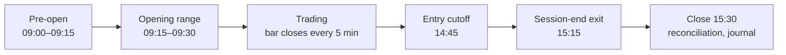
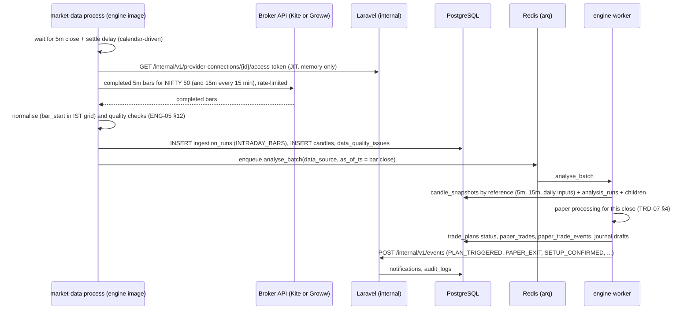
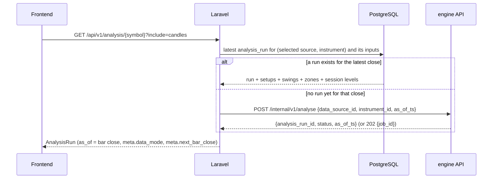
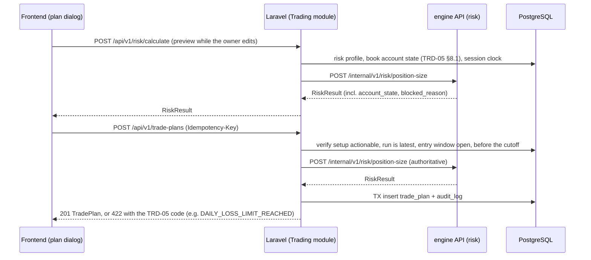

# Data Flow

| Field | Value |
|---|---|
| Document ID | ARC-05 |
| Version | 0.2.0 |
| Status | Specification ready for intraday (ADR-014, ADR-015); flows not implemented yet (I2–I6) |
| Owner | Solution Architect |
| Last updated | 2026-11-17 |
| Related | [ARC-01](01_SYSTEM_ARCHITECTURE.md) · [ARC-08 Integration](08_INTEGRATION_ARCHITECTURE.md) · [ENG-05 §12 Intraday ingestion](../engineering/05_DATA_INGESTION_SPECIFICATION.md#12-intraday-ingestion-adr-015) · [TRD-07 §4 Bar-close processing](../trading/07_PAPER_TRADING_SPECIFICATION.md#4-bar-close-processing) · [TRD-05 Risk](../trading/05_RISK_MANAGEMENT_RULES.md) |

## 1. Purpose

Describes how data moves through PriceAction AI during a trading session for the personal intraday workstation ([ADR-014](../adr/ADR-014-PERSONAL-INTRADAY-WORKSTATION.md)): from the broker's completed bars to analysis, plans, paper trades, the journal and the screen. Version 0.1 described a daily end-of-day pipeline; it is replaced by the bar-close pipeline below. The time model (bars keyed by `bar_start`, snapshots by reference) is [ADR-015](../adr/ADR-015-INTRADAY-TIME-AND-SNAPSHOT-MODEL.md).

## 2. A session at a glance

| Phase (normal session) | Data flow |
|---|---|
| Before the open | Daily bar of the previous session is final (fetched after the last close); limits of both books reset; the calendar decides whether the market opens today. |
| Every 5m close, 09:20–15:30 | Bar-close pipeline (§3): fetch completed 5m (and, every 15 minutes, 15m) bars → quality checks → analysis batch → paper processing → events → notifications. |
| Continuously while open | Current prices of open positions and the watchlist refresh in Redis (§4); they feed live P&L only. |
| 14:45 | Entry cutoff: setups expire, plans can no longer be created, unfilled plans are skipped (TRD-04 SD-08, TRD-07 §3). |
| 15:15 | Session-end exit: open paper positions exit at the open of the 15:15 bar; open actual positions are warned about (TRD-05 §7.2). |
| After 15:30 | Session-end reconciliation (§6), daily bar fetch, journal drafts. |

Special sessions and holidays follow `market_calendar` (seeded; the NSE holiday list still has to be loaded, ARC-03 §2.2).

## 3. Bar-close pipeline

- **Only completed bars.** The process never requests or stores a forming bar (TRD-01 MP-03).
- **Late bars.** A bar missing at the per-bar deadline is retried until the next close, then logged as `LATE_BAR`; the analysis for that close runs on what exists and marks its inputs incomplete. The session-end reconciliation catches up.
- **One batch per close.** `analysis_batches` is unique per (data source, universe, ruleset, `as_of_ts`); re-running a close is idempotent.
- **Budget.** Fetch and analysis of the universe should finish within 60 s of the close (BRD SM-01).

## 4. Current prices (live P&L only)

The market-data process keeps the last traded price of open positions and watchlist symbols in Redis (short TTL) from the provider's quote or streaming API. Laravel reads it for `GET /api/v1/positions/live` (X11) and the dashboard. Current prices are **never** written to `candles` and **never** used by analysis, sizing or paper simulation (ENG-05 §12).

## 5. On-demand analysis (user opens `/analysis/{symbol}`)

The frontend polls every 10–30 s during the session and refetches when `meta.next_bar_close` has passed (ARC-04 §2.9).

## 6. Session-end reconciliation

After the close the process re-fetches the whole session's 5m and 15m bars, inserts missing bars and corrects changed ones. Corrections increment `revision` and archive the old values in `candle_revisions` through the `keep_candle_revision` trigger, so every earlier snapshot can still be rebuilt from its content hash. Paper processing then runs for any bar that arrived late, in bar order. The daily bar is fetched last.

## 7. Trade plan creation

Account state is computed from the trade tables at request time; it is not stored (TRD-05 §8.1).

## 8. Paper trades and actual trades

- **Paper:** processed at every 5m close by the engine-worker (TRD-07 §4), including the session-end exit. Data written: `trade_plans.status`, `paper_trades`, `paper_trade_events`, `journal_entries` (drafts); Laravel turns emitted events into `notifications`.
- **Actual:** recorded by the owner through Laravel (fills with timestamps); positions still open after the close are flagged `CARRIED_OVER`. The app never places or changes broker orders (ADR-010).

## 9. LLM explanations

Deferred by ADR-014. When added, the flow of [ARC-07](07_AI_AND_LLM_ARCHITECTURE.md) applies unchanged: the LLM only explains a persisted analysis run (ADR-009).

## 10. Frontend consumption

| Concern | Rule |
|---|---|
| Adapter boundary | Pages call `data.*` from `frontend/src/lib/data`; an `HttpDataSource` (I6) implements the existing `DataSource` interface against `/api/v1` and maps API schemas to the view types (`Candle` with timestamps, `StockAnalysis.intraday`, `session`, `signalAt`/`validUntil`, `RiskToday`). |
| Data mode and freshness | Every response with market data carries `meta.data_mode` and `meta.as_of` (last bar close); the UI badges DEMO and shows the bar time (PRD-07 UX-08). |
| Refresh | Polling every 10–30 s during the session; pause while the tab is hidden. No push channel in the MVP. |
| Caching | Server components cache only reference data (instruments, universes). Session data is fetched per request (`no-store`). |
| Errors | The adapter converts error envelopes into typed errors; route `error.tsx` boundaries render retry states. |

## 11. Data lineage

Every displayed analysis can be traced: `analysis_run → analysis_run_inputs → candle_snapshots (bar range, max revision, content_hash, data_source) + ruleset_version + engine_version`, rebuildable from `candles` and `candle_revisions`. Every plan: `trade_plan → analysis_run, detected_setup, risk_profile version, ruleset_version`. Every paper trade: `paper_trade → trade_plan, paper_trade_events (bar timestamps)`.
