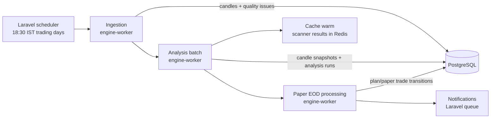
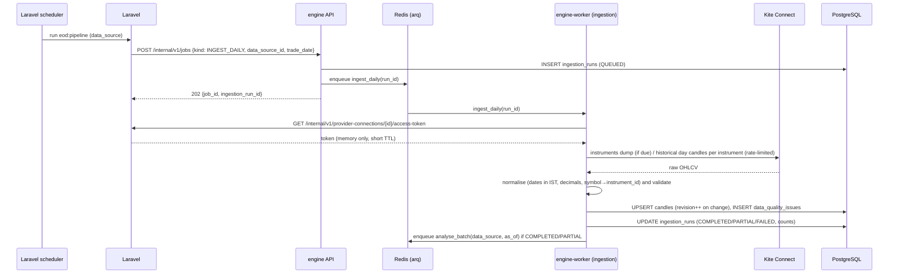
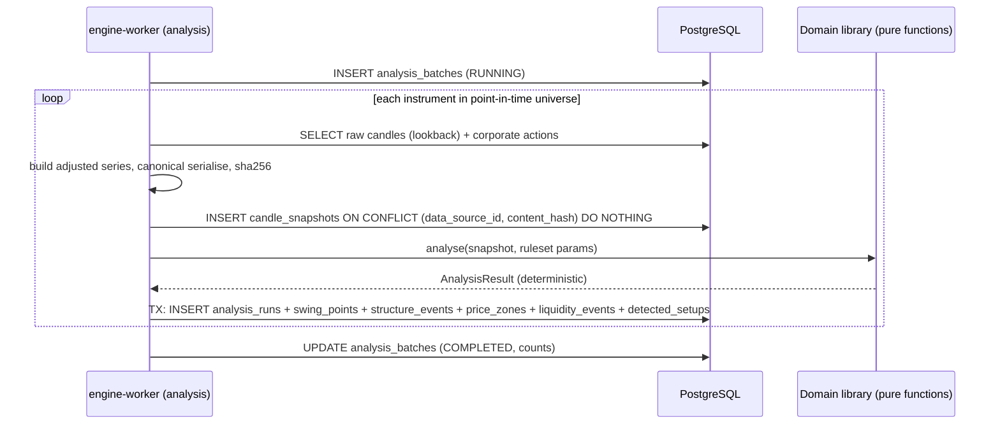
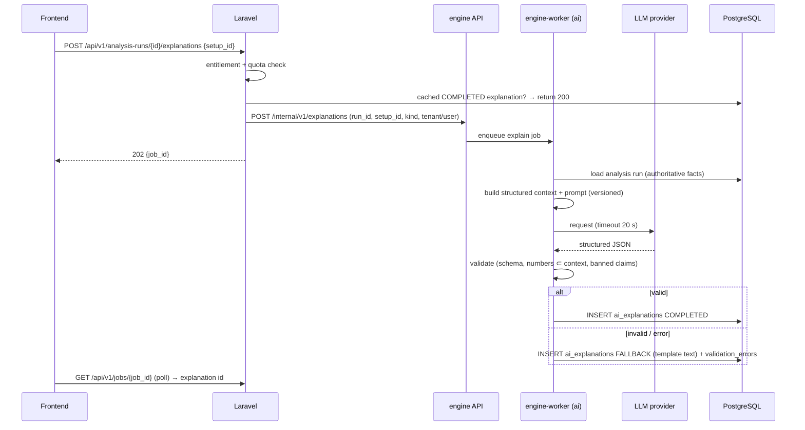
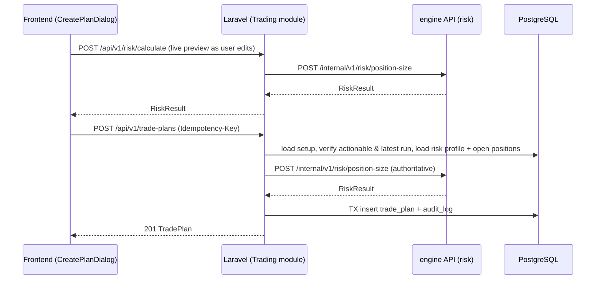

# Data Flow

| Field | Value |
|---|---|
| Document ID | ARC-05 |
| Version | 0.1.1 |
| Status | Daily flows; intraday flows are specified in ENG-05 §12 and TRD-07 §4 and are revised here with I1/I2 (ADR-014) |
| Owner | Solution Architect |
| Last updated | 2026-11-15 |
| Related | [ARC-01](01_SYSTEM_ARCHITECTURE.md) · [ARC-08 Integration](08_INTEGRATION_ARCHITECTURE.md) · [ENG-05 Ingestion](../engineering/05_DATA_INGESTION_SPECIFICATION.md) · [TRD-07 EOD processing](../trading/07_PAPER_TRADING_SPECIFICATION.md#4-bar-close-processing) |

> **Daily scope.** This document still describes the end-of-day data flow of the original scope. For the intraday direction ([ADR-014](../adr/ADR-014-PERSONAL-INTRADAY-WORKSTATION.md)) the authoritative flows are bar-close ingestion ([ENG-05 §12](../engineering/05_DATA_INGESTION_SPECIFICATION.md#12-intraday-ingestion-adr-015)), bar-close paper processing ([TRD-07 §4](../trading/07_PAPER_TRADING_SPECIFICATION.md#4-bar-close-processing)) and the time model of [ADR-015](../adr/ADR-015-INTRADAY-TIME-AND-SNAPSHOT-MODEL.md). This document is revised with milestone I1/I2.

## 1. Purpose

Shows how data moves through the system for the main flows, with the component that owns each step. Rules for each step live in the referenced documents; this document only sequences them.

## 2. Daily end-of-day pipeline (overview)



The pipeline runs once per data source that needs it (the shared DEMO source is static; each PERSONAL source; each LICENSED source). The scheduled time is configurable (`EOD_PIPELINE_TIME`, default 18:30 IST — assumption, OQ-PT-03).

## 3. Broker data retrieval and normalisation



Normalisation and validation rules: [ENG-05 §6–7](../engineering/05_DATA_INGESTION_SPECIFICATION.md). Token custody: [ARC-06 §5](06_SECURITY_ARCHITECTURE.md).

## 4. Analysis job execution and snapshot generation



- The domain library receives only the snapshot and parameters — no DB, clock or network access (enforced by module structure and tests, [ENG-04](../engineering/04_PYTHON_ENGINE_ARCHITECTURE.md)).
- Idempotent: re-running the same batch produces the same snapshot hash and hits the `analysis_runs` unique key.

## 5. On-demand analysis (user opens `/analysis/{symbol}`)

```mermaid
sequenceDiagram
  participant FE as Next.js (server component)
  participant BE as Laravel
  participant R as Redis cache
  participant DB as PostgreSQL
  FE->>BE: GET /api/v1/analysis/RELIANCE?include=candles (cookie forwarded)
  BE->>BE: authorise, resolve tenant's selected data source
  BE->>R: get latest analysis id (source, instrument)
  alt cache miss
    BE->>DB: SELECT latest analysis_run for (source, instrument)
  end
  BE->>DB: load run + children + snapshot candles
  BE-->>FE: AnalysisRun + meta {data_mode, as_of}
  FE->>FE: map to view model; render chart + panels; show data-mode badge
```

`POST /analysis/{symbol}/refresh` calls the engine synchronously (`/internal/v1/analyse`) with a 2 s budget; on timeout it enqueues a job and returns `202 {job_id}`.

## 6. LLM explanation generation



Details: [ARC-07](07_AI_AND_LLM_ARCHITECTURE.md).

## 7. Trade plan creation



## 8. Paper trade updates (EOD)

Sequence in [TRD-07 §4](../trading/07_PAPER_TRADING_SPECIFICATION.md#4-bar-close-processing). Data written: `trade_plans.status`, `paper_trades`, `paper_trade_events`, `journal_entries` (drafts), then Laravel creates `notifications` from emitted events.

## 9. Frontend consumption

| Concern | Rule |
|---|---|
| Adapter boundary | Pages call `data.*` from `frontend/src/lib/data`; an `HttpDataSource` (M7) implements the existing `DataSource` interface against `/api/v1` and maps API schemas to the current view types. |
| Data mode | `DataSource.kind` (currently `"sample" | "live"`) is replaced by the per-response `meta.data_mode`; the sample-data badge renders when `data_mode = DEMO`. |
| Caching | Server components use Next.js caching only for reference data (instruments, universes). User-specific data is fetched per request (`no-store`). |
| Errors | Adapter converts error envelopes into typed errors; route `error.tsx` boundaries render retry states (to be added — none exist today). |

## 10. Data lineage

Every displayed analysis can be traced: `analysis_run → candle_snapshot (content_hash, data_source) + ruleset_version + engine_version`. Every plan: `trade_plan → analysis_run, detected_setup, risk_profile version, ruleset_version`. Every explanation: `ai_explanation → analysis_run, context_hash, prompt_version, model_id`.
