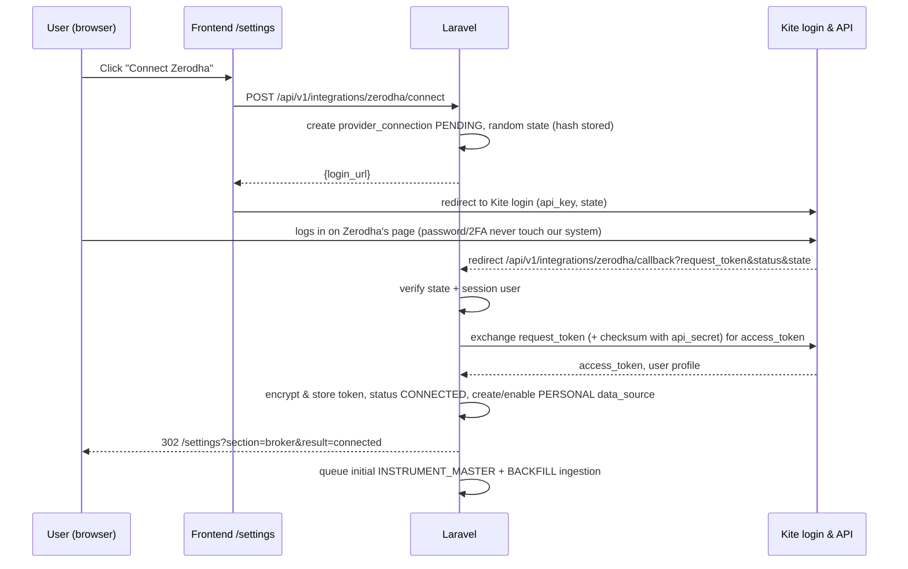

# Integration Architecture

| Field | Value |
|---|---|
| Document ID | ARC-08 |
| Version | 0.1.0 |
| Status | Specification ready (Kite limits and terms to be verified in M2) |
| Owner | Solution Architect |
| Last updated | 2026-11-15 |
| Related | [ADR-007 Provider abstraction](../adr/ADR-007-MARKET-DATA-PROVIDER-ABSTRACTION.md) · [ADR-011 Data modes](../adr/ADR-011-DATA-MODES-AND-TENANT-ISOLATION.md) · [ENG-05 Ingestion](../engineering/05_DATA_INGESTION_SPECIFICATION.md) · [ARC-06 §5](06_SECURITY_ARCHITECTURE.md#5-broker-credential-protection-zerodha) |

## 1. Purpose

Defines (1) the market-data provider abstraction and the Zerodha Kite adapter, (2) the three data modes, and (3) the internal Laravel ↔ engine contracts.

## 2. Data modes

| Mode | Data | Who can see it | Licensing position | Status |
|---|---|---|---|---|
| `DEMO` | Generated sample candles (ported from `frontend/src/mocks/demo-series.ts`) for a fixed demo instrument set | Every tenant | No real market data; always badged "Sample data" | Exists in frontend; backend seed in M1 |
| `PERSONAL` | Data fetched with the user's own authorised Kite Connect session | Only the owning tenant | For the user's personal use. **Not assumed to permit redistribution** to other users or commercial use (C-04) | Specified; built in M2 |
| `LICENSED` | Data from a commercial vendor under a redistribution licence | Tenants entitled by subscription | Requires a signed data licence and legal/regulatory review before launch (C-05) | Future; vendor unresolved |

Rules:
1. Every candle, snapshot and analysis row carries `data_source_id`; mode is derived from it.
2. Data from a `PERSONAL` source is never served to another tenant, never used in shared caches, never used for shared AI summaries, and never exported in bulk.
3. A tenant has exactly one *selected* data source at a time; switching does not mix data.
4. UI must display the mode on every market-data surface; `DEMO` is never presented as live (C-03).

## 3. MarketDataProvider interface (Python)

```python
class MarketDataProvider(Protocol):
    provider_code: str                              # "ZERODHA_KITE", "DEMO", ...

    def fetch_instruments(self, ctx: ProviderContext) -> Iterable[ProviderInstrument]: ...
    def fetch_daily_candles(self, ctx: ProviderContext, ref: ProviderInstrumentRef,
                            start: date, end: date) -> list[ProviderCandle]: ...
    def fetch_index_daily_candles(self, ctx: ProviderContext, ref: ProviderInstrumentRef,
                                  start: date, end: date) -> list[ProviderCandle]: ...
    def capabilities(self) -> ProviderCapabilities:  # max_days_per_request, rate limits, corporate actions?, delisted?
        ...
```

- `ProviderContext` carries `data_source_id`, `credentials_supplier` (a callable that performs the JIT token fetch) and a rate limiter.
- Implementations: `DemoProvider` (deterministic generator, no network), `KiteProvider`, future `LicensedVendorProvider`.
- Nothing outside `app/providers/<provider>/` may import provider SDKs or know provider field names. Normalised types (`ProviderCandle`, `ProviderInstrument`) are the only outputs.
- Errors are normalised to `ProviderAuthExpired`, `ProviderRateLimited`, `ProviderUnavailable`, `ProviderDataError`, `ProviderNotSupported`.

Laravel side: a smaller `BrokerConnector` interface for the **connection flow only** (`loginUrl(state)`, `exchangeRequestToken(requestToken)`, `invalidate(token)`), with `KiteConnector` as the first implementation.

## 4. Zerodha Kite Connect adapter

> **ASSUMPTION — verify in M2 against current Kite Connect documentation and terms:** endpoint names, daily token expiry, historical API date-range limits per interval, rate limits, and whether historical data requires an add-on subscription. Values below are design placeholders, not verified facts.

### 4.1 Authentication flow



### 4.2 Token storage and lifecycle

Per [ARC-06 §5](06_SECURITY_ARCHITECTURE.md#5-broker-credential-protection-zerodha). Daily expiry handling: before each EOD pipeline, a check marks expired connections; the pipeline for that source is skipped with `PROVIDER_AUTH_EXPIRED` and the user is notified "Reconnect Zerodha to update data". Historical data already ingested remains usable.

### 4.3 Instrument master synchronisation

- Frequency: daily before candle ingestion (instrument tokens can change; tick sizes may change).
- Filter: exchange `NSE`, segment equity (`EQ` series) and required indices.
- Mapping: match by ISIN to `instruments`; create new instruments for unseen ISINs; record provider token in `instrument_provider_refs` with `valid_from`; close previous refs when tokens change.
- Attribute changes (name, tick size, lot size) produce a new `instrument_snapshots` row.

### 4.4 Historical candle ingestion

- Interval: day. Requests chunked by `capabilities.max_days_per_request`.
- Daily incremental: fetch `[last_ingested_date − 5 trading days, today]` to capture late corrections.
- Backfill on first connect: `analysis.lookback_bars + analysis.min_bars` sessions minimum (≈ 2 years), configurable up to provider limits.
- Universe: point-in-time NIFTY 500 members + user's watchlist instruments + index instruments.

### 4.5 Rate limits and retries

- Token-bucket limiter per data source in Redis (`KITE_HISTORICAL_RPS`, default 3 req/s — assumption).
- Retries: exponential backoff with jitter (1 s, 2 s, 4 s, 8 s; max 4) for `ProviderRateLimited`/`ProviderUnavailable`; no retry for `ProviderAuthExpired` or 4xx data errors.
- Circuit breaker: > 20% failures in a run ⇒ pause the run, mark `PARTIAL`, alert.

### 4.6 Normalisation, missing and duplicate candles, holidays, corporate actions, data quality

Defined in [ENG-05 §6–8](../engineering/05_DATA_INGESTION_SPECIFICATION.md). Summary: IST trading dates; prices to 2 decimals; duplicates collapsed by `(instrument, date)` with latest response winning and a `DUPLICATE` issue recorded; missing trading days vs `market_calendar` ⇒ `MISSING_SESSION`; corporate actions applied at snapshot build time; Kite candles treated as unadjusted unless verified otherwise (OQ-INT-02).

## 5. Internal engine API (Laravel → engine)

Base: `http://engine:8100/internal/v1`, header `Authorization: Bearer ${ENGINE_SERVICE_TOKEN}`, `X-Request-Id`, `X-Tenant-Id`/`X-User-Id` (asserted context). Schemas are Pydantic models exported as JSON Schema to `contracts/engine/` and verified by Laravel contract tests.

| Endpoint | Purpose | Sync budget | Response |
|---|---|---|---|
| `POST /analyse` | `{data_source_id, instrument_id, as_of?, ruleset_version}` — build snapshot and analyse one instrument | 2 s | `{analysis_run_id, status}` or 202 `{job_id}` |
| `POST /risk/position-size` | Inputs of TRD-05 §2 (Laravel supplies capital, profile, open positions) | 300 ms | `RiskResult` |
| `POST /risk/validate-levels` | Validate user-edited levels | 300 ms | `{errors, warnings, rounding}` |
| `POST /jobs` | `{kind: INGEST_DAILY|BACKFILL|INSTRUMENT_SYNC|ANALYSE_BATCH|BACKTEST|PAPER_EOD|EXPLAIN, payload}` | 100 ms | 202 `{job_id}` |
| `GET /jobs/{id}` | Job status | 100 ms | `{status, progress_pct, result_ref, error_code}` |
| `POST /explanations` | Enqueue explanation | 100 ms | 202 `{job_id}` |
| `GET /health` / `GET /ready` | Liveness / readiness (DB + Redis reachable) | — | 200/503 |

Engine → Laravel internal endpoints (header `Authorization: Bearer ${BACKEND_INTERNAL_TOKEN}`):

| Endpoint | Purpose |
|---|---|
| `GET /internal/v1/provider-connections/{id}/access-token` | JIT token fetch. Response `{access_token, expires_at}`; audited; 409 `PROVIDER_AUTH_EXPIRED`. |
| `POST /internal/v1/events` | Engine emits domain events (`PLAN_TRIGGERED`, `PAPER_EXIT`, `INGESTION_COMPLETED`, `BACKTEST_COMPLETED`, …) for Laravel to create notifications and audit entries. Idempotent by `event_id`. |

## 6. Other integrations

| Integration | Direction | Notes |
|---|---|---|
| LLM provider | engine-worker → provider | [ARC-07](07_AI_AND_LLM_ARCHITECTURE.md) |
| Email | Laravel → provider (SMTP/API) | Verification, password reset, notifications (M6/M9) |
| Error tracking | all → service | [OPS-03](../operations/03_MONITORING_AND_OBSERVABILITY.md) |

## 7. Open questions

| ID | Question |
|---|---|
| OQ-INT-01 | Verify Kite Connect historical limits, rate limits, token expiry, subscription requirements, and terms of use for personal vs multi-user apps. |
| OQ-INT-02 | Are Kite daily candles adjusted for splits/bonuses? Determines whether the adjustment step is applied or skipped for this provider. |
| OQ-INT-03 | Licensed vendor selection for SaaS mode (coverage of delisted symbols, corporate actions, historical index constituents). |
| OQ-INT-04 | Should Groww (the owner's broker) be the first real market-data adapter instead of, or alongside, Kite? Deferred to M2: compare Groww API historical daily candles, instrument master, rate limits, cost and terms against Kite in T-203. Needs no change to ADR-007 (a new adapter behind `MarketDataProvider`); choosing it as first provider changes the "Kite first" plan and goes through CLAUDE.md §8. |
