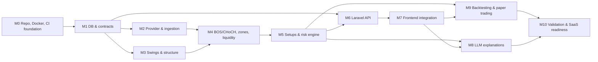

# Implementation Roadmap

| Field | Value |
|---|---|
| Document ID | ENG-01 |
| Version | 0.1.0 |
| Status | Specification ready; §0 intraday roadmap (ADR-014) supersedes M2–M10 |
| Owner | Technical Lead |
| Last updated | 2026-11-15 |
| Related | [PRD-06 Feature catalog](../product/06_FEATURE_CATALOG.md) · [PRD-02 Release gates](../product/02_BRD.md#12-release-gates) · [ENG-10 CI/CD](10_GITHUB_ACTIONS_CI_CD.md) · [DOCUMENTATION_STATUS](../DOCUMENTATION_STATUS.md) |

## 0. Intraday roadmap (ADR-014)

On 2026-11-17 the product direction changed to a personal intraday workstation ([ADR-014](../adr/ADR-014-PERSONAL-INTRADAY-WORKSTATION.md)). M0 and M1 (§3) are complete and stand. **Milestones M2–M10 below are superseded** and kept for reference: much of their content (engine layering, test catalogue, contracts) carries over into I1–I8. Effort is in solo engineering days; the total for I0–I8 is about 68–102 days, of which the MVP (I0–I7) is about 58–87.

| # | Scope | Depends on | Acceptance | Effort (days) | Main risks |
|---|---|---|---|---|---|
| I0 | ADR-014 (direction) and ADR-015 (time and snapshot model); intraday TRD-01..07; product documents refreshed | M1 | ADRs accepted; DECISIONS.md and the ADR index updated; TRD-08 vectors drafted for 5m/15m | 4–6 | Spec scope creep |
| I1 | Expand migrations: bar timestamps, timeframes `1m`/`5m`/`15m`/`1D`, timestamp columns on analysis and trading tables, snapshot by reference, risk-state table, NSE calendar seed; OpenAPI and engine contracts; `app/db/tables.py` | I0 | Fresh DB migrates and seeds; schema-diff, OpenAPI coverage and ruleset identity checks green | 4–6 | Churn across the 32 read-model tables |
| I2 | Provider adapter (Kite first unless T-203 decides otherwise) for historical intraday bars and current prices; bar-close fetcher process; Redis current-price cache; quality checks (calendar gaps, duplicates, late and revised bars); DEMO intraday generator | I1, provider subscription | Recorded-fixture adapter tests; one full NIFTY 50 session ingested without gaps | 8–12 | Provider limits and history depth unverified (OQ-INT-01/04) |
| I3 | `app/domain`: candles, `RulesetParams` per timeframe, pivots, structure, BOS/CHoCH on 15m and 5m, higher-timeframe alignment | I1 | TRD-08 vectors; property tests for no look-ahead and determinism (`result_hash`) | 10–15 | Repainting through pivot confirmation or misaligned higher-timeframe bars |
| I4 | Session context (opening range, previous-day high/low/close, cutoff time), S/R zones, setups (opening range breakout, previous-day high/low break, S/R breakout-retest; trend continuation and sweep reversal after validation), levels, expiry, NO_TRADE | I3 | Vectors with boundary cases for every setup | 10–15 | Opening-range window is a hypothesis |
| I5 | Sizing from stop distance with the ₹ position cap; daily loss and consecutive-loss limits; open positions and open risk; intraday cost schedule; end-of-day exit rule | I1 | TRD-05 worked examples for ₹1,00,000 capital; every limit breach blocks a plan | 6–9 | Cost values unverified |
| I6 | Laravel `/api/v1` subset (scanner, analysis, plans, trades, live positions, daily risk); frontend HTTP adapter behind `DataSource`; intraday chart (timestamps, IST, session gaps); polling | I2–I5 | Scan → analyse → plan → record → monitor works on DEMO data, then on the provider | 12–18 | Time-zone and session-gap bugs |
| I7 | Journal: planned vs actual entry and exit, net P&L after costs, mistakes, notes; stats server-side; screenshots later | I6 | Stats equal hand-computed examples | 4–6 | File storage choice |
| I8 | Intraday backtester: 5m replay, session rules, same-bar collision, end-of-day exit, costs, out-of-sample and walk-forward splits | I3–I5, history | Reproducible runs; collision, end-of-day and cost vectors pass | 10–15 | History depth and quality |

Forward paper logging starts with I6 so that real-time evidence accumulates while I8 is built.

## 1. Purpose

Milestone plan from the starting state (frontend with mock data, no commits, no backend) to a validated personal MVP and SaaS readiness. Live milestone status is tracked in the root [ROADMAP.md](../../ROADMAP.md) and [CURRENT.md](../../CURRENT.md). Durations are not estimated here (solo developer; OQ-RD-01).

## 2. Milestone overview

M3 can start on fixture data in parallel with M2.

## 3. Milestones

### M0 — Repository, Docker and infrastructure foundation

> **Status: complete (2026-11-15)** on branch `chore/m0-foundation`. Deviations: backend-ci and python-engine-ci workflows were pulled forward from M1 because the skeletons exist; Trivy and Semgrep are deferred to Phase 2 image publishing; third-party Actions were pinned by major version tag at first (*Update 2026-11-17, T-901:* now pinned by commit SHA); branch protection, secret scanning and CodeQL default setup are GitHub settings to apply once the repository is pushed (ENG-09 §6–7). *Update 2026-11-16:* applied. The "Protect Main" ruleset requires `ci-gate`; secret scanning with push protection is on; CodeQL runs on `main`.

| Item | Detail |
|---|---|
| Objective | A clean monorepo with a working Compose stack skeleton and required CI checks. |
| Scope | Root `.gitignore`, root README (exists after this phase), `.editorconfig`, `.env.example` files, `infrastructure/docker/` base images, Compose services stubs (backend, engine, worker, postgres, redis) with health checks, **GitHub CI foundation**: `frontend-ci.yml` (lint, typecheck, build), `docker-build.yml`, `security-scan.yml` (secret scan), branch protection, PR template, CODEOWNERS, Dependabot. |
| Dependencies | GitHub repository created; first commit. |
| Files/modules | `/.github/**`, `/docker-compose.yml`, `/infrastructure/docker/**`, `/frontend/package.json` (add `typecheck`, `test` scripts, Vitest), `/scripts/**` |
| Tasks | Initial commit of existing frontend (excluding `.next`, `.DS_Store`, `tsconfig.tsbuildinfo`); add Vitest with first unit tests (formatters, labels); Laravel and FastAPI "hello" skeletons with `/health`; Postgres + Redis services; Makefile/`scripts/dev` wrappers. |
| Tests | Frontend unit tests; Compose config validation; container health checks. |
| Acceptance | `docker compose up` starts all services healthy; CI green on a PR; `main` protected. |
| Exit criteria | Required checks configured: `frontend / typecheck`, `frontend / build`, `docker / build`, `security / secrets`. |

### M1 — Database and contracts

| Item | Detail |
|---|---|
| Objective | Schema and API/engine contracts in place before feature code. |
| Scope | Laravel migrations for ARC-03 (all tables), seeders (ruleset `pa-core 0.1.0`, universes, DEMO data source + demo instruments + demo candles ported from `frontend/src/mocks`), `contracts/api/openapi.yaml` from ARC-04, `contracts/engine/*.json` from Pydantic models, backend CI and python CI workflows, schema-diff test (Laravel migrations vs engine SQLAlchemy tables). |
| Dependencies | M0 |
| Files/modules | `backend/database/**`, `contracts/**`, `python-engine/app/db/tables.py`, `.github/workflows/backend-ci.yml`, `python-engine-ci.yml` |
| Tests | Migration up on empty DB; constraint tests (OHLC check, long-only, stop<entry<target); OpenAPI lint; contract schema validation. |
| Acceptance | Fresh DB migrates and seeds; OpenAPI validates; engine schema matches. |
| Exit criteria | Required checks add `backend / migrations`, `backend / tests`, `python-engine / tests`. |

### M2 — Market data provider and ingestion

| Item | Detail |
|---|---|
| Objective | Reliable daily candles for NIFTY 500 from Zerodha (personal) plus DEMO provider. |
| Scope | `MarketDataProvider` interface, `DemoProvider`, `KiteProvider`, instrument master sync, universe membership loader (current NIFTY 500 list + effective dating), market calendar seed, daily + backfill ingestion jobs, data-quality checks, Laravel Kite connect flow (I1–I4) and JIT token endpoint, verification spike for Kite limits/terms (OQ-INT-01/02). |
| Dependencies | M1; Kite developer app. |
| Files/modules | `python-engine/app/providers/**`, `app/ingestion/**`, `backend/app/Modules/Integrations/**`, `MarketData/**` |
| Tests | Provider adapter tests with recorded fixtures (no live calls in CI); normalisation, duplicate/missing detection; token never logged (log capture test). |
| Acceptance | Owner connects Zerodha; backfill completes; ingestion run shows counts and issues. |
| Exit criteria | Two consecutive trading days ingested automatically. |

### M3 — Swing points and market structure

| Item | Detail |
|---|---|
| Objective | TRD-02 §3–5 implemented as pure functions. |
| Scope | Candle validation, snapshot builder (adjustment, hashing), pivots, labels, structure state machine (without BOS/CHoCH events first), test catalogue completeness script. |
| Dependencies | M1 (can use fixtures before M2). |
| Files/modules | `python-engine/app/domain/candles.py`, `pivots.py`, `structure.py`, `tests/trading/**`, `scripts/check_trading_test_catalogue.py` |
| Tests | TV-PIV-01..06, TV-NLA-01/02/04 for pivots, determinism. |
| Acceptance | All listed tests pass; golden fixtures committed. |
| Exit criteria | `python-engine / trading-tests` becomes a required check. |

### M4 — BOS, CHoCH, zones and liquidity

| Item | Detail |
|---|---|
| Objective | TRD-02 §6–8 and TRD-03 complete. |
| Scope | BOS/CHoCH/wick breach events, zones (clustering, strength, break/flip), equal highs/lows, analysis run persistence, analysis batch job. |
| Dependencies | M3, M2 for real data runs. |
| Tests | TV-STR-01..08, TV-ZON-01..08; benchmark: 500 instruments analysed within NFR-002. |
| Acceptance | EOD batch persists runs for NIFTY 500 with idempotency. |
| Exit criteria | Nightly determinism check implemented. |

### M5 — Setup detection and risk engine

| Item | Detail |
|---|---|
| Objective | TRD-04 and TRD-05 complete. |
| Scope | Four setups, lifecycle/expiry, target ladder, PAQS, signal mapping, evidence templates, risk sizing/validation, internal engine endpoints `/analyse`, `/risk/*`. |
| Dependencies | M4 |
| Tests | TV-SET-01..12, TV-RSK-01..08, TV-GAP-01..04, contract tests. |
| Acceptance | Analysis runs contain setups with levels/evidence; risk endpoint matches TRD-05 examples. |
| Exit criteria | Engine contracts frozen at v1 for M6/M7. |

### M6 — Laravel API implementation

| Item | Detail |
|---|---|
| Objective | ARC-04 endpoints for auth, onboarding, preferences, risk, data sources, instruments, scanner, analysis read, watchlists, trade plans, notifications, entitlements. |
| Scope | Modules per ARC-01 §5; policies; tenant scoping; rate limits; audit logging; engine client; event intake; email (verification/reset). |
| Dependencies | M1, M5 (for plans/risk) |
| Tests | Feature tests per endpoint; cross-tenant 404 matrix; OpenAPI response validation; architecture tests (module boundaries). |
| Acceptance | OpenAPI contract tests pass for all M6 endpoints. |
| Exit criteria | `backend / contract-tests` required. |

### M7 — Frontend integration

| Item | Detail |
|---|---|
| Objective | Frontend uses the real API with no screen redesign. |
| Scope | HTTP adapter + mutations client, auth guard, onboarding persistence, reset-password page, error boundaries, data-mode badges from `meta`, plan dialog via risk API, discrepancy items D-01..D-07, D-10..D-24 (ENG-02 §9). |
| Dependencies | M6 |
| Tests | Unit tests for mappers; Playwright E2E happy paths against Compose stack. |
| Acceptance | BAC-01 and BAC-03 pass end-to-end on DEMO data. |
| Exit criteria | `frontend / e2e` (smoke) required on PRs touching frontend or API contracts. |

### M8 — LLM explanations

| Item | Detail |
|---|---|
| Objective | ARC-07 implemented. |
| Scope | Provider adapter, context builder, prompts v1, validator (HV-01..07), fallback templates, quotas, UI panel (UIA-03). |
| Dependencies | M5, M7; LLM provider decision (OQ-AI-01). |
| Tests | TV-LLM-01; validator unit tests on adversarial outputs; stubbed provider in CI. |
| Acceptance | US-12 passes; ≥ 90% validation pass on eval set (manual run). |
| Exit criteria | Spend cap and quota verified. |

### M9 — Backtesting and paper trading

| Item | Detail |
|---|---|
| Objective | TRD-06 and TRD-07 implemented. |
| Scope | Backtest engine (bar replay, execution model, costs), backtest job + API B1–B6 + UI; EOD paper processing; paper/actual trade APIs X1–X10; journal APIs J1–J4 and drafts; notifications for events; portfolio book toggle. |
| Dependencies | M5, M7 |
| Tests | TV-GAP, TV-COL, TV-UNI, TV-NLA-03; paper EOD idempotency; journal stats. |
| Acceptance | BAC-04, BAC-05 pass. |
| Exit criteria | Release gate **G1** (Personal MVP) evaluated. |

### M10 — Validation and SaaS readiness

| Item | Detail |
|---|---|
| Objective | Validate rules and harden for multi-user. |
| Scope | IS/OOS/holdout backtests and parameter promotion (TRD-08 §6); point-in-time universe source (OQ-BT-01); staging + production deployment with approvals; backups/DR drill; RLS; 2FA; monitoring/alerts; security review; legal & data-licensing workstreams for G2/G3. |
| Dependencies | M9 |
| Tests | DR restore test; load test of EOD pipeline; RLS tests. |
| Acceptance | G2 conditions met; G3 workstreams have owners and decisions recorded. |
| Exit criteria | Documentation status updated; ADRs for any new decisions. |

## 4. Cross-cutting tasks by milestone

| Concern | M0 | M1 | M2–M5 | M6–M7 | M8–M9 | M10 |
|---|---|---|---|---|---|---|
| CI | Frontend, docker, secrets | Backend, python, DB | Trading tests required | Contract + E2E | LLM validator | Release workflows |
| Security | Secret scanning | DB roles | Token custody | Policies, rate limits | Quotas, spend cap | RLS, 2FA, review |
| Docs | Update status | OpenAPI | TRD conformance notes | Feature catalog statuses | — | Audit refresh |

## 5. Technical risks

| ID | Risk | Mitigation |
|---|---|---|
| TR-01 | Kite API limits/terms differ from assumptions | M2 spike first; provider abstraction |
| TR-02 | Look-ahead bugs | TV-NLA tests from M3, instrumented accessors |
| TR-03 | Spec ambiguity discovered in implementation | Raise as open question; ruleset version bump; update TRD docs in same PR |
| TR-04 | Shared DB coupling between Laravel and engine | Single-writer rule, DB roles, schema-diff test |
| TR-05 | Next.js 16 API differences | Follow bundled docs (frontend/AGENTS.md) |

## 6. Recommended next milestone

**M1** (M0 completed 2026-11-15). No backend feature code before M1 contracts exist.

## 7. Open questions

| ID | Question |
|---|---|
| OQ-RD-01 | Target dates per milestone. |
| OQ-RD-02 | Should M8 (LLM) be deferred after M9 to reach G1 sooner? Dependency graph allows it. |
