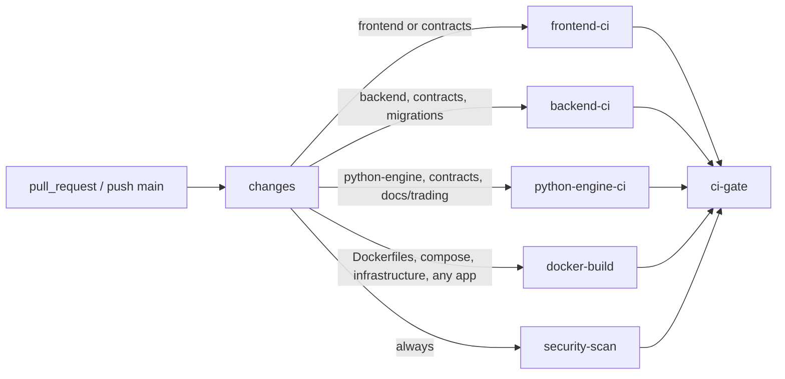

# GitHub Actions CI/CD

| Field | Value |
|---|---|
| Document ID | ENG-10 |
| Version | 0.1.0 |
| Status | Specification ready (workflow YAML not created in this phase) |
| Owner | Technical Lead / DevOps |
| Last updated | 2026-11-15 |
| Related | [ADR-012](../adr/ADR-012-GITHUB-ACTIONS-CI-CD.md) · [ENG-07 Testing](07_TESTING_STRATEGY.md) · [ENG-09 Repo](09_GITHUB_REPOSITORY_STRATEGY.md) · [ENG-11 Release](11_BRANCHING_AND_RELEASE_STRATEGY.md) · [TRD-08 §5](../trading/08_TRADING_ENGINE_VALIDATION.md#5-ci-enforcement) · [OPS-01 Deployment](../operations/01_DEPLOYMENT_GUIDE.md) |

## 1. Purpose

Defines the CI/CD architecture on GitHub Actions (mandatory, constraint C-14) using GitHub-hosted runners: workflows, triggers, path filters, jobs, caching, artifacts, secrets, quality gates and the deployment evolution.

## 2. Workflow organisation

> **Implemented in M0:** `ci.yml`, `frontend-ci.yml`, `backend-ci.yml`, `python-engine-ci.yml`, `docker-build.yml`, `security-scan.yml` (gitleaks + npm/composer/pip-audit). Not yet: `nightly.yml`, `release.yml`, deploy workflows, Trivy, Semgrep, Playwright E2E. Actions are pinned to major tags; switch to commit SHAs (Dependabot keeps them current) before Phase 2.

```
.github/workflows/
  ci.yml                 # coordinator: detects changes, calls component workflows, single required gate
  frontend-ci.yml        # reusable (workflow_call) + manual (workflow_dispatch)
  backend-ci.yml         # reusable
  python-engine-ci.yml   # reusable
  docker-build.yml       # reusable; also on push to main (image publishing from Phase 2)
  security-scan.yml      # reusable; also scheduled weekly
  nightly.yml            # scheduled: full property-based suite, determinism, dependency audit
  release.yml            # Phase 2+: on tag v*.*.* → build & publish images, release notes
  deploy-staging.yml     # Phase 3: on successful main build → deploy staging
  deploy-production.yml  # Phase 4: manual dispatch with environment approval
```

### 2.1 Why a coordinator

Path-filtered workflows that do not run leave required checks "pending" forever. `ci.yml` always runs on PRs, computes which areas changed (`dorny/paths-filter`, SHA-pinned), invokes only the relevant reusable workflows, and ends with a `ci-gate` job that is the **single required status check**. `ci-gate` passes only if every invoked job succeeded (skipped jobs count as pass when their area did not change).



### 2.2 Path filters

| Area | Paths | Triggers |
|---|---|---|
| frontend | `frontend/**` | frontend-ci, docker-build |
| backend | `backend/**` | backend-ci, docker-build |
| engine | `python-engine/**` | python-engine-ci, docker-build |
| contracts | `contracts/**`, ARC-04 | contracts-ci; also frontend-ci, backend-ci, python-engine-ci (all consumers) |
| schema | `backend/database/**` | backend-ci (migrations), python-engine-ci (schema-diff, DB integration) |
| trading-docs | `docs/trading/**` | python-engine-ci trading-tests + catalogue completeness |
| infra | `docker-compose.yml`, `infrastructure/**`, `**/Dockerfile*` | docker-build (all images), compose smoke |
| ci | `.github/**` | all workflows (a CI change must prove itself) |
| docs | `docs/**` | docs-lint job in ci.yml (markdown lint, link check) |

## 3. Triggers

| Workflow | Triggers |
|---|---|
| `ci.yml` | `pull_request` to `main`; `push` to `main`; `merge_group` (if merge queue enabled later) |
| Component workflows | `workflow_call` from ci.yml; `workflow_dispatch` |
| `security-scan.yml` | `workflow_call`; `schedule` weekly (Mon 03:00 UTC) |
| `nightly.yml` | `schedule` daily 20:30 UTC; `workflow_dispatch` |
| `release.yml` | `push` tags `v*.*.*` |
| `deploy-staging.yml` | `workflow_run` of release/docker publish on `main` success (Phase 3) |
| `deploy-production.yml` | `workflow_dispatch` with `version` input; GitHub Environment `production` with required reviewer (Phase 4) |

Concurrency: `concurrency: ci-${{ github.ref }}` with `cancel-in-progress: true` for PRs; deploy workflows use a non-cancelling group per environment.

## 4. Component workflows

### 4.1 frontend-ci.yml

| Job | Steps | Fails when |
|---|---|---|
| `install` | `actions/setup-node` (Node 26, cache npm via `package-lock.json`), `npm ci` | lockfile out of sync (npm ci fails) |
| `lint` | `npm run lint` | ESLint errors |
| `typecheck` | `npm run typecheck` (`tsc --noEmit`; script added in M0) | type errors |
| `test` | `npm test -- --run` (Vitest) | test failure |
| `build` | `npm run build` with `NEXT_TELEMETRY_DISABLED=1`; cache `.next/cache` | build failure |
| `e2e` (M7+) | Compose stack up (DEMO seed), Playwright smoke; upload traces on failure | E2E failure |

Artifacts: Playwright report/traces (on failure, 7 days).

### 4.2 backend-ci.yml

Services: `postgres:17` (health-checked), `redis:7.4`.

| Job | Steps | Fails when |
|---|---|---|
| `composer` | `shivammathur/setup-php` (8.4), cache Composer, `composer validate --strict`, `composer install --no-interaction` | invalid/out-of-sync lock |
| `lint` | `vendor/bin/pint --test`; `php -l` via Pint | style violations |
| `static` | `vendor/bin/phpstan analyse` (Larastan, level per `phpstan.neon`) | errors above baseline |
| `migrations` | `php artisan migrate --force` on empty DB; `migrate:fresh --seed`; previous-release schema → migrate (from M2, using schema dump artifact of last release) | migration error |
| `tests` | `php artisan test --parallel` (unit + feature + architecture) | failures |
| `contract` | Response-contract tests against `contracts/api/openapi.yaml` (M6). *OpenAPI lint moved to `contracts-ci.yml` (below)* | contract drift |

Artifacts: JUnit XML, coverage report (informational).

### 4.3 python-engine-ci.yml

Services: `postgres:17`, `redis:7.4` (integration job only).

| Job | Steps | Fails when |
|---|---|---|
| `setup` | `astral-sh/setup-uv` with cache keyed on `uv.lock`; `uv sync --frozen` | lock mismatch |
| `lint` | `uv run ruff check`, `uv run ruff format --check`, `uv run lint-imports` | violations |
| `types` | `uv run mypy app/domain app/schemas` (strict) + gradual elsewhere | type errors |
| `unit` | `uv run pytest tests/unit -q` | failures |
| `trading-tests` | `uv run pytest tests/trading -m "not slow"`; `scripts/check_trading_test_catalogue.py` | failure, skip, or missing TV-* test |
| `golden` | `uv run pytest tests/trading/golden` | output diff (print diff) |
| `backtest-correctness` | TV-GAP, TV-COL, TV-UNI, TV-NLA-03 suites | failure |
| `integration` | migrate DB with Laravel migration container image (or SQL dump artifact from backend-ci), run `tests/integration` and schema-diff | failure / schema mismatch |
| `contracts` | `scripts/export_engine_schemas.py --check`; ruleset JSON hash equals seeded ruleset | stale schemas |

### 4.3a Contracts CI (`contracts-ci.yml`, implemented in M1, T-103)

| Job | Steps | Fails when |
|---|---|---|
| `openapi` | `redocly lint contracts/api/openapi.yaml --config contracts/redocly.yaml`; `redocly bundle --ext json`; `contracts/scripts/check_arc04_coverage.py` (every ARC-04 endpoint id present with the same method and path, nothing extra, unique `operationId`s); unit tests of the checker | invalid OpenAPI; unused shared components; ARC-04 and the spec disagree |

*Deviation from the original plan:* lint uses **Redocly CLI** (pinned `@redocly/cli@2.72.1`), not Spectral, and runs in its own workflow so it is not tied to the Laravel job. The engine JSON Schema export check (`export_engine_schemas.py --check`, T-104) joins this workflow when `contracts/engine/` exists.

### 4.4 Database CI

Covered inside backend-ci (`migrations`, feature tests on real PostgreSQL) and python-engine-ci (`integration`, schema-diff). Checks: migrations apply cleanly; constraints exist (tests insert invalid rows and expect failure: OHLC, long-only, stop<entry<target, journal exactly-one-trade); FKs and exclusion constraints present; Redis used by queue/rate-limit integration tests.

### 4.5 docker-build.yml

| Job | Steps | Fails when |
|---|---|---|
| `compose-validate` | `docker compose config -q` (all profiles) | invalid compose |
| `build` (matrix: frontend, backend, engine) | `docker/setup-buildx-action`, `docker/build-push-action` with `cache-from/to: type=gha`, `push: false` on PRs | build failure |
| `smoke` | `docker compose up -d --wait` with CI env; probe `/health` endpoints and frontend `/login`; check backend→engine connectivity endpoint; `docker compose logs` uploaded on failure | unhealthy containers |
| `publish` (Phase 2, `main`/tags only) | Push to GHCR `ghcr.io/<org>/priceaction-<service>:<sha>` and `:vX.Y.Z`; provenance/SBOM attestations | push failure |

### 4.6 security-scan.yml

| Concern | Tool | Notes |
|---|---|---|
| Secret scanning | GitHub secret scanning + push protection (repo setting) **and** `gitleaks` on PR diff | gitleaks catches patterns before push protection coverage gaps |
| Dependency vulnerabilities | Dependabot alerts (continuous) + `npm audit --audit-level=high`, `composer audit`, `uv run pip-audit` in CI | fail on high/critical without an exception entry |
| SAST | CodeQL (JavaScript/TypeScript, Python); Semgrep OSS ruleset for PHP/Laravel | one tool per language to avoid duplication |
| Container images | Trivy image scan of built images (critical/high, ignore-unfixed configurable) + Trivy config scan of Dockerfiles/compose | |
| IaC/config | Trivy config (same run) | |

Exceptions: `.github/security-exceptions.yaml` listing CVE/finding id, justification, owner, expiry date; CI fails when an exception expires.

## 5. Required secrets

| Workflow | Secrets | Notes |
|---|---|---|
| CI (all) | none | Generates ephemeral `APP_KEY`, service tokens, DB passwords per run |
| docker publish | `GITHUB_TOKEN` (packages: write) | No PAT needed |
| deploy-staging | `STAGING_SSH_KEY`, `STAGING_HOST`, env-file secrets | GitHub Environment `staging` |
| deploy-production | `PROD_SSH_KEY`, `PROD_HOST`, env-file secrets | Environment `production`, required reviewer |
| nightly LLM eval (optional, non-blocking) | `LLM_API_KEY_EVAL` | Never on PRs from forks |

No Kite credentials are ever used in CI.

## 6. Caching

npm cache (setup-node), `.next/cache`, Composer cache, uv cache, Docker layer cache (`type=gha`), Playwright browsers. Cache keys include lockfile hashes.

## 7. Artifacts and retention

Test reports (JUnit), coverage (informational), Playwright traces (failures), compose logs (failures), schema dump (`backend-ci` → `python-engine-ci`), SBOMs (publish). Retention 7 days for PR artifacts, 30 days for `main`.

## 8. Failure conditions summary

Any lint/type/test failure; lockfile drift; stale contracts/schemas; missing TV-* tests; migration failure; image build or smoke failure; secrets detected; high/critical vulnerabilities without valid exception.

## 9. Pull request checks

Every PR to `main` must pass `ci-gate` and satisfy the PR template (ENG-12): title in Conventional Commits format (checked by `amannn/action-semantic-pull-request` in ci.yml), linked issue (or `no-issue` label with justification), description, testing evidence, docs updated, migration review, API compatibility review, security review where applicable.

## 10. CI quality gates

Required check: **`ci-gate`**, which requires the following component jobs when their area changed:

| Gate | Job |
|---|---|
| Frontend TypeScript validation | `frontend-ci / typecheck` |
| Frontend production build | `frontend-ci / build` |
| Laravel tests | `backend-ci / tests` |
| Database migrations | `backend-ci / migrations` |
| Python tests | `python-engine-ci / unit`, `integration` |
| Trading calculation tests | `python-engine-ci / trading-tests`, `golden`, `backtest-correctness` |
| Docker build | `docker-build / build`, `smoke` |
| No committed secrets | `security-scan / gitleaks` (always runs) |
| Critical vulnerabilities addressed or excepted | `security-scan / dependency-audit`, `trivy` |
| PR title convention | `ci / semantic-title` |

Gates are introduced progressively per roadmap (M0: frontend, docker, secrets; M1: backend, python, migrations; M3: trading tests; M7: e2e).

## 11. Environments and deployment evolution

| Phase | Capability | Trigger | Approval |
|---|---|---|---|
| 1 | CI only | PR / push | — |
| 2 | Build & publish images to GHCR | push to `main` (sha tags), tags `v*` (semver tags) | — |
| 3 | Staging deployment | automatic after Phase 2 publish on `main` | none (staging) |
| 4 | Production deployment | manual `workflow_dispatch` with version | GitHub Environment `production` required reviewer (owner); wait timer optional |

Production is **never** deployed automatically on push (C-16). Deployment mechanics, migrations safety, health checks and rollback: [OPS-01](../operations/01_DEPLOYMENT_GUIDE.md).

## 12. Environments

| Environment | Purpose | Data | Secrets location |
|---|---|---|---|
| Local | Development | DEMO (+ optional personal Kite) | `.env` files |
| CI | Automated tests | Ephemeral DB, fixtures | Generated per run |
| Staging | Pre-production verification | DEMO + owner's personal source (optional) | GitHub Environment `staging` |
| Production | Owner use | Personal | GitHub Environment `production` |
