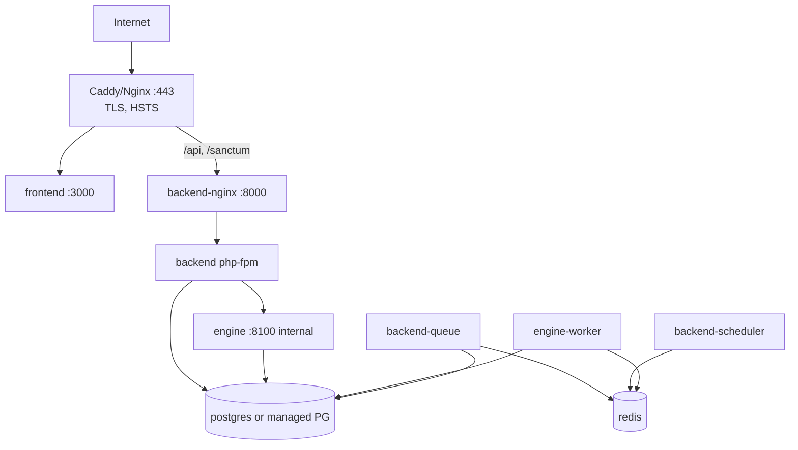

# Deployment Guide

| Field | Value |
|---|---|
| Document ID | OPS-01 |
| Version | 0.1.0 |
| Status | Specification ready (no staging/production exists yet) |
| Owner | DevOps / Technical Lead |
| Last updated | 2026-11-15 |
| Related | [ENG-10 §11 Deployment evolution](../engineering/10_GITHUB_ACTIONS_CI_CD.md#11-environments-and-deployment-evolution) · [OPS-02](02_ENVIRONMENT_CONFIGURATION.md) · [OPS-06 DR](06_DISASTER_RECOVERY.md) · [ARC-01 §11](../architecture/01_SYSTEM_ARCHITECTURE.md#11-deployment-topology) |

## 1. Purpose

How PriceAction AI is deployed to staging and production: topology, procedure, migration safety, health checks and rollback. Kubernetes is intentionally not used; there is no current need for multi-node orchestration.

## 2. Topology

One Linux VM per environment running Docker Engine + Compose v2:

Compose files: root `docker-compose.yml` + `infrastructure/deploy/compose.<env>.yml` (image tags from GHCR instead of builds, no host ports except the proxy, restart policies, resource limits, log rotation).

## 3. Prerequisites per environment

VM (initial sizing assumption: 2–4 vCPU, 8 GB RAM, 80 GB SSD), Docker, firewall allowing 22 (restricted IPs) and 443/80, DNS record, deploy user with SSH key (stored in GitHub Environment), `/srv/priceaction/.env` files (mode 0600) per [OPS-02](02_ENVIRONMENT_CONFIGURATION.md), backup destination configured ([OPS-04](04_DATA_RETENTION_AND_BACKUP.md)).

## 4. Deployment procedure (automated by deploy workflows)

1. **Pre-checks:** target version images exist in GHCR; CI for that commit green; for production, environment approval granted.
2. **Backup:** trigger on-demand DB backup (production only) and verify completion.
3. **Pull:** `docker compose pull` for the target tag.
4. **Migrate:** `docker compose run --rm backend php artisan migrate --force` using the `app_migrator` role. Migrations must be backward compatible with the running version (ENG-12 §4.1), so they run **before** switching containers.
5. **Roll services:** `docker compose up -d --no-deps` in order: engine → engine-worker → backend → backend-queue (Horizon `terminate` for graceful restart) → backend-scheduler → frontend.
6. **Health checks:** wait for all containers healthy (`docker compose up --wait`), then smoke: `GET /api/health` (DB, Redis, engine reachability), `GET /login`, engine `/ready` via backend health detail.
7. **Record:** deployment entry (version, time, actor) in deploy log + GitHub deployment status.

Workers drain gracefully: arq workers finish the current job (`job_timeout` respected); EOD pipeline deploys are avoided between 18:00 and 21:00 IST (deploy workflow refuses unless forced).

## 5. Health checks

| Endpoint | Checks | Used by |
|---|---|---|
| frontend `GET /login` (existing Docker HEALTHCHECK) | Next.js server responds | Docker |
| backend `GET /api/health` | app boot; `?deep=1` adds DB, Redis, engine `/ready` | Docker, deploy smoke, uptime monitor |
| engine `GET /health` / `GET /ready` | process / DB + Redis | Docker |
| worker | heartbeat key in Redis updated every 30 s | monitoring |

## 6. Rollback

| Situation | Action |
|---|---|
| New containers unhealthy, no migration ran | Redeploy previous tag (`compose up -d` with previous image tags) |
| Migration ran (backward compatible by policy) | Redeploy previous tag; schema stays (old code tolerates new additive schema) |
| Migration incompatible or data corruption | Stop writers, restore from pre-deploy backup ([OPS-06](06_DISASTER_RECOVERY.md)), redeploy previous tag; post-incident review |

Rollback is a deploy of the previous version through the same workflow (with approval for production).

## 7. Phases

Per ENG-10 §11: Phase 1 CI only (current target M0) → Phase 2 image publishing → Phase 3 staging auto-deploy → Phase 4 production manual approval. Production never deploys automatically on push.

## 8. Open questions

| ID | Question |
|---|---|
| OQ-OPS-01 | Caddy vs Nginx for edge proxy; hosting provider; managed PostgreSQL (OQ-ARC-01). |
| OQ-OPS-02 | Zero-downtime frontend switch (blue/green with two frontend containers) needed in Phase B? |
