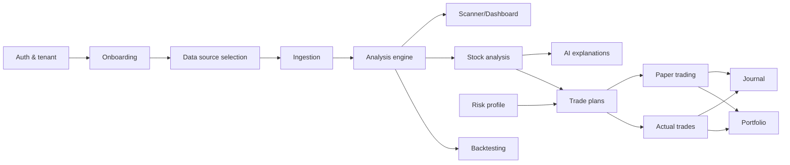

# Product Requirements Document (PRD)

| Field | Value |
|---|---|
| Document ID | PRD-03 |
| Version | 0.1.0 |
| Status | Specification ready |
| Owner | Product Manager |
| Last updated | 2026-11-15 |
| Related | [PRD-02 BRD](02_BRD.md) · [PRD-04 Journeys](04_USER_JOURNEYS.md) · [PRD-05 Onboarding](05_ONBOARDING_SPECIFICATION.md) · [PRD-06 Features](06_FEATURE_CATALOG.md) · [PRD-07 UI/UX](07_UI_UX_SPECIFICATION.md) · [ARC-04 API](../architecture/04_API_SPECIFICATION.md) · [Trading specs](../trading/01_TRADING_METHODOLOGY.md) |

## 1. Purpose and conventions

Defines what the product must do. Identifiers: `FR-` functional, `NFR-` non-functional, `BR-` business rules, `UI-` screen requirements, `US-` user stories. Trading formulas are **not** repeated here; requirements reference the authoritative trading documents.

Status column: **FE** = visible in current frontend with mock data; **Spec** = specified, not built; **Future** = post-MVP.

## 2. Functional requirements

### 2.1 Authentication and account (FR-001 – FR-009)

| ID | Requirement | Route | API | Status |
|---|---|---|---|---|
| FR-001 | Users register with name, email, password; a personal tenant is created. | `/register` | A2 | FE (mock: routes to `/onboarding` without persistence) |
| FR-002 | Users log in with email/password; "remember me" extends session. | `/login` | A3 | FE (mock: any valid-format credentials accepted) |
| FR-003 | Users request a password reset link and set a new password. | `/forgot-password` | A5, A6 | FE (request form only; reset page **missing**) |
| FR-004 | Users must verify email before accessing tenant data. | — | A7, A8 | Spec (no UI) |
| FR-005 | Users log out from the user menu. | top nav | A4 | FE (mock toast) |
| FR-006 | Unauthenticated access to `(app)` routes redirects to `/login`. | all app routes | A9 | Spec (no guard today) |
| FR-007 | Users edit display name, experience level and timezone. | `/settings#profile` | A10 | FE (session-only) |
| FR-008 | Users change password. | `/settings` | A11 | Spec (no UI) |
| FR-009 | Users request account deletion. | `/settings` | A12 | Spec (no UI) |

### 2.2 Onboarding (FR-010 – FR-016)

Detailed in [PRD-05](05_ONBOARDING_SPECIFICATION.md).

| ID | Requirement | Status |
|---|---|---|
| FR-010 | 7-step progressive onboarding (Welcome, Experience, Style, Universe*, Data source, Risk*, Complete); * optional. | FE (state not persisted) |
| FR-011 | Each step persists on "Continue"; resuming returns to the first incomplete step. | Spec |
| FR-012 | Demo mode is selectable and fully usable without a broker. | FE |
| FR-013 | Zerodha selection launches the connection flow (FR-020) or can be deferred. | FE placeholder ("Coming soon" dialog) |
| FR-014 | Skipped optional steps use documented defaults (NIFTY 500 universe; risk defaults TRD-01 §6). | Spec |
| FR-015 | Completion routes to `/dashboard`; incomplete users are routed to `/onboarding` after login. | Partially FE |
| FR-016 | Onboarding answers are editable later in `/settings`. | FE (session-only) |

### 2.3 Data sources and broker (FR-020 – FR-026)

| ID | Requirement | Status |
|---|---|---|
| FR-020 | Connect Zerodha via Kite login redirect; never ask for Zerodha password. | FE placeholder (`/settings` broker section toasts "unavailable") |
| FR-021 | Show connection status (Not connected, Connected, Expired, Error) and last connected time. | FE placeholder |
| FR-022 | Disconnect Zerodha; token deleted. | Spec |
| FR-023 | Select active data source (Demo or Personal). | FE ("Sample data — In use"; "NSE end-of-day — Coming soon") |
| FR-024 | Show ingestion status and last data date for the selected source. | Spec |
| FR-025 | Notify on token expiry with a reconnect action. | Spec |
| FR-026 | Every market-data view shows data mode and as-of date. | FE (Sample data badge) |

### 2.4 Market scanner and dashboard (FR-030 – FR-037)

| ID | Requirement | Status |
|---|---|---|
| FR-030 | Scanner lists latest analysis for the selected universe with structure, setup type, setup status, signal, levels, R:R and quality score. | FE (mock rows) |
| FR-031 | Filters: text, index/universe, bias/structure, setup type, setup status, min R:R, (new) min score, near support/resistance. | FE (exchange & index filters present; exchange filter should be removed — NSE only) |
| FR-032 | Sort by any column; click row opens `/analysis/{symbol}`. | FE |
| FR-033 | Show batch metadata (as-of date, instruments analysed, status). | Spec |
| FR-034 | CSV export subject to data-mode rights. | FE placeholder toast |
| FR-035 | Dashboard shows index strip, summary metrics, top setups, primary watchlist, upcoming triggers, recent analyses, activity. | FE (mock) |
| FR-036 | "Refresh scan" re-fetches the latest batch (does not trigger analysis). | FE (toast) |
| FR-037 | Market session indicator uses the exchange calendar (holidays). | FE partial (clock-based, ignores holidays) |

### 2.5 Stock analysis (FR-040 – FR-049)

| ID | Requirement | Status |
|---|---|---|
| FR-040 | Candlestick chart (daily) with swing labels, BOS/CHoCH lines, zones, events, entry/stop/target lines. | FE (mock heuristic) |
| FR-041 | Analysis panel: structure state, signal state with explanation, setup type/status, levels, R:R, quality score with components. | FE |
| FR-042 | "Why is this setup being considered?" evidence list (supporting/caution). | FE |
| FR-043 | Entry conditions and invalidation list. | FE |
| FR-044 | Show ruleset version, as-of date, data mode; link to rules. | Spec |
| FR-045 | Weekly/monthly view is display aggregation only; no signals. | FE (Weekly option disabled) |
| FR-046 | Unconfirmed recent bars (last R bars) are visibly marked; they never show pivots. | Spec |
| FR-047 | Add/remove symbol to watchlists from analysis. | FE (session-only) |
| FR-048 | Create trade plan from the primary LONG setup (FR-060). | FE (dialog, mock save) |
| FR-049 | Request refresh of analysis for latest ingested data. | Spec |

### 2.6 AI explanations (FR-050 – FR-054)

| ID | Requirement | Status |
|---|---|---|
| FR-050 | "Explain this chart" generates a summary of the computed analysis with evidence references. | Spec (no UI) |
| FR-051 | Users can ask a question about the current analysis (single turn). | Spec |
| FR-052 | Explanations show disclaimer, model/prompt version and "Automatic summary" when fallback is used. | Spec |
| FR-053 | Requests respect entitlement quotas. | Spec |
| FR-054 | Explanations never display numbers not present in the analysis (validator, ARC-07 §6). | Spec |

### 2.7 Watchlists (FR-055 – FR-058)

| ID | Requirement | Status |
|---|---|---|
| FR-055 | Create, rename, delete watchlists (≥ 1 must remain). | FE (session-only) |
| FR-056 | Add/remove symbols; show analysis columns per symbol. | FE |
| FR-057 | Watchlists persist across sessions and devices. | Spec |
| FR-058 | Scanner can filter by watchlist. | Spec |

### 2.8 Trade plans and risk (FR-060 – FR-069)

| ID | Requirement | Status |
|---|---|---|
| FR-060 | Create a plan from a LONG setup with engine levels pre-filled; editing levels shows live risk preview. | FE (dialog computes qty client-side — must call API) |
| FR-061 | Quantity, risk amount, position value and R:R are computed by the engine (TRD-05) and stored. | Spec |
| FR-062 | Refuse plans violating TRD-05 rules with specific messages. | FE partial (stop/target ordering only) |
| FR-063 | Short/informational setups cannot become plans; UI explains why. | FE |
| FR-064 | Plans list with tabs by status, cards/table views, metrics (open plans, awaiting trigger, planned risk, avg R:R). | FE |
| FR-065 | Edit pending plans; cancel pending/triggered plans with confirmation. | FE (cancel/invalidate mock) |
| FR-066 | Plan status updates automatically from EOD processing (TRD-07). | Spec |
| FR-067 | Manual plans (no setup) with all levels entered. | Spec |
| FR-068 | Link an actual trade to a plan. | FE placeholder ("Broker not connected" toast) — will become manual actual-trade entry |
| FR-069 | Risk profile editable in settings; versioned. | FE (session-only) |

### 2.9 Paper trading, actual trades, portfolio (FR-070 – FR-077)

| ID | Requirement | Status |
|---|---|---|
| FR-070 | Plans with paper tracking produce simulated fills/exits per TRD-07. | Spec |
| FR-071 | Users can move paper stops up and request manual close (next open). | Spec |
| FR-072 | Users record actual executed trades (fills) manually, optionally linked to a plan. | Spec |
| FR-073 | Portfolio shows capital, invested, cash, unrealized/realized P&L, open risk, allocation and positions **for one book at a time** (Paper / Actual toggle). | FE (mock "Holdings"; no book toggle) |
| FR-074 | Paper account reset with archive. | Spec |
| FR-075 | Positions show HOLD/EXIT signal state. | FE |
| FR-076 | Executed orders list shows actual fills only. | FE (mock `ExecutedOrder`) |
| FR-077 | Broker holdings/orders sync. | Future |

### 2.10 Journal (FR-080 – FR-084)

| ID | Requirement | Status |
|---|---|---|
| FR-080 | Journal entries auto-drafted when paper/actual trades close. | Spec |
| FR-081 | Filter by kind (Paper/Actual), outcome, setup type, plan adherence, text. | FE (no kind filter) |
| FR-082 | Edit notes, tags, emotions, mistakes, lessons, rating; mark complete. | FE (notes only, session-only) |
| FR-083 | Stats: trades, win rate, profit factor, avg R, net P&L, plan adherence (server-computed). | FE (client-computed) |
| FR-084 | Screenshot attachments. | Future (FE toast) |

### 2.11 Backtesting (FR-090 – FR-095)

| ID | Requirement | Status |
|---|---|---|
| FR-090 | Configure setup types, instruments (single/universe/watchlist), date range, capital, risk %. | FE (strategy list differs from canonical setups) |
| FR-091 | Run asynchronously with progress; results persist and are listed. | Spec (FE shows "Engine not connected") |
| FR-092 | Results: metrics (TRD-06 §10), equity curve, trade list incl. skipped trades, versions, bias flags. | Spec (FE placeholder curve labelled as such) |
| FR-093 | Results labelled hypothetical; low-sample warning. | Spec |
| FR-094 | Cancel running backtest. | Spec |
| FR-095 | Compare two runs. | Future |

### 2.12 Notifications and settings (FR-100 – FR-104)

| ID | Requirement | Status |
|---|---|---|
| FR-100 | In-app notifications (bell) with unread count, mark read / mark all read. | FE (mock) |
| FR-101 | Notification types: plan triggered/skipped/filled, setup invalidated, paper exit, token expired, backtest done, data delayed. | Spec |
| FR-102 | Notification preferences in settings. | FE (session-only) |
| FR-103 | Theme toggle (dark default, light preview), persisted locally. | FE (implemented, localStorage) |
| FR-104 | Email notifications for selected types. | Spec (M9) |

## 3. Non-functional requirements

| ID | Category | Requirement |
|---|---|---|
| NFR-001 | Performance | API p95 < 800 ms for cached reads; risk calculation p95 < 300 ms; scanner page p95 < 1.5 s for 500 rows. |
| NFR-002 | Performance | EOD analysis of 500 instruments completes within 30 min of ingestion completion. |
| NFR-003 | Availability | Personal phase: best effort, single host; failures surface clearly; no data loss (RPO 24 h, RTO 8 h — OPS-06). |
| NFR-004 | Determinism | Identical inputs produce identical outputs (hash-verified). |
| NFR-005 | Correctness | All TRD-08 tests pass in CI before merge. |
| NFR-006 | Security | ARC-06 controls; no secrets in repo; broker tokens never leave backend. |
| NFR-007 | Privacy | No PII to LLM; account deletion within 30 days. |
| NFR-008 | Accessibility | WCAG 2.2 AA target: keyboard navigation, focus states, colour not sole signal (signal states already use shape + icon + colour). |
| NFR-009 | Localisation | en-IN number formatting (lakh/crore), INR, Asia/Kolkata time (existing `lib/format.ts`). |
| NFR-010 | Browser support | Latest two versions of Chrome, Edge, Firefox, Safari; responsive ≥ 360 px. |
| NFR-011 | Observability | Structured logs with request IDs; metrics for pipeline and API (OPS-03). |
| NFR-012 | Auditability | Audited actions per ARC-06 §10. |
| NFR-013 | Maintainability | Module boundaries enforced by architecture tests; docs updated in the same PR as behaviour changes. |
| NFR-014 | Portability | Entire stack runs with Docker Compose locally and on a single server. |

## 4. Business rules

| ID | Rule | Authority |
|---|---|---|
| BR-001 | No order placement or broker order modification anywhere in MVP. | ADR-010 |
| BR-002 | `DEMO` data always shows a sample-data badge; never labelled live. | ADR-011 |
| BR-003 | Only `LONG` setups are actionable; `SHORT` are informational. | TRD-04 SD-06 |
| BR-004 | A plan requires stop < entry < target, R:R ≥ effective minimum, quantity ≥ 1. | TRD-05 |
| BR-005 | Quantity is never accepted from the client. | TRD-05 RM-01 |
| BR-006 | Plans are editable only while `PENDING`. | TRD-07 PL-07 |
| BR-007 | Paper stops can only move up; manual closes fill at next open. | TRD-07 §5 |
| BR-008 | Paper and actual books are never aggregated together. | TRD-07 §6 |
| BR-009 | A plan from an `ENTRY_CONFIRMED` setup can be created only while the entry window is open. | TRD-04 SD-03 |
| BR-010 | Users can only make `min_rr` stricter and `max_entry_gap_pct` stricter than the ruleset. | TRD-01 §6 |
| BR-011 | Personal-mode data is visible only to its tenant and cannot be exported in bulk. | ADR-011 |
| BR-012 | AI explanations cannot introduce numbers or advice. | ARC-07 |
| BR-013 | At least one watchlist must exist. | Current UI behaviour |
| BR-014 | Capital ≥ ₹10,000; risk per trade 0.1–2.0% (backtests allow up to 5% for exploration). | TRD-01 §6 / current UI |
| BR-015 | The quality score is never described as a probability. | TRD-04 §10 |

## 5. User permissions

MVP: one `OWNER` per personal tenant with all permissions. Full matrix: [ARC-06 §3](../architecture/06_SECURITY_ARCHITECTURE.md#3-authorization-rbac). Entitlements gate AI and backtest quotas ([ARC-03 §5.3](../architecture/03_DATABASE_DESIGN.md)).

## 6. Screen-level requirements

| ID | Route | Screen | Key requirements |
|---|---|---|---|
| UI-001 | `/` | Redirect | Redirects to `/login` (unauthenticated) or `/dashboard` (authenticated, onboarded). Today: always `/login`. |
| UI-002 | `/login` | Login | Email/password, show/hide password, remember me, link to register/forgot; generic error; rate-limit message. |
| UI-003 | `/register` | Register | Name, email, password with strength meter, confirm, terms checkbox; field errors from API. |
| UI-004 | `/forgot-password` | Forgot password | Email; always success message. |
| UI-005 | `/reset-password` (**new**) | Reset password | Token from email link; new password + confirm. |
| UI-006 | `/onboarding` | Onboarding | PRD-05; progress indicator; optional steps marked; Zerodha connection entry. |
| UI-007 | `/dashboard` | Dashboard | FR-035; data-mode badge; empty state when no analysis batch yet. |
| UI-008 | `/market-scanner` | Scanner | FR-030–034; batch metadata; empty/no-results states. |
| UI-009 | `/analysis/[symbol]` | Stock analysis | FR-040–049, FR-050–051; 404 for unknown symbol; `INSUFFICIENT_HISTORY` state. `/analysis` redirects to default symbol (`RELIANCE`). |
| UI-010 | `/watchlists` | Watchlists | FR-055–058. |
| UI-011 | `/trade-plans` | Trade plans | FR-064–068; status tabs incl. new `SKIPPED`/`EXPIRED`. |
| UI-012 | `/portfolio` | Portfolio | FR-073–076; Paper/Actual toggle (new). |
| UI-013 | `/journal` | Journal | FR-080–083; Paper/Actual filter (new). |
| UI-014 | `/backtesting` | Backtesting | FR-090–094; run history list (new). |
| UI-015 | `/settings` | Settings | Sections: Profile, Trading preferences, Risk management, Market data, Broker connection, Notifications, Appearance; FR-007/008/009/016/020–025/069/102/103. |
| UI-016 | `/paper-trades` (**proposed**) or a tab within `/portfolio` | Paper trades | Open/closed paper trades, stop move, close. Decision pending (OQ-PRD-01). |
| UI-017 | any | Not found | Existing `not-found.tsx`. |
| UI-018 | any `(app)` route | Error boundary (**new**) | Retry state for API/engine failures (`error.tsx`). |

## 7. User stories and acceptance criteria

| ID | Story | Acceptance criteria |
|---|---|---|
| US-01 | As a new user, I want to explore with demo data so I can evaluate the product without connecting my broker. | Given I chose Demo in onboarding, when I open any market screen, then data loads and a "Sample data" badge is visible, and no screen claims live prices. |
| US-02 | As a trader, I want to connect Zerodha safely. | Given I click Connect, I am redirected to Zerodha's login; our app never shows a password field for Zerodha; on return the status shows Connected; tokens never appear in network responses. |
| US-03 | As a trader, I want a daily shortlist of setups. | Given the EOD pipeline completed, when I open the scanner filtered by signal BUY WATCH, then I see only LONG setups with score ≥ threshold and R:R ≥ minimum, with as-of date shown. |
| US-04 | As a trader, I want to understand why a setup was flagged. | On `/analysis/{symbol}`, each evidence item references chart objects that are highlighted on hover; structure/BOS/zones match TRD rules for that snapshot. |
| US-05 | As a trader, I want "No trade" when nothing qualifies. | When no LONG setup meets criteria, the signal shows NO TRADE with its explanation and reason codes; no levels are presented as actionable. |
| US-06 | As a trader, I want correctly sized plans. | Given my risk profile (₹10,00,000, 1%), when I create a plan with entry 1,495.50 / stop 1,477.00 / target 1,560.00, then quantity = 167 and binding constraint = position cap (TRD-05 §3.1). |
| US-07 | As a trader, I want invalid plans blocked. | R:R 1.55 → error `RR_BELOW_MINIMUM`; stop ≥ entry → `STOP_NOT_BELOW_ENTRY`; short setup → plan button disabled with explanation. |
| US-08 | As a trader, I want paper trades simulated honestly. | A plan triggered at close fills at next open only if the gap is ≤ 2%; same-bar stop/target collision exits at stop; results include costs. |
| US-09 | As a trader, I want to log my real executions. | I can add BUY/SELL fills to an actual trade linked to a plan; overselling is rejected; portfolio "Actual" book reflects it; paper book unchanged. |
| US-10 | As a trader, I want to journal closed trades. | When a trade closes, a draft entry appears with facts prefilled; I can add notes/tags and mark complete; stats update. |
| US-11 | As a trader, I want to backtest a setup. | I submit a config; status progresses QUEUED → RUNNING → COMPLETED; results show metrics, skipped-trade counts, ruleset/cost versions and bias flags. |
| US-12 | As a trader, I want AI to explain the chart in plain words. | Explanation references evidence; contains no numbers absent from the analysis; shows disclaimer; when the LLM fails, an automatic summary appears instead of an error. |
| US-13 | As a trader, I want to be told when my Zerodha session expires. | On expiry, a notification and settings banner prompt reconnection; analyses continue using last ingested data with its as-of date. |

## 8. Validation requirements

Client-side validation mirrors server rules for UX only; the server is authoritative. Field rules are defined per endpoint in [ARC-04](../architecture/04_API_SPECIFICATION.md). Existing frontend validators: `features/auth/validation.ts` (email, password strength), onboarding risk step (capital ≥ ₹10,000), backtest form (date order, capital ≥ ₹10,000, risk 0.1–5%), plan dialog (stop < entry < target, risk > 0).

## 9. Error scenarios

| Scenario | Expected behaviour |
|---|---|
| Engine down | Analysis pages show last persisted analysis; refresh/plan creation show "Analysis engine unavailable, try again" (503). |
| No analysis batch yet (new personal source) | Scanner/dashboard empty state: "First analysis runs after data ingestion completes" with ingestion status. |
| Provider token expired | Banner + notification; data stays at last as-of date. |
| Ingestion partial | Scanner shows batch status PARTIAL and count of instruments analysed. |
| Stale analysis when creating plan | 409 `ANALYSIS_STALE`; UI reloads analysis. |
| Concurrent plan edit | 409 `STALE_VERSION`; UI reloads plan. |
| Quota exceeded (AI/backtest) | Message with reset time. |
| Network/API error | Route error boundary with retry. |

## 10. Edge cases

- Symbols with < 120 bars (new listings) → `INSUFFICIENT_HISTORY`, NO TRADE.
- Circuit-locked days (H = L) are valid bars.
- Instrument removed from NIFTY 500: stays in watchlists and analysable if data exists; excluded from scanner universe.
- Symbol renamed: resolved by ISIN; URLs with old symbol redirect to new (M2).
- Holiday: no EOD run; dashboard shows last trading day.
- User changes data source: scanner/analysis switch entirely; existing plans keep their original `analysis_run_id` and data source.

## 11. Feature dependencies

## 12. Open questions

| ID | Question |
|---|---|
| OQ-PRD-01 | Paper trades: dedicated `/paper-trades` route or a tab inside `/portfolio`? |
| OQ-PRD-02 | Should the scanner show SHORT informational setups by default (current UI does) or hide them behind a toggle? Proposed: hidden by default when preference is `LONG_ONLY`. |
| OQ-PRD-03 | Keep "Exchange" filter (NSE/BSE) in scanner UI? Proposed: remove for MVP. |
