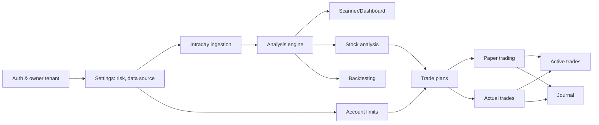

# Product Requirements Document (PRD)

| Field | Value |
|---|---|
| Document ID | PRD-03 |
| Version | 0.2.0 |
| Status | Specification ready for the personal intraday direction (ADR-014) |
| Owner | Product Manager |
| Last updated | 2026-11-17 |
| Related | [ADR-014](../adr/ADR-014-PERSONAL-INTRADAY-WORKSTATION.md) · [PRD-02 BRD](02_BRD.md) · [PRD-04 Journeys](04_USER_JOURNEYS.md) · [PRD-06 Features](06_FEATURE_CATALOG.md) · [PRD-07 UI/UX](07_UI_UX_SPECIFICATION.md) · [ARC-04 API](../architecture/04_API_SPECIFICATION.md) · [Trading specs](../trading/01_TRADING_METHODOLOGY.md) |

## 1. Purpose and conventions

Defines what the product must do for its single user, the owner, trading NSE cash equities intraday. Identifiers: `FR-` functional, `NFR-` non-functional, `BR-` business rules, `UI-` screen requirements, `US-` user stories. Trading formulas are **not** repeated here; requirements reference the authoritative trading documents. IDs from version 0.1.0 are kept where the meaning carries over.

Status column: **FE** = visible in the current frontend with mock (daily) data; **Spec** = specified, not built; **Deferred** = kept in the design but not built for the MVP (ADR-014); **Future** = post-MVP idea.

## 2. Functional requirements

### 2.1 Authentication and account (FR-001 – FR-009)

| ID | Requirement | Route | API | Status |
|---|---|---|---|---|
| FR-001 | Self-service registration. The owner account and tenant are created by a setup command instead. | `/register` | A2 | Deferred (page exists with mock data) |
| FR-002 | The owner logs in with email/password; "remember me" extends the session. | `/login` | A3 | FE (mock: any valid-format credentials accepted) |
| FR-003 | Password reset by email link. | `/forgot-password` | A5, A6 | FE (request form only; reset page **missing**) |
| FR-004 | Email verification. | — | A7, A8 | Deferred (single seeded owner) |
| FR-005 | Log out from the user menu. | top nav | A4 | FE (mock toast) |
| FR-006 | Unauthenticated access to `(app)` routes redirects to `/login`. | all app routes | A9 | Spec (no guard today) |
| FR-007 | Edit display name and timezone (default Asia/Kolkata). | `/settings#profile` | A10 | FE (session-only) |
| FR-008 | Change password. | `/settings` | A11 | Spec |
| FR-009 | Account deletion. | `/settings` | A12 | Deferred |

### 2.2 Onboarding (FR-010 – FR-016)

The 7-step onboarding of [PRD-05](05_ONBOARDING_SPECIFICATION.md) is **deferred** (ADR-014). The owner configures capital, risk limits, data source and watchlist in `/settings`; the `/onboarding` page stays in the code base but is not linked from login.

### 2.3 Data sources and broker (FR-020 – FR-026)

| ID | Requirement | Status |
|---|---|---|
| FR-020 | Connect the broker data account (Zerodha Kite Connect or Groww, decided by T-201/T-203) through the provider's own login; never ask for the broker password. | FE placeholder |
| FR-021 | Show connection status (Not connected, Connected, Expired, Error), last connected time and token expiry. | FE placeholder |
| FR-022 | Disconnect; token deleted. | Spec |
| FR-023 | Switch between DEMO and PERSONAL data in settings. | FE ("Sample data — In use") |
| FR-024 | Show data health for the session: last completed 5m bar, late or missing bars, last reconciliation. | Spec |
| FR-025 | Notify on token expiry with a reconnect action. | Spec |
| FR-026 | Every market-data view shows the data mode and the time of the last completed bar (ARC-04 §2.9). | FE partial (Sample data badge; no bar time) |

### 2.4 Scanner and dashboard (FR-030 – FR-037)

| ID | Requirement | Status |
|---|---|---|
| FR-030 | The scanner lists the latest 5m analysis for NIFTY 50: 15m context, 5m structure, setup type and status, signal with `signal_at` and `valid_until`, entry/stop/target, R:R, quality score, distance to trigger. | FE (daily mock rows) |
| FR-031 | Filters: text, signal, setup type, setup status, 15m context, min R:R, min score, near level (zone, PDH/PDL, opening range). Default hides informational SHORT setups (OQ-PRD-02). | FE partial (daily filters; exchange filter must be removed) |
| FR-032 | Sort by any column; clicking a row opens `/analysis/{symbol}`. | FE |
| FR-033 | Show batch metadata: `as_of` (last 5m close), instruments analysed, late instruments, next bar close. | Spec |
| FR-034 | CSV export. | Deferred |
| FR-035 | Dashboard (intraday): market status and session clock (time to entry cutoff and session-end exit), today's realised and unrealised P&L per book, remaining daily risk and limit status, open positions with live P&L, top active setups, watchlist movers vs levels, recent signals and activity. | FE partial (daily mock layout) |
| FR-036 | Screens with live data refresh automatically by polling every 10–30 s during the session; a manual refresh fetches the latest stored analysis (it never triggers analysis of a forming bar). | Spec (FE toast only) |
| FR-037 | Market status uses the NSE calendar (holidays, special sessions). | FE partial (clock-based, ignores holidays) |

### 2.5 Stock analysis (FR-040 – FR-049)

| ID | Requirement | Status |
|---|---|---|
| FR-040 | Candlestick chart of 5m bars (primary) with session separators, swing labels, BOS/CHoCH, zones, PDH/PDL/PDC, opening range, events and entry/stop/target lines. Each annotation appears only from the bar at which it became known (no repainting). | FE (daily mock heuristic) |
| FR-041 | Analysis panel: 15m context, 5m structure, signal with explanation and validity, setup type/status, levels, R:R before and after estimated costs, quality score with components. | FE partial |
| FR-042 | "Why is this setup being considered?" evidence list (supporting/caution). | FE |
| FR-043 | Entry conditions and invalidation list, including the entry cutoff time. | FE partial |
| FR-044 | Show ruleset version, `as_of` time, data mode; link to rules. | Spec |
| FR-045 | 15m view shows the context timeframe; the daily view is display only. Neither produces separate signals. | FE (daily/weekly toggle) |
| FR-046 | Unconfirmed recent bars (last R bars of each timeframe) are visibly marked; they never show pivots. | Spec |
| FR-047 | Add/remove the symbol to the watchlist. | FE (session-only) |
| FR-048 | Create a trade plan from the primary LONG setup (FR-060). | FE (dialog, mock save) |
| FR-049 | The analysis updates at each 5m close; the page shows when the next update is due. | Spec |

### 2.6 AI explanations (FR-050 – FR-054)

Deferred (ADR-014). The design in [ARC-07](../architecture/07_AI_AND_LLM_ARCHITECTURE.md) and ADR-009 stays valid if they are added later.

### 2.7 Watchlist (FR-055 – FR-058)

| ID | Requirement | Status |
|---|---|---|
| FR-055 | One default intraday watchlist (NIFTY 50); the owner may create more (≥ 1 must remain). | FE (session-only) |
| FR-056 | Add/remove symbols; show live analysis columns per symbol. | FE |
| FR-057 | Watchlists persist. | Spec |
| FR-058 | Scanner can filter by watchlist. | Spec |

### 2.8 Trade plans and risk (FR-060 – FR-069)

| ID | Requirement | Status |
|---|---|---|
| FR-060 | Create a plan from a LONG setup with engine levels pre-filled; editing levels shows a live risk preview from the engine. | FE (dialog computes qty client-side — must call the API) |
| FR-061 | Quantity, risk amount, position value, R:R and estimated costs are computed by the engine (TRD-05) and stored. | Spec |
| FR-062 | Refuse plans that violate TRD-05 (stop, R:R, distance limits) or an account limit (TRD-05 §8), with specific messages. | FE partial (stop/target ordering only) |
| FR-063 | Short/informational setups cannot become plans; the UI explains why. | FE |
| FR-064 | Plans list with status tabs (incl. `SKIPPED`, `EXPIRED`) and today's planned risk. | FE (daily mock) |
| FR-065 | Edit pending plans; cancel pending/triggered plans. | FE (mock) |
| FR-066 | Plan status updates at each 5m close (TRD-07 §4); plans expire at the entry cutoff. | Spec |
| FR-067 | Manual plans (no setup) with all levels entered. | Spec |
| FR-068 | Link an actual trade to a plan. | FE placeholder — becomes manual actual-trade entry |
| FR-069 | Risk profile in settings: capital, risk per trade, max position value, daily loss limit, consecutive-loss limit, max open positions, max open risk; versioned. | FE partial (daily fields, session-only) |

### 2.9 Active trades, paper trading, actual trades (FR-070 – FR-077)

| ID | Requirement | Status |
|---|---|---|
| FR-070 | Plans with paper tracking produce simulated fills/exits at 5m closes per TRD-07, including the session-end exit. | Spec |
| FR-071 | Move paper stops up; request a manual close (exits at the next 5m open). | Spec |
| FR-072 | Record actual executed trades (fills with time) manually, optionally linked to a plan; costs estimated from the cost schedule or entered. | Spec |
| FR-073 | Active trades view for one book at a time (Paper / Actual toggle): entry, current price, unrealised P&L, stop and target with distance, time held, time to session-end exit, exit action. | FE partial (`/portfolio` daily holdings mock; no book toggle) |
| FR-074 | Paper account reset with archive. | Spec |
| FR-075 | Positions show HOLD/EXIT signal state. | FE |
| FR-076 | Executed fills list for the actual book. | FE (mock `ExecutedOrder`) |
| FR-077 | Broker order/holding sync. | Future |

### 2.10 Journal (FR-080 – FR-085)

| ID | Requirement | Status |
|---|---|---|
| FR-080 | Journal entries auto-drafted when paper/actual trades close. | Spec |
| FR-081 | Filter by kind (Paper/Actual), session date, outcome, setup type, plan adherence, text. | FE partial |
| FR-082 | Edit notes, tags, mistakes, emotions, lessons, rating; mark complete. | FE partial (notes only) |
| FR-083 | Stats server-computed: trades, win rate, profit factor, average R (gross/net), net P&L per session, plan adherence. | FE (client-computed) |
| FR-084 | Screenshot attachments. | Spec (milestone I7) |
| FR-085 | Planned vs actual entry/exit (price and time), slippage vs plan and costs per trade. | Spec |

### 2.11 Backtesting (FR-090 – FR-095)

| ID | Requirement | Status |
|---|---|---|
| FR-090 | Configure setup types, instruments (single/NIFTY 50/watchlist), session range, capital, risk limits, slippage and cost schedule version. | FE (daily strategy list) |
| FR-091 | Run asynchronously with progress; results persist and are listed. | Spec |
| FR-092 | Results: TRD-06 §10 metrics incl. session P&L distribution and exit mix, end-of-session equity curve, trade list incl. skipped entries, versions, flags (`short_history`, survivorship). | Spec (FE placeholder curve labelled as such) |
| FR-093 | Results labelled hypothetical; low-sample warning. | Spec |
| FR-094 | Cancel a running backtest. | Spec |
| FR-095 | Compare two runs. | Future |

### 2.12 Notifications and settings (FR-100 – FR-104)

| ID | Requirement | Status |
|---|---|---|
| FR-100 | In-app notifications (bell) with unread count, mark read / mark all read. | FE (mock) |
| FR-101 | Types: setup confirmed (watchlist), plan triggered/skipped/filled/expired, paper exit, account limit reached, entry cutoff reached with open positions, session-end exit time, data delayed, token expired, backtest done. | Spec |
| FR-102 | Notification preferences in settings. | FE (session-only) |
| FR-103 | Theme toggle (dark default), persisted locally. | FE |
| FR-104 | Email/push notifications. | Deferred |

### 2.13 Session and account limits (FR-110 – FR-115)

| ID | Requirement | Status |
|---|---|---|
| FR-110 | A "today" risk panel per book: realised net P&L, open risk, losing streak, remaining daily loss budget, block reason (`GET /api/v1/risk/today`). | Spec |
| FR-111 | When a limit is reached, plan creation for that book is disabled with the reason, and pending plans show as cancelled (`ACCOUNT_LIMIT`). | Spec |
| FR-112 | From the entry cutoff, plan creation is disabled and the UI shows the remaining time to the session-end exit. | Spec |
| FR-113 | Open actual positions trigger a warning at the entry cutoff and at the session-end exit time; positions open after the close are flagged `CARRIED_OVER`. | Spec |
| FR-114 | Settings expose the session parameters read-only (opening range, entry cutoff, session-end exit) with the ruleset version. | Spec |
| FR-115 | Live prices for open positions come from the current-price cache and are labelled with their time; they never change analysis. | Spec |

## 3. Non-functional requirements

| ID | Category | Requirement |
|---|---|---|
| NFR-001 | Performance | API p95 < 800 ms for cached reads; risk calculation p95 < 300 ms; scanner page p95 < 1.5 s for 50 rows. |
| NFR-002 | Timeliness | Bar-close pipeline (fetch + analyse 50 instruments) completes within 60 s of the 5m close on ≥ 95% of bars (BRD SM-01). |
| NFR-003 | Availability | Personal phase: the stack runs reliably during market hours (09:00–15:45 IST) on one host; failures surface clearly; no data loss (OPS-04). |
| NFR-004 | Determinism | Identical inputs produce identical outputs (hash-verified). |
| NFR-005 | Correctness | All TRD-08 tests pass in CI before merge. |
| NFR-006 | Security | ARC-06 controls; no secrets in repo; broker tokens never leave the backend. |
| NFR-007 | Privacy | Personal data stays on the owner's host; no third-party analytics. |
| NFR-008 | Accessibility | WCAG 2.2 AA target: keyboard navigation, focus states, colour not the sole signal. |
| NFR-009 | Localisation | en-IN number formatting, INR, Asia/Kolkata time for every timestamp (existing `lib/format.ts`). |
| NFR-010 | Browser support | Latest two versions of Chrome, Edge, Firefox, Safari; responsive ≥ 360 px. |
| NFR-011 | Observability | Structured logs with request IDs; metrics for the bar-close pipeline and API (OPS-03). |
| NFR-012 | Auditability | Audited actions per ARC-06 §10. |
| NFR-013 | Maintainability | Module boundaries enforced; docs updated in the same PR as behaviour changes. |
| NFR-014 | Portability | The entire stack runs with Docker Compose locally and on a single server. |
| NFR-015 | Freshness | No screen shows market data without its bar time; data older than one bar during the session is marked "Delayed". |

## 4. Business rules

| ID | Rule | Authority |
|---|---|---|
| BR-001 | No order placement or broker order modification anywhere. | ADR-010 |
| BR-002 | `DEMO` data always shows a sample-data badge; never labelled live. | ADR-011 |
| BR-003 | Only `LONG` setups are actionable; `SHORT` are informational. | TRD-04 SD-06 |
| BR-004 | A plan requires stop < entry < target, R:R ≥ effective minimum, quantity ≥ 1, stop distance within limits. | TRD-05 |
| BR-005 | Quantity is never accepted from the client. | TRD-05 RM-01 |
| BR-006 | Plans are editable only while `PENDING`. | TRD-07 PL-07 |
| BR-007 | Paper stops can only move up; manual closes fill at the next 5m open. | TRD-07 §5 |
| BR-008 | Paper and actual books are never aggregated together, including their account limits. | TRD-07 §6, TRD-05 §8.1 |
| BR-009 | A plan from an `ENTRY_CONFIRMED` setup can be created only while its one-bar entry window is open. | TRD-04 SD-03 |
| BR-010 | `min_rr` and `max_entry_gap_pct` can only be made stricter than the ruleset. | TRD-01 §6 |
| BR-011 | Personal-mode data is visible only to its tenant and cannot be exported in bulk. | ADR-011 |
| BR-012 | AI (if added) cannot introduce numbers or advice. | ADR-009 |
| BR-013 | At least one watchlist must exist. | Current UI behaviour |
| BR-014 | Capital ≥ ₹10,000; risk per trade 0.1–2.0%; position value ≤ the max position value. | TRD-01 §6 |
| BR-015 | The quality score is never described as a probability. | TRD-04 §10 |
| BR-016 | A breached daily loss or losing-streak limit blocks new plans for that book for the rest of the session. | TRD-05 §8 |
| BR-017 | No plan at or after the entry cutoff; no paper position after the session-end exit. | TRD-01 §4.1, TRD-07 |

## 5. User permissions

MVP: one `OWNER` in one tenant with all permissions. The role model of [ARC-06 §3](../architecture/06_SECURITY_ARCHITECTURE.md#3-authorization-rbac) stays in place for later use. Entitlements are not enforced in the MVP.

## 6. Screen-level requirements

| ID | Route | Screen | Key requirements |
|---|---|---|---|
| UI-001 | `/` | Redirect | `/login` (unauthenticated) or `/dashboard`. |
| UI-002 | `/login` | Login | Email/password, show/hide password, remember me, forgot link; generic error; rate-limit message. |
| UI-003 | `/register` | Register | Deferred (not linked). |
| UI-004 | `/forgot-password` | Forgot password | Email; always success message. |
| UI-005 | `/reset-password` (**new**) | Reset password | Token from email link; new password + confirm. |
| UI-006 | `/onboarding` | Onboarding | Deferred (not linked). |
| UI-007 | `/dashboard` | Dashboard | FR-035, FR-110; data-mode badge and last bar time; empty state before the first bar of the session. |
| UI-008 | `/market-scanner` | Scanner | FR-030–033; batch metadata; empty/no-results/delayed states. |
| UI-009 | `/analysis/[symbol]` | Stock analysis | FR-040–049; 404 for unknown symbol; `INSUFFICIENT_HISTORY` and `MISSING_CONTEXT` states. |
| UI-010 | `/watchlists` | Watchlist | FR-055–058. |
| UI-011 | `/trade-plans` | Trade plans | FR-060–068; status tabs incl. `SKIPPED`/`EXPIRED`; disabled creation with reason when a limit or the cutoff applies. |
| UI-012 | `/portfolio` | Active trades | FR-073–076, FR-113; Paper/Actual toggle. |
| UI-013 | `/journal` | Journal | FR-080–085; Paper/Actual filter. |
| UI-014 | `/backtesting` | Backtesting | FR-090–094; run history list. |
| UI-015 | `/settings` | Settings | Profile, Risk and limits (FR-069), Session (FR-114), Market data and broker (FR-020–025), Notifications, Appearance. |
| UI-016 | `/portfolio` paper tab | Paper trades | Open/closed paper trades, stop move, close (OQ-PRD-01). |
| UI-017 | any | Not found | Existing `not-found.tsx`. |
| UI-018 | any `(app)` route | Error boundary | Retry state for API/engine failures (`error.tsx`). |

## 7. User stories and acceptance criteria

| ID | Story | Acceptance criteria |
|---|---|---|
| US-01 | As the owner, I want to use the app on demo data before connecting my broker. | With DEMO selected, every market screen loads intraday sample bars with a visible "Sample data" badge; no screen claims live prices. |
| US-02 | As the owner, I want to connect my broker data account safely. | Connect redirects to the provider's login; the app never shows a password field for it; status shows Connected; tokens never appear in network responses. |
| US-03 | As the owner, I want a live shortlist of intraday setups. | During the session, within about a minute of each 5m close, the scanner filtered by BUY WATCH shows only LONG setups with score ≥ threshold and R:R ≥ minimum, each with `signal_at`, `valid_until` and the last bar time. |
| US-04 | As the owner, I want to understand why a setup was flagged, without hindsight. | On `/analysis/{symbol}`, each evidence item references chart objects; pivots and events appear only from their confirmation bar; 15m context matches the last closed 15m bar. |
| US-05 | As the owner, I want "No trade" when nothing qualifies. | When no LONG setup meets the criteria, the signal shows NO TRADE with reason codes; no levels are presented as actionable. |
| US-06 | As the owner, I want correctly sized plans. | With capital ₹1,00,000, risk 0.5%, cap ₹50,000, entry 1,498.10 / stop 1,485.25 / target 1,529.00, quantity = 33 and binding constraint = position cap (TRD-05 §3.1). |
| US-07 | As the owner, I want invalid plans blocked. | R:R 1.81 → `RR_BELOW_MINIMUM`; stop ≥ entry → `STOP_NOT_BELOW_ENTRY`; stop closer than 0.15% → `STOP_TOO_TIGHT`; short setup → plan button disabled with explanation. |
| US-08 | As the owner, I want paper trades simulated honestly. | A plan triggered at a 5m close fills at the next 5m open only if that open is ≤ 0.30% above the reference; same-bar stop/target collision exits at the stop; open paper positions exit at the session-end exit; results include costs. |
| US-09 | As the owner, I want to log my real executions. | I can add timed BUY/SELL fills to an actual trade linked to a plan; overselling is rejected; the Actual book reflects it; the Paper book is unchanged. |
| US-10 | As the owner, I want to journal closed trades. | When a trade closes, a draft entry appears with planned vs actual prices and times, net P&L and exit reason; I add notes/tags and mark it complete; stats update. |
| US-11 | As the owner, I want to backtest a setup. | I submit a config; status progresses QUEUED → RUNNING → COMPLETED; results show metrics, session P&L distribution, skipped-entry counts, ruleset/cost versions and flags. |
| US-12 | *(deferred)* AI explanations. | — |
| US-13 | As the owner, I want to know when the broker session expires. | A notification and settings banner prompt reconnection; screens show the last bar time and "Delayed". |
| US-14 | As the owner, I want my daily loss limit to stop me. | After the book's realised net loss reaches the limit, creating a plan for that book fails with `DAILY_LOSS_LIMIT_REACHED` until the next session, and pending plans show `ACCOUNT_LIMIT`. |
| US-15 | As the owner, I want to be reminded to flatten. | At the entry cutoff and at the session-end exit time, open actual positions trigger a warning on every screen. |

## 8. Validation requirements

Client-side validation mirrors server rules for UX only; the server is authoritative. Field rules are defined per endpoint in [ARC-04](../architecture/04_API_SPECIFICATION.md). Existing frontend validators (`features/auth/validation.ts`, backtest form, plan dialog) are reused and extended for the intraday fields.

## 9. Error scenarios

| Scenario | Expected behaviour |
|---|---|
| Engine down | Screens show the last persisted analysis with its bar time; plan creation shows "Analysis engine unavailable, try again" (503). |
| Bar late for some instruments | Scanner shows the batch with late instruments marked; their rows show the previous bar time and "Delayed". |
| Provider outage | Banner "Market data delayed since HH:MM"; no new signals; session-end reconciliation backfills later. |
| Provider token expired | Banner + notification; data stays at the last bar time. |
| Stale analysis when creating a plan | 409 `ANALYSIS_STALE`; UI reloads the analysis. |
| Concurrent plan edit | 409 `STALE_VERSION`; UI reloads the plan. |
| Network/API error | Route error boundary with retry. |

## 10. Edge cases

- First minutes of the session: the opening range is not yet known; ORB setups cannot form; the scanner says so.
- Special sessions (shortened or Muhurat) use the calendar's times; the opening range, cutoff and exit times follow them.
- Holiday: no session; dashboard shows the last session's summary.
- Instrument halted or no bars: no signals; open paper positions exit at the next available open or the session-end exit.
- Instrument with a split/bonus in the lookback: `INVALID_INPUT` until the window passes (TRD-01 §4).
- Instrument leaves NIFTY 50: stays in watchlists and analysable if data exists; excluded from the scanner universe.
- Switching DEMO ↔ PERSONAL: scanner and analysis switch entirely; existing plans keep their original analysis run and data source.

## 11. Feature dependencies

## 12. Open questions

| ID | Question |
|---|---|
| OQ-PRD-01 | Paper trades: a tab inside `/portfolio` (Active trades, proposed) or a dedicated route? |
| OQ-PRD-02 | Should the scanner show SHORT informational setups by default or hide them behind a toggle? Proposed: hidden by default. |
| OQ-PRD-03 | Resolved: the Exchange filter is removed (NSE only). |
