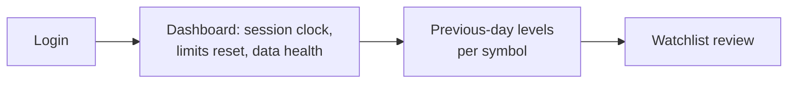
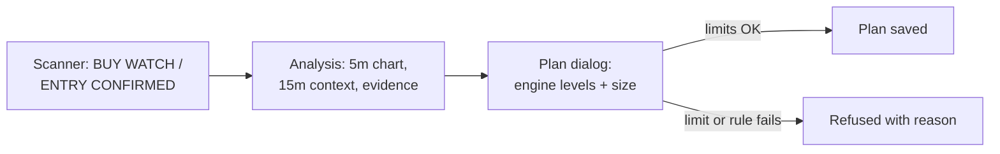

# User Journeys

| Field | Value |
|---|---|
| Document ID | PRD-04 |
| Version | 0.2.0 |
| Status | Specification ready for the personal intraday direction (ADR-014) |
| Owner | Product Manager |
| Last updated | 2026-11-17 |
| Related | [ADR-014](../adr/ADR-014-PERSONAL-INTRADAY-WORKSTATION.md) · [PRD-03 PRD](03_PRD.md) · [ARC-04 API](../architecture/04_API_SPECIFICATION.md) · [TRD-04 Setups](../trading/04_SETUP_DETECTION_RULES.md) · [TRD-05 Risk](../trading/05_RISK_MANAGEMENT_RULES.md) · [TRD-07 Paper trading](../trading/07_PAPER_TRADING_SPECIFICATION.md) |

## 1. Purpose

End-to-end journeys for the only user, **the owner**, who trades NIFTY 50 stocks intraday and executes manually on the broker platform. The journeys follow one trading day. Each lists steps, screens, APIs and what is built today (the current frontend shows daily mock data only). Times are IST on a normal session (09:15–15:30); special sessions use the calendar's times.

Registration, onboarding and the daily after-hours workflow of version 0.1.0 are retired with ADR-014.

## 2. One-time setup

| Step | Screen | API | Today |
|---|---|---|---|
| Owner account and tenant created by a setup command on the server | — | — | Not built |
| Log in | `/login` | A1, A3 | Accepts any valid-format credentials |
| Set capital, risk per trade, max position value, daily loss limit, losing-streak limit, open positions, open risk | `/settings` → Risk and limits | P3, P4 | Daily risk fields, session-only |
| Connect the broker data account through the provider's login (Kite or Groww, T-201/T-203) | `/settings` → Market data and broker | I1–I3 | Placeholder toast |
| Choose DEMO while not connected | `/settings` → Market data | P5, P6 | "Sample data — In use" |
| Review the default watchlist (NIFTY 50) | `/watchlists` | W1, W5 | Mock lists |

## 3. Before the open (09:00–09:15)

| Step | Screen | API | Today |
|---|---|---|---|
| See market status (pre-open), today's limits (fresh), broker connection and data health (last reconciliation) | `/dashboard` | M7, `GET /risk/today`, I3 | Clock-based status; mock widgets |
| See PDH/PDL/PDC and yesterday's structure for the watchlist | `/watchlists`, `/analysis/{symbol}` | N5 | Daily mock chart |

No setups exist yet: analysis starts with the first completed 5m bar.

## 4. Opening range (09:15–09:30)

| Step | Screen | API | Today |
|---|---|---|---|
| First 5m bars arrive at 09:20, 09:25, 09:30 (+ settle delay) | Scanner, dashboard (polling) | N1, N3 | Not built |
| Scanner shows structure and previous-day-level setups; opening range breakouts are marked "opening range forming" until 09:30 | `/market-scanner` | N1 | Not built |
| At the 09:30 close the opening range is known; ORB setups appear as `AWAITING_CONFIRMATION` (or `NO_TRADE` with `OR_TOO_NARROW`/`OR_TOO_WIDE`) | `/market-scanner`, `/analysis/{symbol}` | N1, N5 | Not built |

## 5. Finding and checking a setup (any time before the entry cutoff)

| Step | Screen | API | Today |
|---|---|---|---|
| Filter the scanner by signal BUY WATCH or ENTRY CONFIRMED; sort by score | `/market-scanner` | N1 | Daily mock filters |
| Open a symbol: 5m chart with annotations shown from their confirmation bar, 15m context, evidence, levels, R:R before and after costs, `valid_until` | `/analysis/{symbol}` | N5 | Daily mock chart and panel |
| Open the plan dialog: engine entry/stop/target pre-filled; size, risk, position value and costs computed by the engine (e.g. 33 shares, ₹424.05 risk, binding: position cap — TRD-05 §3.1) | Plan dialog | R1, T2 | Client-side calculation (must call the API) |
| Save: account limits and rules are checked; a refused plan shows the specific reason (`DAILY_LOSS_LIMIT_REACHED`, `RR_BELOW_MINIMUM`, …) | Plan dialog | T2 | Mock save |

## 6. Executing and monitoring a trade

| Step | Screen | API | Today |
|---|---|---|---|
| When the setup confirms (5m close), the plan becomes `TRIGGERED`; a notification shows the one-bar entry window | Notifications, `/trade-plans` | Z1, T1 | Mock |
| The owner places the order on the broker platform (outside the app) and records the fill with its time | `/portfolio` → Actual → Add fill | X8 | Placeholder |
| Paper tracking fills the paper twin at the next 5m open (or skips it with a reason) | `/portfolio` → Paper | X3 | Not built |
| Active trades show the current price (labelled with its time), unrealised P&L, distance to stop and target, time to session-end exit, HOLD/EXIT | `/portfolio` | X10, `GET /positions/live` | Daily holdings mock |
| Exit: record the sell fill; the paper twin exits by its own rules | `/portfolio` | X9 | Placeholder |

## 7. Limits during the day

| Event | What the owner sees | API | Today |
|---|---|---|---|
| A loss brings the book's realised net loss to the daily limit | Banner "Daily loss limit reached — new plans blocked for this book until tomorrow"; pending plans show `ACCOUNT_LIMIT` | `GET /risk/today`, T1 | Not built |
| Third consecutive losing trade (default limit 3) | Same, with the streak reason | `GET /risk/today` | Not built |
| Two positions already open (default limit) | Plan dialog disabled with `MAX_POSITIONS_REACHED` | T2 | Not built |

## 8. Entry cutoff and session end (14:45–15:30)

| Time (normal session) | What happens | Today |
|---|---|---|
| 14:45 (entry cutoff, 45 min before the close) | No new plans; open setups expire (`SESSION_CUTOFF`); warning if actual positions are open | Not built |
| 15:15 (session-end exit, 15 min before the close) | Paper positions exit at the 15:15 bar's open (`SESSION_END`); warning on every screen for open actual positions | Not built |
| 15:30 close | Session-end reconciliation of bars; journal drafts for every closed trade; an actual position still open is flagged `CARRIED_OVER` | Not built |

## 9. Journaling (after the close)

| Step | Screen | API | Today |
|---|---|---|---|
| Open today's drafts: planned vs actual entry/exit (price and time), slippage, costs, net P&L, R, exit reason | `/journal` | J1, J2 | Daily mock entries |
| Add notes, mistakes, tags, rating; mark complete; attach a screenshot (I7) | `/journal` | J3 | Notes only |
| Review session stats per book (net P&L, win rate, average R, plan adherence) | `/journal` | J4 | Client-computed |

## 10. Backtesting and review (weekly)

| Step | Screen | API | Today |
|---|---|---|---|
| Configure setups, NIFTY 50 or watchlist, session range, capital, limits, slippage, cost schedule | `/backtesting` | B1, B2 | Daily strategy list |
| Follow progress; read metrics (session P&L distribution, exit mix, skips by reason), flags and versions | `/backtesting` | B3, B4, B5 | Placeholder curve labelled as such |
| Compare with the forward paper log before trusting a setup with real money (BRD G1) | `/journal` (Paper), `/backtesting` | J4, B4 | Not built |

## 11. Settings

| Section | Contents | Today |
|---|---|---|
| Profile | Display name, timezone, password | Partially (session-only) |
| Risk and limits | Capital, risk %, max position value, daily loss limit, losing-streak limit, open positions, open risk (FR-069) | Daily fields, session-only |
| Session | Opening range, entry cutoff, session-end exit, ruleset version (read-only, FR-114) | Not built |
| Market data and broker | DEMO/PERSONAL, connection status, token expiry, data health | Placeholders |
| Notifications, Appearance | In-app types; theme | Built (session-only / localStorage) |
