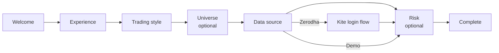
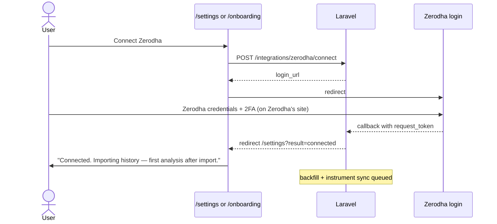
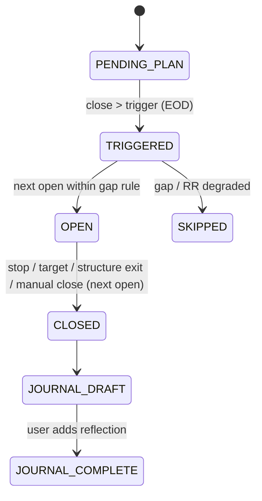

# User Journeys

| Field | Value |
|---|---|
| Document ID | PRD-04 |
| Version | 0.1.0 |
| Status | Specification ready |
| Owner | Product Manager |
| Last updated | 2026-11-15 |
| Related | [PRD-03 PRD](03_PRD.md) · [PRD-05 Onboarding](05_ONBOARDING_SPECIFICATION.md) · [ARC-04 API](../architecture/04_API_SPECIFICATION.md) · [TRD-07 Paper trading](../trading/07_PAPER_TRADING_SPECIFICATION.md) |

## 1. Purpose

End-to-end journeys for the primary persona ("Ravi", a working professional who swing-trades NIFTY 500 stocks after market hours). Each journey lists steps, the screens used, the APIs involved and what is built today versus specified.

## 2. Registration

```mermaid
flowchart LR
  A[/register/] -->|submit| B{Valid?}
  B -- no --> A
  B -- yes --> C[Tenant + user created<br/>verification email sent]
  C --> D[/onboarding/ welcome]
  D -.->|email link| E[Email verified]
```

| Step | Screen | API | Today |
|---|---|---|---|
| Enter name, email, password, accept terms | `/register` | `GET /sanctum/csrf-cookie`, `POST /auth/register` | Form + validation built; submits to nothing, routes to `/onboarding` after 700 ms |
| Verify email (can continue onboarding in parallel; tenant data blocked until verified) | Email → `/api/v1/auth/email/verify/...` | A8 | Not built |

Failure paths: email taken (field error), weak password, rate limit.

## 3. Login

| Step | Screen | API | Today |
|---|---|---|---|
| Enter credentials | `/login` | A1, A3 | Accepts any valid-format credentials |
| Routing | — | A9 `GET /me` | Always `/dashboard`; spec: `/onboarding` if onboarding incomplete, else `/dashboard` (or original deep link) |
| Forgot password | `/forgot-password` → email → `/reset-password` | A5, A6 | Request form only |

## 4. First-time onboarding

See [PRD-05](05_ONBOARDING_SPECIFICATION.md) for full state machine.



## 5. Demo mode

1. User picks Demo in onboarding (default) → `data_source_selections` = DEMO source.
2. Dashboard, scanner, analysis, backtests use demo instruments and generated candles; every surface shows "Sample data".
3. Plans, paper trades and journal work normally against demo analysis (records are tagged with the demo data source through their `analysis_run_id`).
4. User can switch to Personal later from `/settings → Market data`; demo records remain, clearly linked to demo runs.

Today: the whole frontend runs in this mode by default with mock data.

## 6. Zerodha connection



Post-conditions: PERSONAL data source exists; selection prompt "Use Zerodha data now?" (switch happens only after first successful ingestion — `DATA_SOURCE_NOT_READY` otherwise). Daily: if token expired at EOD time, user receives "Reconnect Zerodha" notification.

Today: buttons exist and show "coming soon"/"unavailable" toasts; no credentials are collected (correct).

## 7. Universe selection

1. Onboarding optional step or `/settings → Trading preferences`.
2. Options: NIFTY 500 (default, product universe), NIFTY 50, NIFTY 100, NIFTY 200, NIFTY MIDCAP 150 — all subsets of NIFTY 500.
3. Effect: scanner and dashboard default filter; EOD analysis always covers NIFTY 500 + watchlist symbols regardless (so switching is instant).

Discrepancy: current UI offers NIFTY 50/100/200/MIDCAP 150 and an "All NSE equities" option but **no NIFTY 500**; "All NSE" is out of scope. See [ENG-02 §9](../engineering/02_FRONTEND_ARCHITECTURE.md#9-discrepancy-register).

## 8. First stock analysis

| Step | Detail |
|---|---|
| Open | Global search (⌘K) or scanner row → `/analysis/{symbol}` |
| Read | Chart with annotations; analysis panel (structure, signal, setup, levels, quality); evidence; entry conditions; invalidation |
| Explain (spec) | "Explain this chart" → AI summary with evidence refs and disclaimer |
| Act | Add to watchlist; "Create plan" for LONG setups |

## 9. Daily scanning workflow (after 18:30 IST)

```mermaid
flowchart TB
  N[Notification: scan ready / plan triggered] --> D[/dashboard/]
  D --> T{Triggered plans?}
  T -- yes --> TP[/trade-plans/ review TRIGGERED plans<br/>decide manual execution at next open]
  T -- no --> S[/market-scanner/ filter BUY WATCH, score ≥ 60]
  S --> A[/analysis/symbol/ review evidence]
  A --> P{Plan?}
  P -- yes --> C[Create plan: risk-sized]
  P -- no --> W[Add to watchlist or skip]
  TP --> E[Execute manually on Kite next morning<br/>record actual trade]
```

## 10. Trade plan creation

1. From analysis panel, "Create plan" opens the dialog with engine entry/stop/target.
2. As the user edits, the dialog calls `POST /risk/calculate` and shows quantity, position value, R:R, binding constraint and errors.
3. Save → `POST /trade-plans` (server recomputes and stores).
4. Plan appears in `/trade-plans` as PENDING (or TRIGGERED if created from an ENTRY_CONFIRMED setup inside its entry window).

Today: dialog computes quantity in the browser and shows a "saved for this session" toast — must be replaced by API calls (M7).

## 11. Paper trade lifecycle



User touchpoints: notifications at TRIGGERED, OPEN/SKIPPED, CLOSED; `/portfolio` (Paper) for open positions; `/journal` for drafts.

## 12. Trade journaling

1. Notification "Paper trade RELIANCE closed at target (+2.3R) — add a note".
2. `/journal` → entry drawer shows facts (planned vs actual, exit reason, followed-plan flag computed).
3. User writes notes, tags (e.g. `late-entry`), emotions, mistakes, rating → marks complete.
4. Stats bar updates (server-side).

Today: journal list, filters, detail drawer and notes editing exist with mock entries; save is session-only; no paper/actual distinction.

## 13. Backtesting

1. `/backtesting` → choose setup types, instruments (single / NIFTY 500 / watchlist), dates, capital, risk %.
2. Submit → `POST /backtests` → 202; run appears in history with progress.
3. On completion → notification; results show metrics, equity curve, trades (incl. skipped with reasons), version stamps and bias warnings (e.g. "Universe history incomplete — survivorship bias possible").

Today: form + validation exist; submission ends in "Backtest engine not connected"; the curve shown is a labelled placeholder.

## 14. Account settings

| Section | Actions | Today |
|---|---|---|
| Profile | Name, timezone; change password; delete account | Name/email inputs (session-only); no password/delete |
| Trading preferences | Styles, timeframe (Daily only), universe, direction (long only / long + reference) | Present (session-only) |
| Risk management | Capital, risk %, max positions, max heat, max position % (new), min R:R override (new) | Present without max position % / min R:R |
| Market data | Select Demo / Personal; ingestion status | Present as placeholders |
| Broker connection | Connect/disconnect Zerodha; status | Placeholder ("Upstox — Planned") |
| Notifications | Toggles | Present (session-only) |
| Appearance | Dark/light | Implemented (localStorage) |
