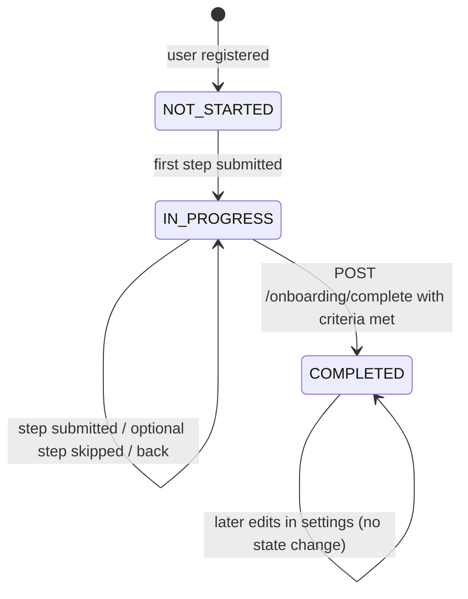

# Onboarding Specification

| Field | Value |
|---|---|
| Document ID | PRD-05 |
| Version | 0.1.1 |
| Status | **Deferred** by ADR-014 (personal intraday direction); kept for a possible future multi-user phase |
| Owner | Product Manager |
| Last updated | 2026-11-17 |
| Related | [PRD-03 FR-010–016](03_PRD.md) · [ARC-04 §5](../architecture/04_API_SPECIFICATION.md#5-onboarding-preferences-data-source-entitlements) · [ARC-03 §4.5](../architecture/03_DATABASE_DESIGN.md) · Frontend: `frontend/src/features/onboarding/` |

> **Deferred (ADR-014).** The MVP has one owner whose account is created by a setup command. Capital, risk limits, data source and watchlist are set in `/settings` ([PRD-03 §2.2](03_PRD.md#22-onboarding-fr-010--fr-016)). The rest of this document describes the earlier multi-user design and is not built for the MVP; its risk defaults (NIFTY 500 universe, 1% risk) are superseded by TRD-01 §6 (`pa-intraday`).

## 1. Purpose

Defines progressive onboarding: steps, data captured, where it is stored, state transitions, optional steps, completion criteria and recovery. The current frontend implements the 7-step UI (`onboarding-flow.tsx`, `options.ts`) with local React state only.

## 2. Principles

1. **Value before commitment:** users reach a working dashboard on demo data without connecting a broker.
2. **Separation of concerns:** each answer is stored in its owning domain, not in an "onboarding blob".
3. **Resumable:** progress is saved per step; leaving and returning resumes.
4. **Everything editable later** in `/settings`.
5. **Broker connection is never required** to complete onboarding.

## 3. Domain separation

| Concern | Captured in step | Stored in | Editable at |
|---|---|---|---|
| User profile (experience level) | Experience | `user_profiles` | `/settings#profile` |
| Trading preferences (styles, universe) | Style, Universe | `trading_preferences` | `/settings#trading` |
| Data-source configuration (selected mode) | Data source | `data_source_selections` | `/settings#data` |
| Broker connection (Zerodha token) | Data source → Connect (optional) | `provider_connections` (+ `data_sources` PERSONAL) | `/settings#broker` |
| Risk configuration | Risk | `risk_profiles` (version 1) | `/settings#risk` |
| Progress only | all | `onboarding_progress` | — |

## 4. Steps

| # | Step id | Required | Inputs | Defaults if skipped | Validation |
|---|---|---|---|---|---|
| 1 | `WELCOME` | Yes (acknowledge) | — | — | — |
| 2 | `EXPERIENCE` | Yes | `NEW` / `INTERMEDIATE` / `ADVANCED` | — | One value |
| 3 | `STYLE` | Yes | ≥ 1 of `SWING`, `POSITIONAL`, `BREAKOUT`, `PULLBACK` | — | 1–4 values |
| 4 | `UNIVERSE` | Optional | `NIFTY500` (default), `NIFTY50`, `NIFTY100`, `NIFTY200`, `NIFTYMIDCAP150` | `NIFTY500` | Known code |
| 5 | `DATA_SOURCE` | Yes | `DEMO` (default) or `PERSONAL/ZERODHA_KITE` | — | If PERSONAL chosen and not connected, selection stays DEMO with `pending_personal = true` |
| 6 | `RISK` | Optional | capital (₹), risk per trade %, max open positions | TRD-01 §6 defaults with capital ₹5,00,000 (current UI default) | capital ≥ 10,000; risk 0.1–2.0%; positions 1–20 |
| 7 | `DONE` | — | — | — | Completion criteria (§6) |

Current UI defaults (`INITIAL` in `onboarding-flow.tsx`): universe `nifty100`, data `demo`, capital `500000`, risk `1`, max positions `5`. Canonical universe default changes to `NIFTY500` (discrepancy D-03 in [ENG-02 §9](../engineering/02_FRONTEND_ARCHITECTURE.md#9-discrepancy-register)).

## 5. State machine

Step-level transitions:

| From | Event | To | Side effect |
|---|---|---|---|
| step k | `PUT /onboarding/steps/{k}` valid | step k+1 | persist to owning table; add k to `completed_steps`; `current_step = k+1` |
| optional step k | `POST /onboarding/steps/{k}/skip` | step k+1 | add to `skipped_steps`; apply defaults |
| step k | Back (client only) | step k−1 | none (answers remain saved) |
| `DATA_SOURCE` | Choose Zerodha → Connect | external Kite flow → return to `RISK` | `provider_connections` PENDING → CONNECTED; selection remains DEMO until first ingestion completes, then user is asked to switch |
| `DATA_SOURCE` | Choose Zerodha → "Later" | `RISK` | selection DEMO, `pending_personal = true` reminder card on dashboard |

Changing an answer on a completed step overwrites the owning record (risk profile creates a new version).

## 6. Completion criteria

`COMPLETED` requires: `EXPERIENCE`, `STYLE`, `DATA_SOURCE` in `completed_steps`; `UNIVERSE` and `RISK` either completed or skipped; a data source selection exists; a current risk profile exists (default-created when skipped). Then the user is routed to `/dashboard`.

Completion does **not** require email verification to *finish* the flow, but tenant data APIs return `EMAIL_NOT_VERIFIED` until verified; the dashboard then shows a verification banner (decision: allow flow completion to keep momentum).

## 7. Routing rules

| User state | On login / visiting app routes |
|---|---|
| `NOT_STARTED` / `IN_PROGRESS` | Redirect to `/onboarding` (resume at `current_step`) |
| `COMPLETED` | Normal routing; `/onboarding` redirects to `/dashboard` |
| Onboarding `flow_version` increased with new required step | Prompt (not block) to complete new step |

## 8. Recovery behaviour

| Situation | Behaviour |
|---|---|
| Browser closed mid-flow | Resume at `current_step` with saved answers prefilled |
| Kite login cancelled/failed | Return to `/onboarding?step=data_source&result=error&code=…`; message; options Retry or Continue with demo |
| Kite callback after session expired | Callback requires session; user logs in and is shown connection result from `provider_connections` status |
| API error on step submit | Inline error, answers kept, retry |
| User skips everything optional and picks demo | Valid; completes with defaults |

## 9. Analytics events (privacy-preserving, first-party)

`onboarding_step_viewed`, `onboarding_step_completed`, `onboarding_step_skipped`, `onboarding_completed`, `broker_connect_started/succeeded/failed` — counts only, no PII. Implementation optional in MVP (OQ-ONB-01).

## 10. Open questions

| ID | Question |
|---|---|
| OQ-ONB-01 | Is product analytics wanted in the personal phase? |
| OQ-ONB-02 | Should experience level change defaults (e.g. lower risk % for `NEW`)? Proposed: suggest 0.5% for `NEW`, user can change. |
