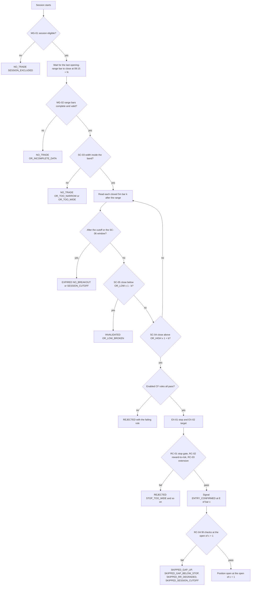

# 09 — Opening Range Breakout

| Field | Value |
|---|---|
| Strategy id | `opening_range_breakout` (not yet in the single-strategy registry, `app/domain/strategies.py`) |
| Roadmap position | 09 of 12 ([roadmap](../development/strategy-development-roadmap.md)) |
| Acceptance status | `SPECIFICATION_APPROVED` (Phase 2 approved by the owner, 2026-11-23). No later stage has evidence. The code in `opening_range.py` exists and is unchanged; its old specification ([TRD-04 §3](../trading/04_SETUP_DETECTION_RULES.md)) was never approved under the [development process](../development/strategy-development-process.md) |
| Executable directions | Long. Short is informational ([ADR-014](../adr/ADR-014-PERSONAL-INTRADAY-WORKSTATION.md), D-4 deferred) |
| Ruleset version | None assigned. Nothing here changes `pa-intraday 0.1.0` (live) or `0.5.0` (research). A research ruleset for Phase 3 would be a separate, later decision (OD-8, open) |
| Specification approved | **Approved by the owner, 2026-11-23** (Phase 2, with OD-1, OD-2, OD-3, OD-7, OD-11, OD-13 as recommended). **B0 and the methodology are frozen** (see the freeze notice below). Decisions OD-8, OD-14, OD-15 and OD-16 stay open for Phase 3 approval; OD-4, OD-5, OD-6, OD-10 and OD-17 stay open until Stage B; OD-9 and OD-12 default |
| Last updated | 2026-11-23, Phase 2 approved and B0 frozen (version 1.0.0) |
| Validation plan | [ORB validation plan](../research/orb-validation-plan.md) (Phase 3 draft, **not approved**, not registered) |

**Freeze notice (2026-11-23).** The following are frozen at version 1.0.0 and change only through the decision-change protocol of CLAUDE.md §8 (a recorded owner decision and a new version of this page): the **B0 definition** of [§10.3](#103-reference-configurations) (15-minute wick-basis range, width `0.30-2.00%`, first close above `OR_HIGH × (1 + 0.05%)` inside the 60-minute window, whipsaw invalidation, stop `OR_LOW × (1 − sb)`, fixed 2.0R target, mandatory exits only, **no context filter at any instant**); the **mandatory gates** `MG-01` to `MG-07` including strict range validation; the **three evaluation timestamps** of [§10.4](#104-evaluation-timestamps); `FIRST_ONLY` breakout semantics; the **rule IDs, classes and rejection codes**; and the **target formulas** T1 to T4 of [§12.4](#124-target-experiments-formulas). Everything else in the page that is marked a candidate, experiment or alternative stays a registered **experiment**, not a rule of B0, and is pre-registered only at Phase 3 approval. Freezing the specification authorises no code, ruleset, run or backtest.

**Scope of this page.** Phase 2 is specification only ([DEC-025](../../DECISIONS.md)): no code, ruleset, PAQS or other strategy was changed, and no backtest was run to write it. It was written from the code, the specifications and the results already recorded in the repository. Sections 1-16 are the **specification** (what ORB should do), section 17 records what the **code does today**, and §17.2 sets the two side by side. Where the owner has not decided, alternatives and trade-offs are given instead of a choice (§26). **Revision 2** applies the owner's review: strict range validation (§7.1.2), three separate evaluation timestamps (§10.4), separated target experiments with formulas (§12.4), the January-November 2026 ORB results classified as development data (§25), and a decision register and readiness assessment in [one page](../development/orb-phase2-decisions-and-readiness.md). Methodology decisions and engineering prerequisites are kept apart there.

**Reading guide.** §10 holds the rule inventory (IDs `ORB-MG/SC/CF/RC/EX-nn`), the classification and the reference configurations. §9.1 and §13.3 hold the decision flows. §14 is the parameter inventory. §13.2 is the rejection table. §26 lists the open owner decisions.

## 1. Strategy overview

After the opening auction, the first minutes of an NSE session set a range of prices that buyers and sellers have just agreed to trade. ORB buys when a closed 5-minute bar settles above the top of that range, on the view that acceptance above the range starts a move that is large relative to the range itself. The range's other side is the invalidation: the stop sits where the range would be lost.

ORB is one strategy among twelve and is specified, built, tested and validated alone ([ADR-018](../adr/ADR-018-INDEPENDENT-STRATEGY-LIBRARY.md)). It uses no indicator ([MP-01](../trading/01_TRADING_METHODOLOGY.md)).

## 2. Strategy objective

A successful trade is a long entered after one confirmed close above the opening range, held while the range stays defended, and exited at a target that pays at least the account's minimum reward-to-risk (`risk.min_rr`, 2.0) or at the session-end exit, with costs and slippage included. The objective is **not** a high hit rate: with a stop at the far side of the range and a 2R target, about one trade in three must win to break even before costs, and the strategy must beat random entries (§3).

## 3. Trading hypothesis

**H-ORB (long).** On NIFTY 50 stocks, entering at the open after the first 5-minute close above the 15-minute opening range, with the stop at the range low and a fixed-R target, produces a gross expectancy per trade that is higher than that of random entries in the same time window with the same stop distance, by at least 0.05R with a 99% interval above zero, and a net expectancy above 0.10R after the cost schedule in use ([criteria §3](../research/validation-criteria.md)).

**The hypothesis fails** if, on the time-matched control ([plan §4](../research/orb-validation-plan.md)), the gross edge is not above zero; or the net expectancy is not positive on the out-of-sample segment; or the result depends on one period, one regime or one instrument ([criteria §1, §3](../research/validation-criteria.md)).

**Prior evidence is against it, and it is stated before any Phase 3 run.**

| Evidence | What it shows | Limits |
|---|---|---|
| [Fast screen M1](../research/fast-screening-report.md) (2024, 10 stocks, 1,021 trades with no stop filter) | The minimal ORB (first close above `OR_HIGH × 1.0005`, stop `OR_LOW`, target 2.5R) lost to matched random entries: gross edge −0.150R, 99% interval −0.201 to −0.100; net −0.137R. Worse than random in all three stop filters | One year, 10 stocks; the control draws a random bar **anywhere** between 09:30 and the cutoff, so it is not matched on time of day. ORB trades cluster in the opening hour, where volatility and friction differ. Whether that mismatch drives part of the result is unknown and is the first thing Phase 3 must test ([plan §4.2](../research/orb-validation-plan.md#42-the-matched-random-entry-control-mtc)) |
| [Framework diagnosis](../research/framework-diagnosis-report.md) | Friction (0.05% slippage per execution and the assumed charges) costs about 0.3R on 0.3-1.0% stops; entries of the two parked strategies were no better than random | Strategies 01 and 02, not ORB. ORB stops are wider (they include the range width), so its friction in R should be lower; this is the one structural advantage ORB has |
| Combined runs ([PRE-001/003](../research/experiment-registry.md)) | ORB trades inside combined, non-isolated runs: 13 trades +0.10R (2026-09..11); 75 trades -0.12R net (2026-01..08, `0.1.0`); 49 trades -0.02R net / +0.08R gross (variant D) | Not isolated (15m filter, structure exit, score gate, slot limits, ranking), small samples, **and these sessions are now exposed** (§25) |
| Daily screen B2 ([report](../research/daily-screening-report.md)) | Buying a long-range breakout on daily bars was worse than random by 0.25R to 0.39R | Daily bars; shows a pattern across the breakout family, not ORB |

The honest prior is that ORB, as implemented, has no entry edge. Phase 3 is designed so that it can end quickly with `VALIDATION_FAILED` if the first, cheap tests agree ([plan §4.4](../research/orb-validation-plan.md#44-stage-a-stopping-and-continuation-criteria-fixed-now-before-any-result)).

## 4. Market conditions

### 4.1 Where ORB is meant to apply

Normal full-length sessions in which the first 15 minutes produce a well-formed range: complete data, a width that is neither noise nor an event-driven spike (§7.1, `ORB-SC-03`), and enough remaining session for a move (entry window ends well before the cutoff). The setup window is **09:30 to 10:30** in today's code (§17), a consequence of the shared 12-bar expiry rather than a tested choice, so the window is a parameter (`ORB-SC-06`).

### 4.2 Broader market direction

Three kinds of context are candidates. None is part of the baseline; each is a confirmation rule that must earn its place ([plan §6](../research/orb-validation-plan.md)).

| Context | Rule | Status |
|---|---|---|
| 15m structure of the stock | `ORB-CF-01`: 15m state `BULLISH`, `SIDEWAYS` or `TRANSITION(UP)` at the breakout. This is today's SD-05 filter | In the code today; the specification must name it as ORB's own rule or it is excluded from isolated runs (D-5) |
| 5m structure of the stock | `ORB-CF-05`: 5m state is not `BEARISH` at the breakout | Candidate |
| The index (NIFTY 50) | `ORB-CF-08`: index 15m structure not against, at the breakout | **Untestable until an index series exists in the stored data**; not verified in Phase 2 (OD-6). Cross-instrument context is a new kind of dependency, so it needs the owner's approval |

Direction of the broad market affects eligibility only through those rules. No rule in the specification may be added from a trading anecdote ("trade ORB only on trend days"); a context is a rule only when it is defined on named bars and is on this list.

### 4.3 Which timeframes matter

| Timeframe | Role in ORB |
|---|---|
| 5m | Primary: the range, the breakout bar, the stop, the target, the exit |
| 15m | Context only, through `ORB-CF-01` (candidate); the 15m structure is computed from closed 15m bars whose end is at or before the 5m bar's end (MP-10) |
| Daily | Context only, from the previous full session's 1D bar (D-7, L-5): previous close for the gap (`ORB-CF-04`), previous-day range for range expansion (`ORB-CF-06`), previous-day high for headroom (`ORB-CF-07`). None is in the baseline |

### 4.4 When ORB must be avoided (stand-aside conditions)

These are rejections, not preferences (§13.2): session not eligible or range data incomplete (`ORB-MG-01/02`); range too narrow (stop inside noise, friction dominates) or too wide (stop beyond the account's limit, or the move is already spent); the range's low is closed below before the breakout (`ORB-SC-05`, a two-sided whipsaw day); no confirmed breakout inside the window; stop or reward-to-risk fails the risk rules; the entry would be extended or gap beyond the limits. The following are **not** stand-aside rules in the baseline and are tested as confirmations: gap-open days, 15m or 5m structure against, a range that is large or small relative to the previous day's range.

### 4.5 Does volatility affect the range requirement?

Yes, through the width band, which is a volatility proxy built from price only. Two ways to express it:

| Option | Definition | Trade-off |
|---|---|---|
| Absolute band (today) | `0.30% ≤ width ≤ 2.00%` of `OR_LOW` | One number for every stock and every regime; a 0.3% range is wide for a quiet stock and tight for a volatile one. Simple to explain and test |
| Relative band | Width as a multiple of the previous day's range (`ORB-CF-06`) | Adapts to the stock. Uses one ratio of two OHLC ranges, not an average, so no ATR. The owner must confirm it is admissible under MP-01 (OD-5); depends on a reliable previous-day range (L-5) |

An ATR-style average is excluded by MP-01. The absolute band stays the baseline; the relative band is a registered candidate.

**A derived constraint the width band hides.** The stop gate (`ORB-RC-01`, 2.0% of entry) and the stop at the range low (`ORB-EX-01`) interact: with a stop at `OR_LOW` and an entry just above `OR_HIGH`, the stop distance is about `width + extension`. Solving `stop distance ≤ 2.0%` gives a **usable maximum width of about 1.94% at the lowest possible entry**, and less when the breakout close is extended (about 1.55% at an extension of 0.25 range widths above the high, about 1.3% at 0.5). The nominal 2.0% upper width limit is therefore never reachable (this is arithmetic on the rules, not a backtest result).

## 5. Instruments

NIFTY 50 cash equities, today's membership applied to all history (`survivorship_bias_risk`, L-1). Excluded: instrument-sessions inside a known unadjusted corporate-action window (L-6; matters for any gap rule), instrument-sessions with data-quality issues (L-11), and the special sessions in `app/backtest/exclusions.py` (L-4). Liquidity is not a filter here: every NIFTY 50 stock is liquid.

## 6. Timeframes

Setup and trigger: 5m closed bars. Context: 15m closed bars (candidate rule only), daily bars (candidate rules only). No 1m data exists (L-10), so the order of the high and low inside a 5m bar is unknown and a bar touching both the stop and the target counts as the stop (BT-04).

## 7. Bullish setup

Notation: `N` is the opening-range length in minutes (default 15), `K = N / 5` the number of 5m bars in it, bar index `k = 0` is the bar starting at the session open (09:15 on a normal session), `E(k)` is the end time of bar `k`, `b = setup.breakout_buffer_pct / 100`, `sb = risk.stop_buffer_pct / 100`.

### 7.1 Opening range formation (question B)

| Item | Proposal | Alternatives and trade-offs |
|---|---|---|
| Period | `N = 15` minutes, so bars `k = 0..2` (09:15-09:30). The range exists only from `E(K−1)`, the close of its last bar | `N = 5` is one bar, so the first 5m bar's auction spike defines the range; `N = 30` and `60` delay the signal and push the window toward the cutoff; at 60 the range is no longer an "opening" statistic. The key `session.opening_range_minutes` (5-60) already exists. Must be a multiple of 5 (5m bars) |
| High and low | `OR_HIGH = max H[k]`, `OR_LOW = min L[k]` over `k < K` (wick basis) | Body basis (`max/min` of `O, C`) removes opening-auction wicks, so the range is narrower and the breakout level lower. The wick basis is today's and is the baseline (`ORB-SC-02`) |
| Validity | All `K` bars present, contiguous, closed, valid (`ORB-MG-02`); session eligible (`ORB-MG-01`); width inside the band (`ORB-SC-03`) | See §7.1.1 |
| Width | `width_pct = (OR_HIGH − OR_LOW) / OR_LOW × 100` | Today's band `0.30-2.00`. The minimum is also a **friction filter**: a stop distance is at least the width, and the diagnosis found friction per trade falls as the stop widens ([diagnosis §4](../research/framework-diagnosis-report.md)). Sweeping the minimum is how Phase 3 tests that for ORB |
| Incomplete formation | Before `E(K−1)` no range exists, no breakout can be taken, and a break inside the window is part of the range. A missing or invalid bar inside the window makes the range **invalid** (`OR_INCOMPLETE_DATA`) | Silently using the bars that exist (today's behaviour, §17.1) can understate the range and trigger false breakouts |

#### 7.1.1 Gaps and unusual openings

Today ORB does nothing special for gaps. The proposal separates data integrity (fixed) from market context (tested).

| Condition | Treatment | Class |
|---|---|---|
| Stale or unadjusted previous close (corporate action, demerger; L-6) | Instrument-session excluded; any gap rule would be wrong on that day | Mandatory gate (`ORB-MG-01`) |
| Missing or invalid opening bars; partial or evening sessions | Excluded (`ORB-MG-01/02`) | Mandatory gate |
| Gap `g = (O[0] − PDC) / PDC × 100` | Bands registered in advance: `g < −0.5`, `−0.5 ≤ g ≤ +0.5`, `g > +0.5` percent; the rule `ORB-CF-04` allows a long breakout only in listed bands. The band edges are fixed now so they cannot be chosen after a result | Confirmation, tested |
| Opening auction spike inside the first bar | Not removed in the baseline; the body-basis alternative (`ORB-SC-02`) is the registered way to measure its effect | Strategy-specific, tested |
| Price-band or circuit stocks, trading halts | Not present in the stored data for NIFTY 50; any halt appears as missing bars and is excluded by `ORB-MG-02` | Mandatory gate |
| News or results days | Not identifiable: no event calendar is stored. Recorded as a limitation (§25), not a rule | — |

#### 7.1.2 Strict opening-range validation (`ORB-MG-02`)

The range is valid only if **every** check below passes, evaluated on the stored bars at `t_OR = E(K−1)`. The checks are pure functions of the bars and have no tolerance.

| Check | Definition | Sub-reason on failure |
|---|---|---|
| Count | Exactly `K` bars start in `[session_open, session_open + N)` (3 for `N = 15`) | `OR_MISSING_BAR` (fewer), `OR_DUPLICATE_BAR` (more) |
| Grid | The start times are exactly `session_open + 5 min × i`, `i = 0..K−1`; no other start time in the window; no duplicate start time | `OR_MISSING_BAR`, `OR_DUPLICATE_BAR` |
| Closed | Every bar's end is at or before `t_OR`, and the series up to the last bar of the window is available | `OR_NOT_CLOSED` |
| Valid OHLC | Open, high, low and close are finite and `> 0`; `H ≥ max(O, C)`, `L ≤ min(O, C)`, `H ≥ L`; each price is a multiple of the tick when the tick is known | `OR_INVALID_OHLC` |
| Session | Normal full-length session, not in the special-session list (`ORB-MG-01`) | `SESSION_EXCLUDED` |
| Volume | Not a validity input (volume is not used by B0). A negative or missing volume does not invalidate the range; it is recorded as a data-quality item | none |

**Explicit invalid-session behaviour.** An invalid range gives `NO_TRADE` with the sub-reason, **no setup and no signal for that instrument that session**. There is no fallback to the bars that exist and no later retry inside the session in research runs (the stored data is final). In live use a late-arriving bar is re-evaluated at the next analysis; if the range then becomes valid, signals are allowed only from bars analysed after that point and are flagged `LATE_DATA`. Invalid sessions are counted per sub-reason in every run record. They are removed from the ORB candidate set and from every control's eligible sessions alike ([plan §4.2](../research/orb-validation-plan.md#42-the-matched-random-entry-control-mtc)), so the comparison stays matched.

### 7.2 Setup identification (question C)

**Breakout.** The setup is a **close** beyond the range, not a wick: `C[k] > OR_HIGH × (1 + b)` for the first bar `k ≥ K` (`ORB-SC-04`). Reasons: MP-05 (a structural break needs a closing price beyond the level; a wick without such a close is a wick breach); a wick through the high with a failed close is the liquidity-sweep family (Strategy 01), so accepting wicks would make ORB overlap it; and a close is what the owner can observe on a closed bar (MP-03).

| Question | Proposal | Alternatives and trade-offs |
|---|---|---|
| Does price need to close beyond? | Yes, one 5m close | A two-close hold delays the entry by one bar and is partly the retest strategy (11); not specified |
| Buffer | `b = 0.05%` of `OR_HIGH` (today's `setup.breakout_buffer_pct`, shared with other setups) | A price-percent buffer is the same for a 0.3% and a 2% range. Registered alternatives: `0`, `0.10%`, `0.20%`. A buffer expressed in range widths is the same idea as the displacement rule `ORB-CF-03`, so it is not duplicated |
| Does a wick breakout qualify? | No | See above |
| Does breakout strength matter? | Not in the baseline. Three definitions are registered as confirmations, one per rule: close location `ORB-CF-02`, displacement in range widths `ORB-CF-03`, and an upper cap on extension `ORB-RC-03` (a very extended close is a poor entry, not a strong one) | Strength is only a rule if a backtest shows it separates good from bad trades |
| First or best breakout | **First close only** (`FIRST_ONLY`): the first bar beyond the trigger is the breakout. If it fails a confirmation or a risk rule the setup is rejected for the session | `FIRST_PASSING` (the first bar that passes every rule) gives the confirmations a timing role but allows waiting for a "good" bar, which is a hindsight freedom and overlaps retest and continuation logic. Open decision OD-11 |
| One signal | One long signal per instrument per session (`ORB-MG-06`); no re-arming after invalidation, expiry or rejection | Re-arming after a failure is Strategy 02 territory |

### 7.3 False breakouts

A false breakout is defined by what price does after the close; the specification keeps three cases apart so none is treated as a filter for another.

| Case | When it is known | What ORB does |
|---|---|---|
| Whipsaw before the breakout: a close below `OR_LOW × (1 − b)` between `E(K−1)` and the breakout | Before the signal | `ORB-SC-05`: the setup is invalidated for the session (`OR_LOW_BROKEN`) |
| Failed breakout after the signal and fill: a 5m close back below `OR_HIGH` | After entry | Optional exit `ORB-EX-05`. Not a filter, because it cannot be seen before the entry |
| Wick-only excursion above the range that closes inside it | Never a signal | Not ORB. It is the sweep and failed-breakout family (Strategies 01, 02) |

## 8. Bearish setup

`Informational only`. The mirror is a close below `OR_LOW × (1 − b)`. The code builds it and keeps it non-executable behind four gates ([audit §D.1](../research/adaptive-strategy-validation/RESEARCH_READINESS.md)). The specification does not define short entries, exits or sizing; it would need D-4 and D-9 and a superseding ADR for any actionability change. Short results are reported `UNSUPPORTED_DIRECTION` (L-9).

## 9. Entry rules (question E)

| Item | Proposal |
|---|---|
| Signal time | The close of the breakout bar `c`: `signal_at = E(c)` |
| Entry reference | `C[c]` (SD-07). Used for the stop distance, the reward-to-risk and the sizing |
| Fill | The open of bar `c + 1` (BT-02), with adverse slippage `backtest.slippage_pct` on entries in the `adverse-all` model. A stop-order fill inside bar `c + 1` is **not** modelled: the order of ticks inside a bar is unknown (L-10, OQ-SD-02), so buying through the high intrabar cannot be simulated honestly |
| Latest signal | `E(c) ≤ min(entry cutoff, 09:15 + N + T_w)`; the fill bar must start before the entry cutoff (SD-08) |
| Maximum acceptable gap | Today: the fill is skipped if `O[c+1] > C[c] × (1 + 0.30%)`, if `O[c+1] ≤ stop`, or if the reward-to-risk at the fill is below `min_rr` (`ORB-RC-04`, TRD-05 §7.1). **Trade-off:** 0.3% is a third of a 0.9% stop, so an entry may degrade by about 0.33R before the rule rejects it; expressing the limit as a fraction of the risk (for example 0.15R) is the alternative (OD-10) |
| Retest entry | **A separate strategy** (Strategy 11, `BREAKOUT_RETEST`, which already accepts `OR_HIGH` as an anchor). It is not an ORB variation: its trigger, stop and lifecycle differ. In isolated runs ORB never uses a retest, so the two strategies never share a trade (the overlap of anchors is recorded for the Strategy 11 specification) |

### 9.1 Entry decision flow



## 10. Confirmation rules (question D) and rule inventory

### 10.1 Classification

Every rule has one class. **Fixed** means it is part of the definition of ORB and is validated by tests (look-ahead, boundary, replay), not by a backtest. **Configurable** means its value, or whether it is on, is a registered Phase 3 experiment. Nothing here sets a minimum confirmation score: there is no score. Each confirmation is a separate yes/no rule and its contribution is measured ([plan §6](../research/orb-validation-plan.md)).

| Class | Meaning | Rules | Fixed or configurable |
|---|---|---|---|
| 1. Mandatory gate | Data, calendar and lifecycle integrity; without it the setup is undefined | `MG-01` to `MG-07` | **Fixed** (`MG-01` data exclusions are run-level inputs) |
| 2. Strategy-specific condition | Defines what ORB is: the range and the breakout | `SC-01` to `SC-07` | `SC-04` and `SC-05` fixed in kind (close-based, whipsaw invalidation) with a configurable buffer; `SC-01`, `02`, `03`, `06` configurable; `SC-07` is a candidate |
| 3. Confirmation condition | Optional filter that must prove its contribution | `CF-01` to `CF-09` | **Configurable** (all off in the baseline B0); `CF-09` research-only |
| 4. Risk constraint | Protects the account; mostly shared TRD-05 rules | `RC-01` to `RC-05` | `RC-01`, `02`, `04`, `05` fixed (shared, TRD-05); `RC-03` configurable |
| 5. Exit condition | How a position ends | `EX-01` to `EX-10` | `EX-01`, `03`, `04` mandatory (`EX-01` method configurable); `EX-02` mandatory to declare, method configurable; `EX-05` to `EX-10` optional variations |

### 10.2 Rule inventory

Columns: calculation and input; pass / fail; parameters; rationale; evidence required. "Code" says what `opening_range.py` and its callers do today (`=` same, `≠` different, `—` absent).

#### Mandatory gates

| ID | Rule | Calculation and input | Pass / fail | Parameters | Rationale | Evidence required | Code |
|---|---|---|---|---|---|---|---|
| `ORB-MG-01` | Eligible session and instrument-session | Session from `market_calendar` is a normal full-length session; not in the special-session list; no unresolved data-quality issue; not inside a known unadjusted corporate-action window | Pass: all true. Fail: `SESSION_EXCLUDED` | none | The range and the session-end exit assume a normal 09:15-15:30 session; bad data is not an edge (L-4, L-6, L-11) | Tests; the exclusion list in the run record (standards §5.3) | Backtest: `=` via `exclusions.py`. Live: calendar only |
| `ORB-MG-02` | Strict range data validation | Exactly `K` (3 for `N = 15`) complete 5m candles whose start times are `session_open + 5i` for `i = 0..K−1`; **no missing and no duplicated start time** among bars starting in `[open, open + N)`; every candle closed and valid per §7.1.2 | Pass: all true. Fail: the session is invalid for ORB, with the sub-reason of §7.1.2 | none | A missing or extra bar changes `OR_HIGH` and `OR_LOW` silently | Boundary tests for each failure mode; counts of invalid instrument-sessions per run and per sub-reason | `—` (§17.1 item 1) |
| `ORB-MG-03` | No look-ahead | The range is used only from `E(K−1)`; the first bar that can break out is `k = K`; the 15m and daily context use only bars ended at or before `E(c)` | Pass by construction. A truncation test must give an identical setup | none | MP-03, MP-04, MP-10 | A truncation-equality test and a bar-by-bar replay test (process §4; neither exists for ORB today) | `=` (range known only after its last bar) |
| `ORB-MG-04` | Closed bars and the entry cutoff | Signal on a closed bar; `E(c) ≤ entry cutoff`; fill bar starts before the cutoff | Fail: `SESSION_CUTOFF` (setup) or `SKIPPED_SESSION_CUTOFF` (fill) | `session.entry_cutoff_minutes_before_close` (45) | MP-11, SD-08 | Existing TV-SET-16 plus a fill-bar test | `=` |
| `ORB-MG-05` | Long-only actionability | A short mirror is computed and flagged informational | Short never becomes a plan or a trade | none | ADR-014, C-12, SD-06 | Test that a short never reaches the risk or replay layer | `=` (four gates) |
| `ORB-MG-06` | One signal per session, one position per instrument | One setup per direction per session; no re-arming after invalidation, expiry, rejection or a skipped fill | Duplicate prevention | none | Avoids counting one move twice (process §4 "duplicate signal prevention") | A duplicate-signal test over a replay | `=` for setup; the one-position rule is in the replay |
| `ORB-MG-07` | Reference data present | Tick size known; when an enabled rule uses it, the previous full session's 1D bar (previous close, high, low) | Fail: `MISSING_CONTEXT` | none | SD-09 | A missing-context test per rule that uses daily data | `≠` (ORB returns nothing silently) |

#### Strategy-specific conditions

| ID | Rule | Calculation and input | Pass / fail | Parameters | Rationale | Evidence required | Code |
|---|---|---|---|---|---|---|---|
| `ORB-SC-01` | Range length | `N` minutes, multiple of 5; bars `0..K−1` | n/a | `session.opening_range_minutes` 15; sweep `5, 30, 60` | Defines "opening"; longer ranges mix the opening with the morning | Experiment E-A1 (plan §7) | `=` (15) |
| `ORB-SC-02` | Range bounds | Wick basis: `max H`, `min L`. Alternative body basis: `max/min(O, C)` | n/a | proposed `orb.range_basis` `WICK` / `BODY` | The auction spike lives in the first bar's wicks | E-A2 | `=` (wick) |
| `ORB-SC-03` | Width band | `width_pct = (OR_HIGH − OR_LOW)/OR_LOW×100`; pass if `min ≤ width_pct ≤ max` | Fail: `OR_TOO_NARROW`, `OR_TOO_WIDE` | `setup.opening_range_min_pct` 0.30, `setup.opening_range_max_pct` 2.00; registered: min `0.5`, `1.0`; max `1.5` | Stop distance ≥ width, so the band is also a friction and risk-gate filter (§4.5) | E-A3, E-A4 | `=` |
| `ORB-SC-04` | Breakout | First `k ≥ K` with `C[k] > OR_HIGH × (1 + b)`; the bar is `c` | Pass: found by the window end. Fail: `NO_BREAKOUT` | `setup.breakout_buffer_pct` 0.05; registered `0`, `0.10` | MP-05: close beats wick | E-A5 | `=` |
| `ORB-SC-05` | Whipsaw invalidation | Any `k` with `K ≤ k < c`, `C[k] < OR_LOW × (1 − b)` | Fail: `OR_LOW_BROKEN`, setup ends for the session | none in the spec; ablated once (E-A7) | A close below the range before the breakout means the range did not hold on both sides | E-A7 (one on/off pair, not a tuned value) | `=` |
| `ORB-SC-06` | Breakout window | `E(c) ≤ min(cutoff, 09:15 + N + T_w)` | Fail: `NO_BREAKOUT` (code: `AGED_OUT`) | proposed `orb.breakout_window_minutes` 60 (= today's 12 bars); registered `30`, `to the cutoff` | Today's window is a side effect of `setup.expiry_bars`; it should be a stated choice | E-A6 | `≠` (shared key, not an ORB parameter) |
| `ORB-SC-07` | Reserved | Gap eligibility is `ORB-CF-04`; no separate strategy-specific gap rule is proposed | — | — | Keeps all gap logic in one rule so it is tested once | — | — |

#### Confirmation conditions (all off in baseline B0)

| ID | Rule | Calculation and input | Pass / fail | Parameters | Rationale (hypothesis) | Evidence required | Code |
|---|---|---|---|---|---|---|---|
| `ORB-CF-01` | 15m context not against | Aligned 15m state is `BULLISH`, `SIDEWAYS` or `TRANSITION(UP)`; missing context counts as against. **Three separate experiments, never combined:** (a) evaluated once at range completion `t_OR`; (b) evaluated once at breakout detection `t_BD`; (c) `CONTINUOUS`: at `t_OR` and every later bar (today's behaviour). See §10.4 | Fail: `HTF_AGAINST` | proposed `orb.cf01_timestamp` `T_OR`, `T_BD`, `CONTINUOUS` | A breakout against the higher-timeframe direction is more likely to fail | E-E1a, E-E1b, E-E1c; the earlier combined log found `BULLISH` worse than `TRANSITION` (D8), so the sign is not assumed | `≠` (continuous, and a range-close lockout) |
| `ORB-CF-02` | Breakout bar closes high in its range | `(C[c] − L[c]) / (H[c] − L[c]) ≥ λ`; a zero-range bar fails | Fail: `BREAKOUT_BAR_WEAK` | proposed `orb.cf02_min_close_location` 0.70, one registered value (PAQS uses 0.70 as a score point, not a gate) | A close near the high shows no seller response inside the bar | E-E2 | `—` as a gate (a PAQS point only) |
| `ORB-CF-03` | Minimum displacement | `(C[c] − OR_HIGH) / (OR_HIGH − OR_LOW) ≥ δ` | Fail: `BREAKOUT_MARGINAL` | proposed `orb.cf03_min_displacement` one registered value `0.25` | A close barely above the range is within noise; this is the buffer in range units | E-E3 | `—` |
| `ORB-CF-04` | Gap context | `g = (O[0] − PDC)/PDC×100`; allowed bands set in advance (§7.1.1) | Fail: `GAP_EXCLUDED` | proposed `orb.cf04_allowed_gap_bands`; edges `−0.5, +0.5` fixed now; registered: exclude `g < −0.5`; exclude `|g| > 0.5` | After a large gap the first 15 minutes may already hold the move (gap up) or be a reversal attempt (gap down) | E-E4, E-E5. Needs `MG-07` and a reliable `PDC` | `—` |
| `ORB-CF-05` | 5m structure not bearish | 5m structure state at `E(c)` is not `BEARISH` (TRD-02) | Fail: `STRUCTURE_5M_AGAINST` | none | Shared structure fact named explicitly (standards §2.2) | E-E6 | `—` |
| `ORB-CF-06` | Range expansion vs yesterday | `q = (OR_HIGH − OR_LOW) / (PDH − PDL)`; pass if `q_lo ≤ q ≤ q_hi` | Fail: `RANGE_EXPANSION_OUT` | proposed `orb.cf06_band` one registered value `q ≥ 0.15` | A small share of yesterday's range may mean energy is stored; a large one that the day's range is spent | E-E7. **Needs the owner's MP-01 ruling (OD-5)**; `PDH/PDL` from 1D bars (L-5) | `—` |
| `ORB-CF-07` | Headroom to PDH | Fail if `PDH > entry` and `(PDH − entry) < θ × (entry − stop)`, `θ = 1.0` | Fail: `PDH_TOO_CLOSE` | proposed `orb.cf07_min_headroom_r` 1.0 | A level just above entry caps the move | E-E8; `PDH` accuracy (L-5) | `—` (PDH is a target candidate only) |
| `ORB-CF-08` | Index context | Index 15m state not against at `E(c)` | Fail: `INDEX_AGAINST` | none | Stocks follow the index on many days | E-E9 only if an index series is stored (OD-6); else `UNTESTABLE` | `—` |
| `ORB-CF-09` | Breakout-bar volume | Volume of bar `c` ≥ `m` × median volume of the same time-of-day over the last `analysis.lookback_sessions` sessions | Fail: `VOLUME_WEAK` | proposed `orb.cf09_min_volume_ratio` `m` = 1.0 | Participation behind the break | E-E10. **Research track only** ([ADR-020](../adr/ADR-020-VOLUME-AND-CANDLE-FACTORS-IN-RESEARCH.md)); live use needs an MP-01 change. The ORB code has no volume support, and zero-volume bars exist in the stored data (L-11) | `—` |

#### Risk constraints

| ID | Rule | Calculation and input | Pass / fail | Parameters | Rationale | Evidence required | Code |
|---|---|---|---|---|---|---|---|
| `ORB-RC-01` | Stop-distance gates | With `d = entry − stop`: `d ≥ max(2 ticks, 0.15% of entry)` and `d / entry ≤ 2.0%`. The stop is never moved to pass | Fail: `STOP_TOO_TIGHT`, `STOP_TOO_WIDE` | `risk.min_stop_distance_pct`, `risk.max_stop_distance_pct` (shared) | TRD-05 §4 | Boundary tests with ORB numbers (the §4.5 limit) | `=` (applied by `calculate_risk`) |
| `ORB-RC-02` | Reward-to-risk | `rr = (target − entry) / (entry − stop) ≥ risk.min_rr`. Holds by construction for a fixed-R target; a real filter for a structural or measured target | Fail: `RR_BELOW_MINIMUM`, `NO_TARGET` | `risk.min_rr` 2.0 (shared) | TRD-05 §5 | Target experiments (E-C) report how many candidates the gate removes | `=` |
| `ORB-RC-03` | Entry-extension cap | `(C[c] − OR_HIGH) / (OR_HIGH − OR_LOW) ≤ ε` | Fail: `ENTRY_EXTENDED` | proposed `orb.rc03_max_extension` sweep `0.5, 1.0` | Entering far above the range raises the risk (`width + extension`) without moving the stop | E-F1 | `—` |
| `ORB-RC-04` | Fill rules | At the open of `c+1`: skip if `O > C[c]×(1+0.30%)`, `O ≤ stop`, rr at the fill `< min_rr`, or the bar starts at/after the cutoff | `SKIPPED_GAP_UP`, `SKIPPED_GAP_BELOW_STOP`, `SKIPPED_RR_DEGRADED`, `SKIPPED_SESSION_CUTOFF` | `risk.max_entry_gap_pct` 0.30 (shared); alternative in R units (OD-10) | TRD-05 §7.1 | Skip counts per run; the fill gap in R | `=` |
| `ORB-RC-05` | Sizing and account limits | Risk per trade, position value cap, open risk, daily loss, loss streak, open positions | Applied in experiment 4b only | TRD-05 §3, §8 | Judge the strategy under the project's limits (standards §4b) | 4b report | `=` |

#### Exit conditions (detail in §11-§13)

| ID | Rule | Class | Status |
|---|---|---|---|
| `ORB-EX-01` | Initial protective stop (method configurable, default `OR_LOW`) | Mandatory | `=` for the default |
| `ORB-EX-02` | Profit-target policy (one must be declared; "none, hold to the session-end exit" is a declaration) | Mandatory | `≠` (ladder, §12) |
| `ORB-EX-03` | Session-end exit at the open of the bar starting at `session.exit_minutes_before_close` | Mandatory | `=` |
| `ORB-EX-04` | Bar-by-bar rule: `evaluate_bar_exit` (gap through stop or target, collision to the stop) | Mandatory, shared | `=` |
| `ORB-EX-05` | Failed-breakout exit: a 5m close below `OR_HIGH` after the fill | Optional | `—` |
| `ORB-EX-06` | Break-even stop after `+β R` | Optional | `—` (engine does not support it) |
| `ORB-EX-07` | Trailing stop after `+1R` | Optional | `—` (engine does not support it) |
| `ORB-EX-08` | Partial profit at `+1R` | Optional | `—` (engine does not support it) |
| `ORB-EX-09` | Time exit: exit if `+0.5R` is not reached within `n` bars | Optional | `—` |
| `ORB-EX-10` | Structure exit: bearish 5m CHoCH | Optional, shared | `=` (on in `0.1.0` and `0.5.0`) |

### 10.3 Reference configurations

Two named configurations anchor every comparison. They are defined now so that neither can be chosen after a result.

| | **B0 baseline** (proposed Phase 3 reference) | **CUR** (what the code does today, for reproduction) |
|---|---|---|
| Purpose | The smallest definition of ORB that the hypothesis names; each later rule is measured against it | Shows how far today's behaviour is from B0 and checks implementation fidelity |
| Range | `N = 15`, wick basis, width `0.30-2.00` | same |
| Breakout | first close `> OR_HIGH × 1.0005`, window 60 min, `FIRST_ONLY`, whipsaw invalidation on | same (window from `setup.expiry_bars`) |
| Context filters | **none** (no 15m, 5m, daily, gap, index or volume rule; each is a separate experiment) | `CF-01` continuous (15m), PAQS gate off in isolation (D-5) |
| Risk | `RC-01`, `RC-02`, `RC-04`; `RC-03` off | same |
| Stop | `OR_LOW × (1 − sb)` | same |
| Target | `FIXED_R` 2.0 (OD-3) | structure ladder with the measured-range candidate |
| Exits | `EX-03`, `EX-04` only | `EX-03`, `EX-04`, `EX-10` |
| Costs | `nse-intraday-assumed-0`, `adverse-all` slippage 0.05% | same |

### 10.4 Evaluation timestamps

Three instants are kept apart. Every input to a rule carries an as-of time at or before the rule's evaluation instant (MP-04, MP-10); nothing from a later bar is read.

| Instant | Definition | What may be evaluated there |
|---|---|---|
| `t_OR` (opening-range completion) | `E(K−1)`: the close of the last range bar (09:30 for `N = 15`) | The range itself (`MG-02`, `SC-02`, `SC-03`) and, only in experiment E-E1a, a context filter that decides whether the setup is armed |
| `t_BD` (breakout detection) | `E(c)`: the close of the first bar with `C > OR_HIGH × (1 + b)` | The breakout bar's shape (`CF-02`, `CF-03`), the extension (`RC-03`), the 5m, daily and index context as of that close (`CF-04..08`), and, in E-E1b, the 15m filter |
| `t_EC` (entry confirmation) | The instant at which the entry decision is final: all enabled rules and the risk checks (`RC-01..03`) have passed. In B0 and every experiment of the plan `t_EC = t_BD`, because ORB has no confirmation bar after the breakout. The fill is the open of `c + 1` and uses nothing from bar `c + 1` except its open price for `RC-04` | `RC-01`, `RC-02`, `RC-03`, the signal itself. A rule that needs a later bar (a hold, a retest) would make `t_EC > t_BD`, which is a different strategy and is not specified |

Consequences. (1) **B0 has no context filter at any instant.** (2) CF-01 at `t_OR`, at `t_BD` and continuous are three different rules, tested separately, because today's code mixes them (the `t_OR` check is a permanent lockout; the later checks invalidate an armed setup). (3) A context value computed at `t_OR` is never reused as if it were known at `t_BD`; the engine recomputes it as of the later close. (4) The three timestamps are stored on every candidate in the run record.

## 11. Stop-loss rules (question F)

| Method | Definition | Strengths | Weaknesses | Verdict |
|---|---|---|---|---|
| **S-A Opposite side of the range** | `OR_LOW × (1 − sb)`, rounded down to the tick | Same level as the whipsaw invalidation (`SC-05`), so the setup and the stop say one thing; objective; as far as the hypothesis requires | Risk is `width + extension`, so a 2R target must be far (§12); large losses in rupees per share (sizing shrinks the position) | **Proposed default.** It follows from the hypothesis: the strategy is wrong if the range is lost |
| S-B Breakout-bar low | `L[c] × (1 − sb)` | Tight, high reward-to-risk | Inside normal 5m noise; the diagnosis found friction about 0.3R on 0.3-0.5% stops; the minimum stop gate rejects many | Registered alternative (E-B1) |
| S-C Recent 5m swing low | Latest confirmed 5m swing low below entry in the session (as `PREV_DAY_HIGH_BREAK`), else `OR_LOW` | Adapts to what price did after the range | Few confirmed pivots exist before 10:30; needs the structure engine; the choice moves with data | Registered alternative (E-B2) |
| S-D Range midpoint | `(OR_HIGH + OR_LOW)/2 × (1 − sb)` | Halves the stop distance, so a 2R target is nearer | A close back below the midpoint is common inside a still-valid range | Registered alternative (E-B3) |
| S-E Structural invalidation as an exit | Exit on a close back below `OR_HIGH` (`EX-05`), with `S-A` as the protective stop | Exits before the full stop when the breakout fails | Adds exits that cut winners that dip back (the earlier study found structure exits gave back gains, D5) | Optional (E-D1) |

A stop is rounded **down** to the tick (TRD-01 §5). If the resulting distance fails `ORB-RC-01` the trade is rejected, never tightened. Stops are conditions of a long position; a gap through the stop fills at the open (`evaluate_bar_exit`).

## 12. Target rules (question G)

### 12.1 The problem the target rule must solve

With the stop at the range low, `risk = width + extension` (`e` = extension in range widths, so `entry = OR_HIGH + e × width`). Two identities follow, using range widths as the unit and ignoring buffers:

| Fact | Consequence |
|---|---|
| A measured move of one range width from `OR_HIGH` gives `reward < width < risk`, so `rr < 1` for any entry above `OR_HIGH` | The candidate `MEASURED_OPENING_RANGE` in today's ladder **can never satisfy `min_rr = 2.0`** with the stop at `OR_LOW`. It is dead as a target (it survives only as the "nearest candidate" fallback, which is then flagged `RR_BELOW_MINIMUM`). TRD-04 §3's own example shows `rr = 0.69` |
| A 2.0R target needs `target = OR_HIGH + (2 + 3e) × width` | `e = 0` needs 2.0 widths above the high; `e = 0.25` needs 2.75; `e = 0.5` needs 3.5. For a 0.7% range that is about 1.4% to 2.5% above the high |

So the target rule decides **which breakouts become trades at all**. In the 2026-09..11 combined run ORB produced only 13 trades in 55 sessions across 50 stocks. That run also had slot limits and ranking, so the count is consistent with, but does not prove, a target rule that needs a far overhead level; either way, the selection was never a hypothesis.

### 12.2 Options and trade-offs

| Option | Definition | Strengths | Weaknesses |
|---|---|---|---|
| **T-B Fixed R** | `entry + m × risk`, `m ∈ {1.0, 1.5, 2.0, 2.5, 3.0}` | No dependency on other levels; every valid breakout is a trade (large sample, simple to test); `m = 2.0` equals `min_rr`, so `RC-02` holds by construction. The 2026-11-20 study found fixed targets of 1.0-2.5R did not fix the combined entries (D6), so this tests ORB alone | Ignores structure; a far target on a wide stop has a low hit rate (D4: 12% reached +2R on the earlier trades) |
| T-C Measured move | `OR_HIGH + k × width`, `k ∈ {2, 3}` | Uses the strategy's own range; classic | With the range-low stop it reaches `rr ≥ 2` only for `k ≥ 2 + 3e`; `k = 1` (today) cannot |
| T-D Structure ladder | The first of PDH, session high, resistance-zone low, 15m swing high, last-leg measured move that gives `rr ≥ min_rr` (today) | Respects overhead supply | **Skips nearer obstacles:** "the first candidate meeting `min_rr`" bypasses a closer resistance at 1R and targets a farther one; depends on the zone engine and on `PDH` (L-5); trade existence depends on a far level being present; `SESSION_HIGH` is the bar's own high, so it never qualifies |
| T-F No target | Hold to the session-end exit, optionally with `EX-05` or `EX-07` | Lets a trending day run; no hit-rate trade-off | A loss on days that reverse after a spike; the result is dominated by the exit time; relies on trailing logic the engine lacks |
| T-E Session levels only | `PDH`, `SESSION_HIGH` | Simple | `SESSION_HIGH` is endogenous; `PDH` has data issues |

### 12.3 Proposed priority

The baseline is `FIXED_R` at 2.0 (OD-3). The other three methods below are **separate experiments**, each replacing the target of B0 and nothing else. No run mixes methods, there is no "first of several" and no fallback to another method.

### 12.4 Target experiments (formulas)

Notation: `E = C[c]` (reference entry), `S` the stop of `ORB-EX-01`, `R = E − S` (risk per share), `W = OR_HIGH − OR_LOW`, `down(x)` rounds down to the tick, `rr(T) = (T − E) / R`. A target `T` is usable only if `T ≥ E + 1 tick`. The reward-to-risk gate `ORB-RC-02` (`rr ≥ 2.0`) then applies to every method; a failure rejects the trade (`RR_BELOW_MINIMUM`) and never retargets.

| ID | Method | Formula | Behaviour |
|---|---|---|---|
| **T1** | Fixed 2R (B0) | `T = down(E + 2.0 × R)` | `rr = 2.0` by construction (before rounding), so `RC-02` never rejects; every valid breakout is a trade |
| **T2** | Existing ladder | The code's `trade_levels` unchanged: candidates in this order, **first with `rr ≥ 2.0` wins**: (1) `OR_HIGH + W` (`MEASURED_OPENING_RANGE`); (2) the reference levels `PDH`, `SESSION_HIGH`, `OR_HIGH` that are `> E`, ascending; (3) resistance-zone lows `> E`, ascending; (4) the highest confirmed 15m swing high `> E` known at `E(c)`; (5) `E + h`, `h` = height of the last completed 5m swing leg. If none reaches 2.0 the trade is `NO_TRADE` | A reproduction of today's rule, used to measure how many breakouts it removes and what the survivors earn. Candidate (1) can never pass with `S = OR_LOW` (§12.1) |
| **T3** | Opening-range measured move | `T = down(OR_HIGH + k × W)`, `k ∈ {2, 3}` (`k = 1`, today's candidate, is shown arithmetically to give `rr < 1` and is not run) | Passes `RC-02` only when `k ≥ 2 + 3e` (§12.1), so it rejects the more extended breakouts |
| **T4** | Structural resistance | `T = down(min(X))`, `X` = {`Z.low` of `ACTIVE` resistance zones `> E`; confirmed 15m swing highs `> E` known at `E(c)`; `PDH` if `> E`}; the **nearest** only | Rejects if `X` is empty or `rr(T) < 2.0`. Never skips a nearer level and never builds `E + 2R`. The source (zone, swing, `PDH`) is recorded and reported separately |

**Comparison rule.** T2, T3 and T4 reject trades that T1 keeps, so their results are not comparable by average alone. Each is reported (a) on its own trade set against the matched control built for that set ([plan §4](../research/orb-validation-plan.md#4-stage-a-the-entry-edge-test)), and (b) on the **common trades** that T1 and that method both take. A method cannot be promoted on (a) alone.

## 13. Invalidation, trade management and rejection

### 13.1 Trade management (question H)

| Element | Mandatory or optional | Rule | Engine support today |
|---|---|---|---|
| Initial stop | **Mandatory** | `ORB-EX-01` | Yes |
| Profit-target policy | **Mandatory to declare** | `ORB-EX-02` | Yes |
| Session-end exit | **Mandatory** | Open of the bar starting at 15:15 (`session.exit_minutes_before_close`); from 2026-08-03 the 15:15-15:25 bars are missing in 75 sessions (L-3), so a trade still open then is closed at the last close and is flagged, not counted as a session-end exit | Yes |
| Gap and collision handling | **Mandatory, shared** | `evaluate_bar_exit`: gap through the stop or target fills at the open; a bar touching both counts as the stop | Yes |
| Break-even | Optional | After a closed bar reaches `+β R` (`β` = 1.0), move the stop to the entry (`ORB-EX-06`). Moves the stop up only | **No** (the [exit specification](../trading/exit-execution-specification.md) scope line excludes it) |
| Trailing stop | Optional | After `+1R`, stop = lowest low of the last `m` closed bars or the latest confirmed swing low (`ORB-EX-07`) | **No** |
| Partial profit | Optional | Book a fraction at `+1R`, rest to target or the session end (`ORB-EX-08`) | **No** (quantity, lots and costs per leg) |
| Time exit | Optional | If `+0.5R` is not reached within `n` bars of the fill, exit at the next open (`ORB-EX-09`) | **No** |
| Failed-breakout exit | Optional | A 5m close below `OR_HIGH` after the fill: exit at the next open (`ORB-EX-05`). ORB's own invalidation after entry | **No** |
| Structure exit | Optional, shared | Bearish 5m CHoCH (`ORB-EX-10`, today's `exit.structure_exit_enabled`). Part of ORB only if the owner names it | Yes |

The optional items cannot be tested in the engine without Phase 4 changes. The plan evaluates them only if the entry has shown an edge (§26 OD-8).

### 13.2 Rejection conditions (question I)

ORB returns `NO_TRADE` or skips the fill, with the stated reason, in each case below. A trade rejected by a risk rule is never repaired (the stop is not moved, the target is not shortened).

| Code | Condition | Rule | Exists today |
|---|---|---|---|
| `SESSION_EXCLUDED` | Special session, data-quality or corporate-action exclusion | `MG-01` | Run-level only |
| `OR_INCOMPLETE_DATA` | A range bar is missing or invalid | `MG-02` | **No** |
| `MISSING_CONTEXT` | A needed reference is missing (previous-session bar, tick size) | `MG-07` | **No** for ORB |
| `OR_TOO_NARROW` / `OR_TOO_WIDE` | Width outside the band | `SC-03` | Yes |
| `OR_LOW_BROKEN` | Close below the range low before the breakout | `SC-05` | Yes |
| `NO_BREAKOUT` | No close above the trigger inside the window | `SC-06` | As `AGED_OUT` |
| `SESSION_CUTOFF` | Window reaches the entry cutoff | `MG-04` | Yes |
| `HTF_AGAINST` | 15m context against | `CF-01` | Yes |
| `BREAKOUT_BAR_WEAK`, `BREAKOUT_MARGINAL` | Strength rules fail | `CF-02`, `CF-03` | No |
| `GAP_EXCLUDED` | Gap band not allowed | `CF-04` | No |
| `STRUCTURE_5M_AGAINST`, `RANGE_EXPANSION_OUT`, `PDH_TOO_CLOSE`, `INDEX_AGAINST`, `VOLUME_WEAK` | Other confirmations fail | `CF-05..09` | No |
| `ENTRY_EXTENDED` | Breakout close too far above the range | `RC-03` | No |
| `STOP_TOO_TIGHT` / `STOP_TOO_WIDE` | Stop distance outside 0.15-2.0% | `RC-01` | Yes (risk layer) |
| `RR_BELOW_MINIMUM` / `NO_TARGET` | Reward-to-risk under 2.0 or no target | `RC-02` | Yes |
| `SKIPPED_GAP_UP`, `SKIPPED_GAP_BELOW_STOP`, `SKIPPED_RR_DEGRADED`, `SKIPPED_SESSION_CUTOFF` | The fill fails | `RC-04` | Yes |
| `LOW_SCORE` | PAQS below 60 | Not an ORB rule: PAQS is excluded from isolated runs (D-5) | Yes (live only) |
| Account limits | Open positions, open risk, daily loss, loss streak, position cap | `RC-05` | Yes (4b only) |
| `MARKET_CONTEXT_INCOMPATIBLE` | Not a code: the context rules above (`CF-01`, `04`, `05`, `06`, `08`) each give their own reason | — | — |

### 13.3 Exit decision flow

```mermaid
flowchart TD
  P[Position open at the open of c + 1] --> Q[Each closed 5m bar j from the fill bar]
  Q --> R{O[j] <= stop?}
  R -- yes --> S1[STOP_GAP at the open]
  R -- no --> T{O[j] >= target?}
  T -- yes --> S2[TARGET_GAP at the open]
  T -- no --> U{Bar starts at or after 15:15?}
  U -- yes --> S3[SESSION_END at the open]
  U -- no --> V{Optional: EX-05, EX-09 or EX-10 pending?}
  V -- yes --> S4[Exit at the open of the next bar]
  V -- no --> W{L[j] <= stop?}
  W -- yes --> S5[STOP, stop wins a same-bar collision]
  W -- no --> Y{H[j] >= target?}
  Y -- yes --> S6[TARGET]
  Y -- no --> Z[Optional: EX-06 break-even or EX-07 trail may move the stop]
  Z --> Q
```

The order of the first six decisions is the existing `evaluate_bar_exit` ([exit specification §1](../trading/exit-execution-specification.md)). Placing the optional pending exits at row 4 follows the structure-exit rule; their order relative to the stop is a Phase 4 decision if any is adopted.

## 14. Configuration parameters

Existing keys are in [TRD-01 §6](../trading/01_TRADING_METHODOLOGY.md#6-ruleset-parameter-registry-authoritative). Proposed keys do **not** exist and are not added to any ruleset by this page. "Sweep" values are the Phase 3 grids, fixed in advance ([plan §7](../research/orb-validation-plan.md)).

| Key | Today | Sweep (Phase 3) | Rule | Fixed or configurable | Notes |
|---|---|---|---|---|---|
| `session.opening_range_minutes` | 15 | 5, 30, 60 | SC-01 | Configurable | Range 5-60, multiple of 5 |
| `orb.range_basis` (proposed) | wick | body | SC-02 | Configurable | |
| `setup.opening_range_min_pct` | 0.30 | 0.5, 1.0 | SC-03 | Configurable | Also a friction filter |
| `setup.opening_range_max_pct` | 2.00 | 1.5 | SC-03 | Configurable | Effective maximum about 1.94 (§4.5) |
| `setup.breakout_buffer_pct` | 0.05 | 0, 0.10 | SC-04, SC-05 | Configurable | Shared with other setups: an ORB sweep must not change them (research ruleset only) |
| `orb.breakout_window_minutes` (proposed) | 60 (via `setup.expiry_bars` 12) | 30, to the cutoff | SC-06 | Configurable | |
| `orb.requalify` (proposed) | `FIRST_ONLY` | `FIRST_PASSING` (OD-11) | SC-04 | Fixed pending OD-11 | |
| `orb.cf01_timestamp` (proposed) | continuous | `T_OR`, `T_BD`, `CONTINUOUS` (three experiments) | CF-01 | Configurable | §10.4 |
| `orb.cf02_min_close_location` (proposed) | 0.70 | 0.70 | CF-02 | Configurable | One value, no grid |
| `orb.cf03_min_displacement` (proposed) | 0 | 0.25 | CF-03 | Configurable | One value, no grid |
| `orb.cf04_allowed_gap_bands` (proposed) | all | exclude `g < −0.5`; exclude `|g| > 0.5` | CF-04 | Configurable | Edges fixed now |
| `orb.cf06_band` (proposed) | none | `q ≥ 0.15` | CF-06 | Configurable | After OD-5 |
| `orb.cf07_min_headroom_r` (proposed) | none | 1.0 | CF-07 | Configurable | |
| `orb.cf09_min_volume_ratio` (proposed) | none | 1.0 | CF-09 | Research only | ADR-020 |
| `orb.rc03_max_extension` (proposed) | none | 0.5, 1.0 | RC-03 | Configurable | |
| `risk.stop_buffer_pct` | 0.05 | not swept | EX-01 | Fixed | Shared |
| `orb.stop_method` (proposed) | S-A | S-B, S-C, S-D | EX-01 | Configurable | |
| `orb.target_method` and `orb.target_k` (proposed) | ladder | `FIXED_R` 2.0 (B0); `LADDER` (today's); `OR_MEASURED` k = 2, 3; `STRUCTURAL` | EX-02 | Configurable | Four separate experiments (§12.4); never combined |
| `risk.min_rr` | 2.0 | not swept | RC-02 | Fixed | Account policy |
| `risk.min_stop_distance_pct`, `risk.max_stop_distance_pct` | 0.15, 2.0 | not swept | RC-01 | Fixed | |
| `risk.max_entry_gap_pct` | 0.30 | 0.15R (OD-10) | RC-04 | Configurable | |
| `session.entry_cutoff_minutes_before_close` | 45 | not swept | MG-04 | Fixed | |
| `session.exit_minutes_before_close`, `exit.session_end_exit_enabled` | 15, true | not swept | EX-03 | Fixed | |
| `exit.structure_exit_enabled` | true (`0.1.0`, `0.5.0`) | on, off | EX-10 | Configurable | Off in B0 |
| `orb.exit_failed_breakout`, `orb.be_after_r`, `orb.trail`, `orb.partial`, `orb.time_exit_bars` (proposed) | none | one registered setting each | EX-05..09 | Configurable | EX-06..08 need engine work |
| `backtest.slippage_pct`, cost schedule | 0.05, `nse-intraday-assumed-0` | slippage 0, 0.05, 0.10; costs 0.5x, 1x, 2x | Sensitivity | Fixed per run | `adverse-all` model |

Hardcoded today and not in the ruleset: `OR_WIDTH_OK`, `OR_CONFIRM_WITHIN_BARS`, `TOP_FRACTION` in PAQS ([configuration inventory](../trading/configuration-inventory.md)); PAQS is not changed by this phase.

## 15. Dependencies

Shared neutral infrastructure used by the specification, each named:

| Fact | Used by | Notes |
|---|---|---|
| 5m closed bars, candle validation, session calendar | All | |
| Session reference levels `OR_HIGH`, `OR_LOW` (`session.py`) | `SC-02..SC-06` | The code computes the range here; the specification would add the completeness check |
| 15m structure state, aligned without look-ahead | `CF-01` | Candidate only |
| 5m structure state | `CF-05` | Candidate only |
| Previous full session's 1D bar | `CF-04`, `CF-06`, `CF-07` | Candidate only; L-5 |
| Index series | `CF-08` | Not verified to exist |
| Confirmed 5m swing lows | `S-C` | Candidate only |
| Zones, 15m swing highs | `T-D` | Candidate only |
| `evaluate_bar_exit`, `calculate_risk`, `simulate_entry`, slippage model | Exits, sizing, fills | Generic risk and execution (standards §2.2) |

ORB depends on **no other strategy**: not on `PREV_DAY_HIGH_BREAK`, `BREAKOUT_RETEST`, sweeps or failed breakouts, on PAQS, or on `choose_signal`. The shared ladder `trade_levels()` contains an ORB branch (`levels.py`); the specification treats it as the code of the candidate `T-D`, not as an ORB dependency.

## 16. Edge cases

| Case | Specification |
|---|---|
| First bar missing or late | Range invalid (`MG-02`); no trade that session |
| A bar missing inside the range | Range invalid |
| Range bar with zero volume | Not a rule in the baseline; `CF-09` is research only. Recorded as a data-quality item (L-11) |
| Open gap | Only `CF-04`; data exclusions per `MG-01` |
| Range exactly at the width limits | Inclusive (`min ≤ width ≤ max`, TV-SET-05 boundaries) |
| The breakout and the whipsaw on the same bar | Impossible: one close cannot be both above `OR_HIGH × (1+b)` and below `OR_LOW × (1−b)` |
| Breakout bar is the last bar before the cutoff | `E(c)` must be at or before the cutoff; the fill bar must start before it |
| Breakout in the window but the fill is skipped | No re-arming (`MG-06`); the skip is recorded |
| Same-bar stop and target | Stop wins (BT-04) |
| Session-end bars missing (L-3) | Trade closed at the last close and flagged |
| Special sessions, holidays | Excluded; no verified holiday calendar yet (L-4) |
| Symbol changes or demergers | Instrument-session excluded (L-6) |
| One signal per instrument per session | Ties between instruments do not exist in 4a; in 4b the documented tie-break applies (standards §4b) |

## 17. Implementation details (code today)

### 17.1 What the code does

Module `python-engine/app/domain/setups/opening_range.py` (51 lines), with `common.py` (lifecycle), `session.py` (range), `levels.py` (stop and target), `scoring.py` (PAQS), `signal.py` (selection). Facts, each read in the source on 2026-11-23:

1. **Range** (`session_levels`): bars of the session whose end is at or before `09:15 + 15`; the range is "known" once any bar ends at or after that time. There is **no check that all three bars exist or are valid**; a missing bar silently shrinks the range. `candles.missing_bar_starts` exists but is called by no detector.
2. **Detection** (`detect_opening_range`): `o` is the first bar ending at or after the range end. Width gate `0.30-2.00` gives `OR_TOO_NARROW` / `OR_TOO_WIDE`. A setup per direction is created `AWAITING_CONFIRMATION` at `o`, **only if** the 15m context at `o` is not against (no context counts as against). If the 15m state is against at `o`, no setup exists even if it turns favourable at 09:45.
3. **Replay** (`replay_simple`, from `o + 1`): in order each bar: cutoff (`EXPIRED SESSION_CUTOFF`), age over 12 bars (`EXPIRED AGED_OUT`, so the last confirmable bar ends **10:30**), 15m against (`INVALIDATED HTF_AGAINST`), close below `OR_LOW × (1 − 0.05%)` (`INVALIDATED OR_LOW_BROKEN`), then confirmation by the first close above `OR_HIGH × (1 + 0.05%)`. The first close above the trigger confirms; there is no strength test.
4. **Levels** (`trade_levels`): entry = confirmation close; stop = `OR_LOW × (1 − 0.05%)` rounded down; target = the first candidate meeting `min_rr = 2.0` among `MEASURED_OPENING_RANGE` (`OR_HIGH + width`), `PDH`, `SESSION_HIGH`, `OR_HIGH`, resistance-zone lows, the highest 15m swing high, and a measured move of the last 5m leg. If none qualifies the nearest is the target and the signal is `NO_TRADE RR_BELOW_MINIMUM`.
5. **Scoring** (live path only): PAQS adds 9 points for width 0.50-1.50, 8 for a close in the top 30% of the bar, and 8 for confirmation within 24 bars of the open. Confirmation is always within 14 bars (the 12-bar expiry), so the third criterion is always satisfied. PAQS is not a gate in isolated runs (D-5) and is not changed here.
6. **Signal** (`choose_signal`): ORB competes with `PREV_DAY_HIGH_BREAK` and `BREAKOUT_RETEST` for the one primary setup; an `ENTRY_CONFIRMED` setup is a signal only on its confirmation bar.
7. **Exits** (replay): `evaluate_bar_exit`, with the structure exit on in `pa-intraday 0.1.0` and `0.5.0`.
8. **Short**: built, flagged informational, never executed (four gates).
9. **Isolation**: ORB is **not** in `STRATEGY_DETECTORS`, so no single-strategy run of ORB exists. Every ORB trade recorded so far came from a combined run.
10. **Retest**: `BREAKOUT_RETEST` accepts `OR_HIGH` as an anchor; when both exist both are reported and `choose_signal` picks one.

### 17.2 Existing, intended and proposed, side by side

"Intended" is what TRD-04 §3 and the roadmap state or imply. "Proposed" is this page.

| # | Aspect | Existing implementation | Intended (TRD-04 §3, SD rules) | Proposed specification | Why it matters |
|---|---|---|---|---|---|
| 1 | Range completeness | Not checked; partial range accepted | SD-09: a missing reference level is `NO_TRADE MISSING_CONTEXT` | `MG-02`: invalid range, `OR_INCOMPLETE_DATA` | A missing bar changes the trigger and the stop |
| 2 | 15m filter | In every ORB; checked at range close and every bar; a lockout if against at 09:30 | SD-05 for all setups | Not in baseline; `CF-01` ablated, with `AT_BREAKOUT` and `CONTINUOUS` modes | D-5 requires the specification to name the filter; the lockout drops days where context turns later |
| 3 | Breakout window | 09:35-10:30, from the shared 12-bar expiry | "Confirmation within 24 bars" appears only in the PAQS checklist | `SC-06`, an ORB parameter, default 60 minutes | A tested window, not a side effect |
| 4 | Target | Ladder; the ORB-specific candidate can never meet `min_rr` | "Setup-specific candidate: measured move" | `T-B` fixed 2.0R in baseline; ladder and measured moves as alternatives; corrected nearest-obstacle priority for `T-D` | Today the target decides which trades exist (13 in 55 sessions) |
| 5 | Max width | 2.0% nominal; about 1.94% reachable before extension | Band `0.30-2.00` | State the usable limit; sweep `1.0, 1.5` | The nominal limit is misleading |
| 6 | Breakout strength | None (first close wins); PAQS awards points only | "A decisive close above it" (§3 idea text) | `CF-02`, `CF-03`, `RC-03` as separate tested rules | "Decisive" was never defined |
| 7 | Gap handling | None; `PDC` unused | None | Integrity gates fixed; `CF-04` bands registered | Gap days are a distinct regime |
| 8 | Exits | Structure exit (CHoCH), session end | TRD-05 §7.2 | Mandatory: stop, declared target, session end; structure exit optional; `EX-05` failed-breakout exit new | A generic CHoCH exit is not an ORB rule (D-5) |
| 9 | Selection and score | One primary setup across strategies; PAQS gate in live | TRD-04 §12 | None in ORB; candidates only (process §2.2) | Isolation (standards §2) |
| 10 | Retest | Separate setup sharing the `OR_HIGH` anchor | §5 note: both reported | Separate strategy; never inside ORB | Independence |
| 11 | Window for the whipsaw | Close below `OR_LOW × (1−b)` | Same | Same; ablated once | Confirms its contribution |
| 12 | Short | Informational | SD-06 | Informational | D-4 |
| 13 | Tests | 8 tests in `test_setups_session.py` shared with the PDH setup; no truncation, replay, missing-bar, gap or isolation test | Process §4 list | All of §18 | Stage 3 |
| 14 | Strategy id | Not in `STRATEGY_DETECTORS` | Process §2.1 | Registered at implementation (Phase 3 prerequisite, OD-8) | No isolated run exists |

## 18. Functional test coverage

Existing (`tests/trading/test_setups_session.py`, shared with the PDH setup; all pass in the 500-test suite):

| Area | Test | Covers |
|---|---|---|
| Valid setup | `test_tv_set_04_orb_worked_example` | Range, trigger, confirmation, width, stop base |
| Incomplete range | `test_tv_set_17_opening_range_incomplete` | Nothing before the range closes |
| Boundaries | `test_tv_set_05_width_gate_boundaries` | Width at, just below and just above both limits |
| Invalidation | `test_tv_set_06_close_below_or_low_invalidates` | `OR_LOW_BROKEN` |
| Expiry | `test_tv_set_07_age_12_open_13_expired` | 12 bars open, 13 expired |
| Context | `test_tv_set_15_htf_turns_bearish` | `HTF_AGAINST` |
| Cutoff | `test_tv_set_16_cutoff_expires_and_blocks_confirmation` | `SESSION_CUTOFF` |
| Short | `test_tv_set_10_short_mirror_is_informational` | Informational mirror |

**Gaps against the [Stage 3 list](../development/strategy-development-process.md#4-functional-testing-standard-stage-3) (to be written at implementation, not in Phase 2):** a truncation-equality look-ahead test; a bar-by-bar replay equivalence test; a missing-bar and invalid-bar test (`MG-02`); an opening-gap test; a stop and target tick-rounding and distance test with ORB numbers (including the §4.5 limit); one signal per session; a fill-gap test; the isolation proof (the single-strategy candidates equal the ORB-only candidates from a full run); a test per proposed rule at, just above and just below each threshold; TRD-08 vectors for each new rule.

## 19. Independent backtest configuration

Not run. Defined in the [validation plan](../research/orb-validation-plan.md): experiments 4a and 4b, the time-matched control, costs and slippage, segments, exclusions, regimes fixed in advance. ORB cannot be run in isolation until it is registered in the single-strategy harness (OD-8).

## 20. Historical performance

`Not run`. Earlier ORB figures come only from combined runs and from the minimal M1 screen (§3). They are not evidence for this specification.

## 21. In-sample results
## 22. Out-of-sample results
## 23. Walk-forward results

`Not run`. See the [experiment registry](../research/experiment-registry.md).

## 24. Robustness analysis

`Not run`. Required elements are in the [validation plan](../research/orb-validation-plan.md) and the [criteria](../research/validation-criteria.md).

## 25. Known limitations

- Data limits L-1 to L-14 ([list](../research/research-data-limitations.md)). Those that bind ORB most: **L-1** survivorship; **L-3** no session-end bars from 2026-08-03 (affects exits held to 15:15); **L-5** `PDH`/`PDL` (affects `CF-06`, `CF-07`, `T-D`); **L-6** corporate actions (affects any gap rule); **L-7** costs and slippage unverified; **L-10** no 1m data, so the intrabar order is unknown and a pending stop-entry cannot be simulated; **L-12** one market period; **L-14** look-ahead tests.
- **Sample exposure and data classes (owner review, revision 2).** Aggregate ORB results have been seen on (a) 2024, 10 stocks, in the M1 screen; and (b) 2026-01-01 to 2026-11-19, inside combined runs (PRE-001 to PRE-003 and the 2026-11-20 diagnostics, including an opening-hour window tested on the same trades). **All of 2026-01-01 to 2026-11-19 is classified as `DEVELOPMENT` data for ORB.** It is not out-of-sample and **not a holdout**, and no document may call it blind, whatever the segment labels used for Strategies 01 and 02. Data classes for ORB: `DEVELOPMENT` (2024-01-02 to 2025-09-23, partly seen through M1; and 2026-01-01 to 2026-11-19, seen in combined runs); `RESERVE` (2025-09-24 to 2025-12-31, never seen for ORB; **retrospective**, so supportive only and not blind, because the segment was chosen after the exposure was known); `PROSPECTIVE` (sessions after a frozen pre-registration date: the only genuinely unseen data). Only the prospective data can validate. The plan defines the prospective protocol ([plan §8](../research/orb-validation-plan.md#8-stage-c-prospective-validation)).
- 5m bars cannot show when inside a bar a breakout occurred; a trader using a stop order would fill earlier than the model.
- No event calendar (results, index events) is stored.
- The strategy is long-only; a one-sided breakout rule on a rising 2024 may flatter long results (the screen controls were positive).

## 26. Outstanding issues

### 26.1 Owner decisions

The full register (question, options, recommendation, consequences, gate) is on the [decisions and readiness page](../development/orb-phase2-decisions-and-readiness.md). Status after the Phase 2 approval of 2026-11-23:

| ID | Subject | Kind | Status |
|---|---|---|---|
| OD-1 | B0 is the frozen reference | Methodology | **Approved 2026-11-23** |
| OD-2 | The 15m context filter stays outside B0 as a separate experiment | Methodology | **Approved 2026-11-23** |
| OD-3 | Fixed 2R is B0's target | Methodology | **Approved 2026-11-23** |
| OD-7 | Development, exposed and reserve data classes | Methodology | **Approved 2026-11-23** |
| OD-11 | First qualifying close-based breakout only (`FIRST_ONLY`) | Methodology | **Approved 2026-11-23** |
| OD-13 | Wick-based opening-range calculation | Methodology | **Approved 2026-11-23** |
| OD-8 | Engineering prerequisite scope | Engineering | **Open** (no engineering authorised) |
| OD-14 | Stage A stopping and continuation criteria, with explicit counting populations | Methodology | **Approved 2026-11-23** |
| OD-15 | Matched random-entry control design and interval method | Methodology | **Open** (no interval method selected) |
| OD-16 | Prospective validation protocol | Methodology | **Not approved** (owner prefers option (a), no early log) |
| OD-4, OD-5, OD-6, OD-10, OD-17 | Stage B choices | Methodology | Open until Stage B |
| OD-9, OD-12 | Short stays informational; retest is Strategy 11 | Methodology | Default holds |
| DR-1 to DR-8 | Data remediation decisions (sources, MG-02 amendment direction, corporate-action rule, identity and demo separation, re-fetch, D0, review roles, post-remediation scan) | Methodology and governance | Recorded 2026-11-23 in the [remediation page](../development/orb-data-remediation.md#1-owner-decision-register-2026-11-23); MG02-A1 (the `ORB-MG-02` amendment): the **substantive policy is formally approved** (2026-11-23) but the text is **not yet adopted into this specification**, and B0 and `ORB-MG-02` are unchanged; MG02-A1 has no adjusted-price exception and a strict definition of a known tick (owner decisions, 2026-11-23); D0 **not accepted**, remaining gates pending (off-device copy, independent review); DR-3a approved |
| OD-18 to OD-21 | Calibration screening thresholds; P0-1 approved for separate execution (not run), P0-1b not approved; prospective trade-floor counting; frozen prospective universe | Methodology | Accepted 2026-11-23 (see the register; B0 and this specification are unchanged) |

### 26.2 Technical dependencies and issues

- Items 1-14 of §17.2 are specification-versus-code differences; none is fixed in Phase 2.
- ORB is not isolatable until the engineering prerequisites E1 to E5 of the [readiness page](../development/orb-phase2-decisions-and-readiness.md#3-engineering-prerequisites-for-isolated-orb-research) are done (OD-8).
- `TRD-04 §3` and the PAQS checklist stay authoritative for the existing code until the owner approves this page; at approval TRD-04 §3 is updated to match (process Stage 1).
- The `MG-02` completeness rule changes live and backtest behaviour; at implementation it needs a new ruleset or run-mode flag so `0.1.0` outputs do not change silently (ADR-008).

## 27. Acceptance decision

Status `SPECIFICATION_APPROVED`: the owner approved Phase 2 on 2026-11-23 and B0 is frozen (freeze notice at the top). This is Stage 1 of the [process](../development/strategy-development-process.md#2-lifecycle) only. The [acceptance checklist](../development/strategy-development-process.md#5-acceptance-checklist) has one item with evidence (specification approved, 2026-11-23); implementation, tests, backtests and validation have none, and no status beyond `SPECIFICATION_APPROVED` is claimed. `TRD-04 §3` still describes the existing code and is brought into line with this page at implementation, not before (spec §26.2).

## 28. Future improvements

Proposals only; each needs a hypothesis, a ruleset version and a pre-registered experiment.

| Idea | Hypothesis |
|---|---|
| A second range anchored at the first pullback | Not ORB; belongs to Strategy 11 |
| Opening-range breakout on the short side | Needs D-4 and D-9 |
| Adaptive width band from the day's early volatility | Needs a price-only definition admitted under MP-01 |
| Entry before the bar closes (stop order) | Needs 1m data (L-10) |

## Related

[Roadmap and tracker](../development/strategy-development-roadmap.md) · [Process](../development/strategy-development-process.md) · [Independent backtesting standards](../research/independent-backtesting-standards.md) · [Validation criteria](../research/validation-criteria.md) · [ORB validation plan](../research/orb-validation-plan.md) · [TRD-04 §3](../trading/04_SETUP_DETECTION_RULES.md) · [Exit execution specification](../trading/exit-execution-specification.md)
