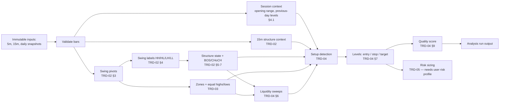

# Trading Methodology

| Field | Value |
|---|---|
| Document ID | TRD-01 |
| Version | 0.2.0 |
| Status | Specification ready for intraday (ADR-014); parameters are unvalidated hypotheses. TRD-02..07 are being revised to match (DOCUMENTATION_STATUS §0) |
| Owner | Quant / Trading Engine Lead |
| Last updated | 2026-11-17 |
| Related | [TRD-02 Market Structure](02_MARKET_STRUCTURE_RULES.md) · [TRD-03 Support/Resistance](03_SUPPORT_RESISTANCE_RULES.md) · [TRD-04 Setups](04_SETUP_DETECTION_RULES.md) · [TRD-05 Risk](05_RISK_MANAGEMENT_RULES.md) · [ADR-008](../adr/ADR-008-DETERMINISTIC-TRADING-ENGINE.md) · [ADR-014](../adr/ADR-014-PERSONAL-INTRADAY-WORKSTATION.md) · [ADR-015](../adr/ADR-015-INTRADAY-TIME-AND-SNAPSHOT-MODEL.md) |

## 1. Purpose and scope

This document defines the pure price-action methodology that the PriceAction AI quantitative engine implements. It is the **entry point** to the trading specification set and owns two things:

1. The methodology principles every rule must obey.
2. The **Ruleset Parameter Registry** (§6), the single authoritative list of configurable parameters and their initial values. Other documents reference parameters by key (for example `pivot.right_bars`) and must not restate different values.

Scope ([ADR-014](../adr/ADR-014-PERSONAL-INTRADAY-WORKSTATION.md)): personal **intraday** trading of NSE cash equities, NIFTY 50 universe, 15-minute bars for structure and 5-minute bars for setups, daily bars as context only, long-side actionable setups, every position closed within the session. Bearish analysis is computed and displayed but is **informational only** (constraint C-12).

> **Revision in progress.** This document is the intraday entry point. TRD-02..TRD-07 still contain daily-scope rules and parameter references; where they conflict with this document or ADR-014, this document wins until they are revised (tasks T-I04..T-I07).

## 2. Methodology principles

| ID | Principle | Consequence for implementation |
|---|---|---|
| MP-01 | **Pure price action.** Only OHLCV of confirmed candles is used. | No RSI, MACD, moving averages, Bollinger bands, ATR-based signals or other derived indicators. Volume may be shown as context and used as a *non-signal* evidence item only (see TRD-04 §8). |
| MP-02 | **Two intraday timeframes, one context timeframe.** | 15m bars give structure and direction (context); 5m bars give setups, confirmation and levels (primary). Daily bars supply only context: previous-day high, low and close and the daily structure state. 1m bars are not used in `pa-intraday 0.1.x`. |
| MP-03 | **Closed bars only.** | The engine never evaluates a forming bar. A bar is closed once its end time has passed and the provider's completed bar has been stored ([ENG-05 §12](../engineering/05_DATA_INGESTION_SPECIFICATION.md#12-intraday-ingestion-adr-015)). A signal produced at the close of bar `t` can be acted on no earlier than the open of bar `t+1`. Current prices (last traded price) never enter analysis. |
| MP-04 | **No look-ahead.** | Every object (pivot, zone, event, setup) carries the bar index at which it became *known* (`confirmed_at_index`). Any evaluation at bar `t` may only use objects whose `confirmed_at_index ≤ t`. |
| MP-05 | **Close beats wick.** | Structural breaks require a *closing* price beyond a level plus buffer. A wick through a level without a qualifying close is a *wick breach*, which is a distinct event type. |
| MP-06 | **Deterministic and reproducible.** | Same candle snapshot + same ruleset version ⇒ byte-identical output. No randomness, no wall-clock dependency, no LLM involvement. |
| MP-07 | **No-trade is a valid outcome.** | The engine returns `NO_TRADE` whenever conditions are not met; it never forces a setup. |
| MP-08 | **Explainable.** | Every setup emits an ordered list of evidence items that reference the concrete pivots, zones and candles that justified it. |
| MP-10 | **Higher-timeframe alignment without look-ahead.** | At a 5m close `t`, the 15m context uses only 15m bars whose end is `≤ t`, and the daily context uses only completed sessions before the current one. A 15m bar that is still forming at `t` is ignored, never approximated from 5m bars. |
| MP-11 | **Session-bounded.** | Setups, plans and positions live within one session. No new entry after the entry cutoff; open positions are exited before the close (§4.1). Nothing is carried overnight. |
| MP-09 | **Parameters are hypotheses.** | All numeric defaults below are engineering starting points. None is claimed to be profitable. Changes are made only through a new ruleset version validated by backtesting ([TRD-06](06_BACKTESTING_METHODOLOGY.md)). |

## 3. Analysis pipeline

The engine processes one instrument at one 5m close as a strictly ordered pipeline over its inputs (5m primary, 15m context, daily context; [ADR-015](../adr/ADR-015-INTRADAY-TIME-AND-SNAPSHOT-MODEL.md)). Each stage consumes only earlier-stage outputs. Pivots, structure and zones run on 5m bars and, separately, on 15m bars for context.

Risk sizing (stage K) is **user-specific** and is not part of the shared analysis run; it is computed per user at trade-plan time from the analysis levels and the user's risk profile.

## 4. Candle conventions

| Term | Definition |
|---|---|
| Bar index `i` | 0-based position within one timeframe's input, oldest first. Every bar also carries its `bar_start` timestamp (IST session grid from 09:15). |
| `O[i] H[i] L[i] C[i] V[i]` | Open, high, low, close, volume of bar `i`. |
| Last bar `T` | Index of the most recent closed 5m bar; the analysis `as_of_ts` is its end time. |
| Price precision | Prices are stored as `NUMERIC(12,2)` INR. Engine arithmetic uses Python `Decimal` with banker-safe explicit rounding (§5). |
| Adjusted vs unadjusted | Intraday inputs span a few sessions, so analysis uses **unadjusted** prices; a split or bonus inside the lookback window makes the run `INVALID_INPUT` for that instrument until the window has passed. Daily context uses adjusted previous-day levels. |

Candle validation rejects a snapshot (status `INVALID_INPUT`) when any bar violates `L ≤ min(O,C) ≤ max(O,C) ≤ H`, has a non-positive price, has duplicate dates, or has dates out of order. Gaps relative to the exchange calendar are flagged but do not reject the snapshot ([ENG-05 §7](../engineering/05_DATA_INGESTION_SPECIFICATION.md)).

**Minimum history:** `analysis.min_bars_5m` closed 5m bars and `analysis.min_bars_15m` closed 15m bars (§6), plus the previous completed session for daily context. Fewer bars ⇒ status `INSUFFICIENT_HISTORY`, signal `NO_TRADE`.

### 4.1 Session conventions

Session times come from `market_calendar` (normal session 09:15–15:30 IST; special sessions use their own times), never from the ruleset.

| Term | Definition |
|---|---|
| Session | One trading day's continuous session for NSE cash equities. Pre-open bars are not used. |
| Opening range (OR) | High and low of the 5m bars that end within the first `session.opening_range_minutes` of the session. Known only once its last bar has closed. |
| Previous-day levels (PDH, PDL, PDC) | High, low and close of the previous completed session's daily bar. |
| Entry cutoff | `session.entry_cutoff_minutes_before_close` before the close: no setup can reach `ENTRY_CONFIRMED` and no plan can be created after it. |
| Session-end exit | `session.exit_minutes_before_close` before the close: every open paper position is exited (reason `SESSION_END`) and the UI warns about open actual positions. |
| Setup expiry | A setup also expires at the entry cutoff, whatever `setup.expiry_bars` says. |

## 5. Numeric conventions

- Percentages in parameters are expressed in **percent** (e.g. `0.50` means 0.50%). Formulas convert with `/100`.
- Level comparisons: `above(level, buffer_pct) ≡ C > level × (1 + buffer_pct/100)`; `below(level, buffer_pct) ≡ C < level × (1 − buffer_pct/100)`.
- Computed price levels (entry, stop, target) are rounded to the instrument tick size: entry/target **up** to tick for long entries, stop **down** to tick (conservative: wider risk). See [TRD-05 §6](05_RISK_MANAGEMENT_RULES.md).
- Risk/reward is rounded to 2 decimals for display only; validation uses unrounded values.

## 6. Ruleset Parameter Registry (authoritative)

Ruleset ID: **`pa-intraday`**, version **`0.1.0`**. Every parameter is configurable per ruleset version; user-level overrides are only allowed where the "User-overridable" column says so. Suffixes `_5m` and `_15m` give a value per timeframe.

> **ASSUMPTION / HYPOTHESIS:** every value in this table is an initial engineering default and has **not** been validated. Status of each is `HYPOTHESIS` until a backtest report referenced in [TRD-08](08_TRADING_ENGINE_VALIDATION.md) promotes it. The risk defaults are the owner's planning values from ADR-014 where given (0.5% risk, ₹50,000 per position) and engineering placeholders otherwise (OQ-TRD-04). The "Defined in" documents are being revised for intraday (T-I04..T-I07); until then this table and §4.1 are authoritative.

| Key | Default | Unit | Range allowed | User-overridable | Defined in |
|---|---|---|---|---|---|
| `analysis.min_bars_5m` | 150 | bars | 75–750 | No | §4 |
| `analysis.min_bars_15m` | 75 | bars | 25–500 | No | §4 |
| `analysis.lookback_sessions` | 5 | sessions | 1–20 | No | TRD-03 (rev. T-I04) |
| `pivot.left_bars_5m` | 2 | bars | 1–10 | No | TRD-02 (rev. T-I04) |
| `pivot.right_bars_5m` | 2 | bars | 1–10 | No | TRD-02 (rev. T-I04) |
| `pivot.left_bars_15m` | 2 | bars | 1–10 | No | TRD-02 (rev. T-I04) |
| `pivot.right_bars_15m` | 2 | bars | 1–10 | No | TRD-02 (rev. T-I04) |
| `structure.break_buffer_pct_5m` | 0.05 | % | 0–0.5 | No | TRD-02 (rev. T-I04) |
| `structure.break_buffer_pct_15m` | 0.05 | % | 0–0.5 | No | TRD-02 (rev. T-I04) |
| `structure.equal_level_tolerance_pct` | 0.10 | % | 0–0.5 | No | TRD-02, TRD-03 (rev. T-I04) |
| `zone.cluster_tolerance_pct` | 0.15 | % | 0.05–1.0 | No | TRD-03 (rev. T-I04) |
| `zone.min_width_pct` | 0.05 | % | 0–0.5 | No | TRD-03 (rev. T-I04) |
| `zone.max_width_pct` | 0.50 | % | 0.1–2.0 | No | TRD-03 (rev. T-I04) |
| `zone.break_confirm_closes` | 1 | bars | 1–3 | No | TRD-03 (rev. T-I04) |
| `zone.proximity_pct` | 0.50 | % | 0.1–2.0 | No | TRD-03 (rev. T-I04) |
| `session.opening_range_minutes` | 15 | minutes | 5–60 | No | §4.1, TRD-04 (rev. T-I05) |
| `session.entry_cutoff_minutes_before_close` | 45 | minutes | 15–120 | No | §4.1 |
| `session.exit_minutes_before_close` | 15 | minutes | 5–30 | No | §4.1, TRD-05 (rev. T-I06) |
| `setup.breakout_buffer_pct` | 0.05 | % | 0–0.5 | No | TRD-04 (rev. T-I05) |
| `setup.retest_tolerance_pct` | 0.10 | % | 0.02–0.5 | No | TRD-04 (rev. T-I05) |
| `setup.max_retest_wait_bars` | 6 | 5m bars | 2–24 | No | TRD-04 (rev. T-I05) |
| `setup.expiry_bars` | 12 | 5m bars | 3–48 | No | TRD-04 (rev. T-I05) |
| `setup.rejection_min_wick_ratio` | 0.50 | ratio | 0.3–0.8 | No | TRD-04 (rev. T-I05) |
| `setup.opening_range_min_pct` | 0.30 | % of price | 0.05–2.0 | No | TRD-04 (rev. T-I05) |
| `setup.opening_range_max_pct` | 2.00 | % of price | 0.5–5.0 | No | TRD-04 (rev. T-I05) |
| `risk.stop_buffer_pct` | 0.05 | % | 0–0.5 | No | TRD-05 (rev. T-I06) |
| `risk.min_stop_distance_pct` | 0.15 | % of entry | 0.05–1.0 | No | TRD-05 (rev. T-I06) |
| `risk.max_stop_distance_pct` | 2.0 | % of entry | 0.2–5.0 | No | TRD-05 (rev. T-I06) |
| `risk.min_rr` | 2.0 | ratio | 1.0–5.0 | Yes (≥ ruleset value only) | TRD-05 (rev. T-I06) |
| `risk.max_entry_gap_pct` | 0.30 | % | 0.05–1.0 | Yes (≤ ruleset value only) | TRD-05 (rev. T-I06) |
| `risk.default_risk_per_trade_pct` | 0.5 | % of capital | 0.1–2.0 | Yes | TRD-05 (rev. T-I06) |
| `risk.default_max_position_value` | 50000 | INR | 5000–1000000 | Yes | TRD-05 (rev. T-I06) |
| `risk.default_daily_loss_limit_pct` | 1.5 | % of capital | 0.5–5.0 | Yes | TRD-05 (rev. T-I06) |
| `risk.default_max_consecutive_losses` | 3 | count | 1–10 | Yes | TRD-05 (rev. T-I06) |
| `risk.default_max_open_positions` | 2 | count | 1–10 | Yes | TRD-05 (rev. T-I06) |
| `risk.default_max_open_risk_pct` | 1.0 | % of capital | 0.25–5.0 | Yes | TRD-05 (rev. T-I06) |
| `exit.structure_exit_enabled` | true | bool | — | No | TRD-06, TRD-07 (rev. T-I07) |
| `exit.session_end_exit_enabled` | true | bool | — | No | §4.1, TRD-07 (rev. T-I07) |
| `backtest.slippage_pct` | 0.05 | % per side | 0–0.5 | Per backtest run | TRD-06 (rev. T-I07) |
| `score.min_display` | 0 | points | 0–100 | No | TRD-04 |
| `score.watch_threshold` | 60 | points | 0–100 | No | TRD-04 |

User overrides are bounded so that a user can only make risk rules **stricter** for `risk.min_rr` and `risk.max_entry_gap_pct`. Rationale: the analysis output must remain comparable to backtested behaviour. Score version for this ruleset: `paqs-intraday-0.1.0` (components revised in TRD-04, T-I05).

## 7. Outputs and vocabulary

The engine's output vocabulary is fixed per ruleset version and mirrored in the API ([ARC-04](../architecture/04_API_SPECIFICATION.md)) and database enums ([ARC-03](../architecture/03_DATABASE_DESIGN.md)).

| Concept | Canonical values |
|---|---|
| Structure state | `BULLISH`, `BEARISH`, `SIDEWAYS`, `TRANSITION` |
| Swing label | `HH`, `LH`, `EQH`, `HL`, `LL`, `EQL`, `NONE` (first pivot of its kind) |
| Structure event | `BOS`, `CHOCH`, `WICK_BREACH` |
| Setup type | MVP: `OPENING_RANGE_BREAKOUT`, `PREV_DAY_HIGH_BREAK`, `PREV_DAY_LOW_BREAK` (bearish, informational), `BREAKOUT_RETEST`. Later in `pa-intraday`: `TREND_CONTINUATION`, `LIQUIDITY_SWEEP_REVERSAL`. Retired with `pa-core`: `SUPPORT_REJECTION`, `TREND_PULLBACK` |
| Direction | `LONG` (actionable), `SHORT` (informational only) |
| Setup status | `FORMING`, `AWAITING_CONFIRMATION`, `ENTRY_CONFIRMED`, `INVALIDATED`, `EXPIRED` |
| Signal state (UI) | `NO_TRADE`, `BUY_WATCH`, `ENTRY_CONFIRMED`, `HOLD`, `EXIT` |
| Run status | `COMPLETED`, `INSUFFICIENT_HISTORY`, `INVALID_INPUT`, `FAILED` |
| Timeframe | `5m` (primary), `15m` (context), `1D` (context); `1m` reserved |
| Time fields | `as_of_ts` (end of the last 5m bar), `signal_at`, `valid_until` (ARC-04 §2.9) |

Mapping of setup status to signal state is defined in [TRD-04 §11](04_SETUP_DETECTION_RULES.md). `HOLD` and `EXIT` are position-level states derived from a paper or actual trade, never from an analysis run alone.

## 8. What the methodology explicitly does not do

- It does not predict price or output a probability of success. The quality score is a rule-conformance score (TRD-04 §9).
- It does not evaluate forming bars, ticks or order-book data, and does not use news or fundamentals.
- It does not hold positions overnight (MP-11).
- It does not support short-selling execution, F&O, or leverage in MVP.
- It does not use the LLM for any calculation ([ADR-009](../adr/ADR-009-LLM-EXPLANATION-ONLY.md)).

## 9. Open questions

| ID | Question | Owner | Blocking |
|---|---|---|---|
| OQ-TRD-01 | Should the daily structure state filter intraday longs (e.g. no long when daily is `BEARISH`)? | Quant lead | No — future ruleset |
| OQ-TRD-02 | Should volume confirmation become a scored component? It is currently evidence-only to stay "pure price action". | Product + Quant | No |
| OQ-TRD-03 | Which backtest result thresholds promote a parameter from `HYPOTHESIS` to `VALIDATED`? Proposed in TRD-08 §6, needs sign-off. | Product owner | Blocks I8 sign-off |
| OQ-TRD-04 | Owner to confirm the risk defaults that ADR-014 left configurable: daily loss limit (placeholder 1.5% = ₹1,500), consecutive-loss limit (3), open positions (2), open risk (1.0%). | Product owner | Blocks T-I06 sign-off |
| OQ-TRD-05 | Opening range length: 15 minutes (placeholder) or 30 minutes? To be decided from backtests (I8) and forward logging. | Product owner + Quant | No |
| OQ-TRD-06 | Intraday short selling: when, if ever, should bearish setups become actionable (would supersede C-12 through an ADR)? | Product owner | No — after long setups are validated |

## Appendix A. Retired daily ruleset (pa-core 0.1.0)

`pa-core 0.1.0` was the daily-timeframe ruleset of the original scope. It remains seeded as an immutable row and in `python-engine/rulesets/pa-core/0.1.0.json` for history, and is not used by the intraday MVP (ADR-014). Its parameters, as they were in this document:

The daily registry (`pa-core`, 0.1.0). Every parameter is configurable per ruleset version; user-level overrides are only allowed where the "User-overridable" column says so.

> **ASSUMPTION / HYPOTHESIS:** every value in this table is an initial engineering default and has **not** been validated. Status of each is `HYPOTHESIS` until a backtest report referenced in [TRD-08](08_TRADING_ENGINE_VALIDATION.md) promotes it.

| Key | Default | Unit | Range allowed | User-overridable | Defined in |
|---|---|---|---|---|---|
| ~`analysis.min_bars`~ | 120 | bars | 60–1000 | No | §4 |
| ~`analysis.lookback_bars`~ | 250 | bars | 120–1000 | No | TRD-03 §3 |
| ~`pivot.left_bars`~ | 2 | bars | 1–10 | No | TRD-02 §3 |
| ~`pivot.right_bars`~ | 2 | bars | 1–10 | No | TRD-02 §3 |
| ~`structure.break_buffer_pct`~ | 0.10 | % | 0–1.0 | No | TRD-02 §6 |
| ~`structure.equal_level_tolerance_pct`~ | 0.20 | % | 0–1.0 | No | TRD-02 §4, TRD-03 §6 |
| ~`zone.cluster_tolerance_pct`~ | 0.50 | % | 0.1–2.0 | No | TRD-03 §3 |
| ~`zone.min_width_pct`~ | 0.20 | % | 0–1.0 | No | TRD-03 §3 |
| ~`zone.max_width_pct`~ | 2.00 | % | 0.5–5.0 | No | TRD-03 §3 |
| ~`zone.break_confirm_closes`~ | 2 | bars | 1–3 | No | TRD-03 §5 |
| ~`zone.proximity_pct`~ | 1.50 | % | 0.25–5.0 | No | TRD-03 §7 |
| ~`setup.breakout_buffer_pct`~ | 0.10 | % | 0–1.0 | No | TRD-03 §5, TRD-04 §3 |
| ~`setup.retest_tolerance_pct`~ | 0.50 | % | 0.1–2.0 | No | TRD-04 §3 |
| ~`setup.max_retest_wait_bars`~ | 10 | bars | 3–30 | No | TRD-04 §3 |
| ~`setup.expiry_bars`~ | 20 | bars | 5–60 | No | TRD-04 §10 |
| ~`setup.rejection_min_wick_ratio`~ | 0.50 | ratio | 0.3–0.8 | No | TRD-04 §4 |
| ~`setup.sweep_max_reclaim_bars`~ | 1 | bars | 0–3 | No | TRD-04 §6 |
| ~`risk.stop_buffer_pct`~ | 0.20 | % | 0–1.0 | No | TRD-04 §7 |
| ~`risk.min_rr`~ | 2.0 | ratio | 1.0–5.0 | Yes (≥ ruleset value only) | TRD-05 §5 |
| ~`risk.max_entry_gap_pct`~ | 2.0 | % | 0.5–5.0 | Yes (≤ ruleset value only) | TRD-05 §7 |
| ~`risk.max_stop_distance_pct`~ | 10.0 | % | 2–20 | No | TRD-05 §4 |
| ~`risk.default_risk_per_trade_pct`~ | 1.0 | % of capital | 0.1–2.0 | Yes | TRD-05 §2 |
| ~`risk.default_max_open_positions`~ | 5 | count | 1–20 | Yes | TRD-05 §8 |
| ~`risk.default_max_portfolio_heat_pct`~ | 5.0 | % of capital | 1–10 | Yes | TRD-05 §8 |
| ~`risk.default_max_position_pct`~ | 25.0 | % of capital | 5–100 | Yes | TRD-05 §3 |
| ~`exit.structure_exit_enabled`~ | true | bool | — | No | TRD-06 §4.2, TRD-07 §5 |
| ~`backtest.slippage_pct`~ | 0.10 | % per side | 0–1.0 | Per backtest run | TRD-06 §5 |
| ~`score.min_display`~ | 0 | points | 0–100 | No | TRD-04 §9 |
| ~`score.watch_threshold`~ | 60 | points | 0–100 | No | TRD-04 §9 |

User overrides are bounded so that a user can only make risk rules **stricter** for `risk.min_rr` and `risk.max_entry_gap_pct`. Rationale: the analysis output must remain comparable to backtested behaviour.

