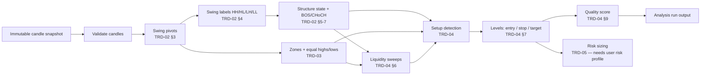

# Trading Methodology

| Field | Value |
|---|---|
| Document ID | TRD-01 |
| Version | 0.1.0 |
| Status | Specification ready (parameters are unvalidated hypotheses) |
| Owner | Quant / Trading Engine Lead |
| Last updated | 2026-11-15 |
| Related | [TRD-02 Market Structure](02_MARKET_STRUCTURE_RULES.md) · [TRD-03 Support/Resistance](03_SUPPORT_RESISTANCE_RULES.md) · [TRD-04 Setups](04_SETUP_DETECTION_RULES.md) · [TRD-05 Risk](05_RISK_MANAGEMENT_RULES.md) · [ADR-008](../adr/ADR-008-DETERMINISTIC-TRADING-ENGINE.md) |

## 1. Purpose and scope

This document defines the pure price-action methodology that the PriceAction AI quantitative engine implements. It is the **entry point** to the trading specification set and owns two things:

1. The methodology principles every rule must obey.
2. The **Ruleset Parameter Registry** (§6), the single authoritative list of configurable parameters and their initial values. Other documents reference parameters by key (for example `pivot.right_bars`) and must not restate different values.

Scope: NSE cash equities, daily timeframe, NIFTY 500 universe, long-side actionable setups. Bearish analysis is computed and displayed but is **informational only** (constraint C-12).

## 2. Methodology principles

| ID | Principle | Consequence for implementation |
|---|---|---|
| MP-01 | **Pure price action.** Only OHLCV of confirmed candles is used. | No RSI, MACD, moving averages, Bollinger bands, ATR-based signals or other derived indicators. Volume may be shown as context and used as a *non-signal* evidence item only (see TRD-04 §8). |
| MP-02 | **Daily timeframe is primary.** | All rules operate on completed daily candles. Weekly is a future context layer and is not a signal input in ruleset `pa-core 0.1.x`. |
| MP-03 | **Closed candles only.** | The engine never evaluates a forming (intraday) candle. A daily candle is "closed" once the session's official close has been ingested (see [ENG-05](../engineering/05_DATA_INGESTION_SPECIFICATION.md)). |
| MP-04 | **No look-ahead.** | Every object (pivot, zone, event, setup) carries the bar index at which it became *known* (`confirmed_at_index`). Any evaluation at bar `t` may only use objects whose `confirmed_at_index ≤ t`. |
| MP-05 | **Close beats wick.** | Structural breaks require a *closing* price beyond a level plus buffer. A wick through a level without a qualifying close is a *wick breach*, which is a distinct event type. |
| MP-06 | **Deterministic and reproducible.** | Same candle snapshot + same ruleset version ⇒ byte-identical output. No randomness, no wall-clock dependency, no LLM involvement. |
| MP-07 | **No-trade is a valid outcome.** | The engine returns `NO_TRADE` whenever conditions are not met; it never forces a setup. |
| MP-08 | **Explainable.** | Every setup emits an ordered list of evidence items that reference the concrete pivots, zones and candles that justified it. |
| MP-09 | **Parameters are hypotheses.** | All numeric defaults below are engineering starting points. None is claimed to be profitable. Changes are made only through a new ruleset version validated by backtesting ([TRD-06](06_BACKTESTING_METHODOLOGY.md)). |

## 3. Analysis pipeline

The engine processes one instrument's candle snapshot as a strictly ordered pipeline. Each stage consumes only earlier-stage outputs.

Risk sizing (stage K) is **user-specific** and is not part of the shared analysis run; it is computed per user at trade-plan time from the analysis levels and the user's risk profile.

## 4. Candle conventions

| Term | Definition |
|---|---|
| Bar index `i` | 0-based position in the snapshot, oldest first. |
| `O[i] H[i] L[i] C[i] V[i]` | Open, high, low, close, volume of bar `i`. |
| Last bar `T` | Index of the most recent closed bar in the snapshot (the analysis `as_of` date). |
| Price precision | Prices are stored as `NUMERIC(12,2)` INR. Engine arithmetic uses Python `Decimal` with banker-safe explicit rounding (§5). |
| Adjusted vs unadjusted | Analysis runs on **split/bonus-adjusted** prices for structure continuity. Execution simulation uses the adjustment factor to convert back where needed ([TRD-06 §7](06_BACKTESTING_METHODOLOGY.md)). |

Candle validation rejects a snapshot (status `INVALID_INPUT`) when any bar violates `L ≤ min(O,C) ≤ max(O,C) ≤ H`, has a non-positive price, has duplicate dates, or has dates out of order. Gaps relative to the exchange calendar are flagged but do not reject the snapshot ([ENG-05 §7](../engineering/05_DATA_INGESTION_SPECIFICATION.md)).

**Minimum history:** `analysis.min_bars` (default 120) closed bars. Fewer bars ⇒ status `INSUFFICIENT_HISTORY`, signal `NO_TRADE`.

## 5. Numeric conventions

- Percentages in parameters are expressed in **percent** (e.g. `0.50` means 0.50%). Formulas convert with `/100`.
- Level comparisons: `above(level, buffer_pct) ≡ C > level × (1 + buffer_pct/100)`; `below(level, buffer_pct) ≡ C < level × (1 − buffer_pct/100)`.
- Computed price levels (entry, stop, target) are rounded to the instrument tick size: entry/target **up** to tick for long entries, stop **down** to tick (conservative: wider risk). See [TRD-05 §6](05_RISK_MANAGEMENT_RULES.md).
- Risk/reward is rounded to 2 decimals for display only; validation uses unrounded values.

## 6. Ruleset Parameter Registry (authoritative)

Ruleset ID: **`pa-core`**, version **`0.1.0`**. Every parameter is configurable per ruleset version; user-level overrides are only allowed where the "User-overridable" column says so.

> **ASSUMPTION / HYPOTHESIS:** every value in this table is an initial engineering default and has **not** been validated. Status of each is `HYPOTHESIS` until a backtest report referenced in [TRD-08](08_TRADING_ENGINE_VALIDATION.md) promotes it.

| Key | Default | Unit | Range allowed | User-overridable | Defined in |
|---|---|---|---|---|---|
| `analysis.min_bars` | 120 | bars | 60–1000 | No | §4 |
| `analysis.lookback_bars` | 250 | bars | 120–1000 | No | TRD-03 §3 |
| `pivot.left_bars` | 2 | bars | 1–10 | No | TRD-02 §3 |
| `pivot.right_bars` | 2 | bars | 1–10 | No | TRD-02 §3 |
| `structure.break_buffer_pct` | 0.10 | % | 0–1.0 | No | TRD-02 §6 |
| `structure.equal_level_tolerance_pct` | 0.20 | % | 0–1.0 | No | TRD-02 §4, TRD-03 §6 |
| `zone.cluster_tolerance_pct` | 0.50 | % | 0.1–2.0 | No | TRD-03 §3 |
| `zone.min_width_pct` | 0.20 | % | 0–1.0 | No | TRD-03 §3 |
| `zone.max_width_pct` | 2.00 | % | 0.5–5.0 | No | TRD-03 §3 |
| `zone.break_confirm_closes` | 2 | bars | 1–3 | No | TRD-03 §5 |
| `zone.proximity_pct` | 1.50 | % | 0.25–5.0 | No | TRD-03 §7 |
| `setup.breakout_buffer_pct` | 0.10 | % | 0–1.0 | No | TRD-03 §5, TRD-04 §3 |
| `setup.retest_tolerance_pct` | 0.50 | % | 0.1–2.0 | No | TRD-04 §3 |
| `setup.max_retest_wait_bars` | 10 | bars | 3–30 | No | TRD-04 §3 |
| `setup.expiry_bars` | 20 | bars | 5–60 | No | TRD-04 §10 |
| `setup.rejection_min_wick_ratio` | 0.50 | ratio | 0.3–0.8 | No | TRD-04 §4 |
| `setup.sweep_max_reclaim_bars` | 1 | bars | 0–3 | No | TRD-04 §6 |
| `risk.stop_buffer_pct` | 0.20 | % | 0–1.0 | No | TRD-04 §7 |
| `risk.min_rr` | 2.0 | ratio | 1.0–5.0 | Yes (≥ ruleset value only) | TRD-05 §5 |
| `risk.max_entry_gap_pct` | 2.0 | % | 0.5–5.0 | Yes (≤ ruleset value only) | TRD-05 §7 |
| `risk.max_stop_distance_pct` | 10.0 | % | 2–20 | No | TRD-05 §4 |
| `risk.default_risk_per_trade_pct` | 1.0 | % of capital | 0.1–2.0 | Yes | TRD-05 §2 |
| `risk.default_max_open_positions` | 5 | count | 1–20 | Yes | TRD-05 §8 |
| `risk.default_max_portfolio_heat_pct` | 5.0 | % of capital | 1–10 | Yes | TRD-05 §8 |
| `risk.default_max_position_pct` | 25.0 | % of capital | 5–100 | Yes | TRD-05 §3 |
| `exit.structure_exit_enabled` | true | bool | — | No | TRD-06 §4.2, TRD-07 §5 |
| `backtest.slippage_pct` | 0.10 | % per side | 0–1.0 | Per backtest run | TRD-06 §5 |
| `score.min_display` | 0 | points | 0–100 | No | TRD-04 §9 |
| `score.watch_threshold` | 60 | points | 0–100 | No | TRD-04 §9 |

User overrides are bounded so that a user can only make risk rules **stricter** for `risk.min_rr` and `risk.max_entry_gap_pct`. Rationale: the analysis output must remain comparable to backtested behaviour.

## 7. Outputs and vocabulary

The engine's output vocabulary is fixed per ruleset version and mirrored in the API ([ARC-04](../architecture/04_API_SPECIFICATION.md)) and database enums ([ARC-03](../architecture/03_DATABASE_DESIGN.md)).

| Concept | Canonical values |
|---|---|
| Structure state | `BULLISH`, `BEARISH`, `SIDEWAYS`, `TRANSITION` |
| Swing label | `HH`, `LH`, `EQH`, `HL`, `LL`, `EQL`, `NONE` (first pivot of its kind) |
| Structure event | `BOS`, `CHOCH`, `WICK_BREACH` |
| Setup type | `BREAKOUT_RETEST`, `SUPPORT_REJECTION`, `TREND_PULLBACK`, `LIQUIDITY_SWEEP_REVERSAL` |
| Direction | `LONG` (actionable), `SHORT` (informational only) |
| Setup status | `FORMING`, `AWAITING_CONFIRMATION`, `ENTRY_CONFIRMED`, `INVALIDATED`, `EXPIRED` |
| Signal state (UI) | `NO_TRADE`, `BUY_WATCH`, `ENTRY_CONFIRMED`, `HOLD`, `EXIT` |
| Run status | `COMPLETED`, `INSUFFICIENT_HISTORY`, `INVALID_INPUT`, `FAILED` |

Mapping of setup status to signal state is defined in [TRD-04 §11](04_SETUP_DETECTION_RULES.md). `HOLD` and `EXIT` are position-level states derived from a paper or actual trade, never from an analysis run alone.

## 8. What the methodology explicitly does not do

- It does not predict price or output a probability of success. The quality score is a rule-conformance score (TRD-04 §9).
- It does not trade intraday, use order-book data, or use news/fundamentals.
- It does not support short-selling execution, F&O, or leverage in MVP.
- It does not use the LLM for any calculation ([ADR-009](../adr/ADR-009-LLM-EXPLANATION-ONLY.md)).

## 9. Open questions

| ID | Question | Owner | Blocking |
|---|---|---|---|
| OQ-TRD-01 | Should weekly structure be added as a context filter (e.g. only long when weekly is not `BEARISH`)? | Quant lead | No — future ruleset |
| OQ-TRD-02 | Should volume confirmation become a scored component? It is currently evidence-only to stay "pure price action". | Product + Quant | No |
| OQ-TRD-03 | Which backtest result thresholds promote a parameter from `HYPOTHESIS` to `VALIDATED`? Proposed in TRD-08 §6, needs sign-off. | Product owner | Blocks M10 |
