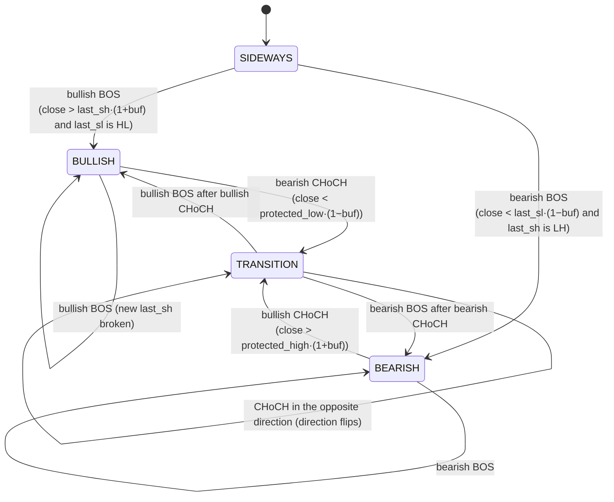

# Market Structure Rules

| Field | Value |
|---|---|
| Document ID | TRD-02 |
| Version | 0.1.0 |
| Status | Specification ready (parameters are hypotheses) |
| Owner | Quant / Trading Engine Lead |
| Last updated | 2026-11-15 |
| Related | [TRD-01 Methodology & Parameter Registry](01_TRADING_METHODOLOGY.md) · [TRD-03](03_SUPPORT_RESISTANCE_RULES.md) · [TRD-08 Validation](08_TRADING_ENGINE_VALIDATION.md) |

## 1. Purpose

Defines the deterministic rules for swing pivots, swing labels, structure state, Break of Structure (BOS), Change of Character (CHoCH) and wick breaches. Parameter values come from the [Parameter Registry](01_TRADING_METHODOLOGY.md#6-ruleset-parameter-registry-authoritative); this document uses their keys.

## 2. Notation

- `L = pivot.left_bars` (default 2), `R = pivot.right_bars` (default 2).
- `buf = structure.break_buffer_pct / 100` (default 0.001).
- `eq = structure.equal_level_tolerance_pct / 100` (default 0.002).
- Every derived object stores `index` (bar where the object is located) and `confirmed_at_index` (first bar at whose close the object is known).

## 3. Swing pivots

### 3.1 Swing high

Bar `i` is a **swing high** iff all hold:

```
H[i] >  H[i-k]   for every k in 1..L        (strictly higher than left bars)
H[i] >= H[i+k]   for every k in 1..R        (not exceeded by right bars)
```

### 3.2 Swing low

Bar `i` is a **swing low** iff:

```
L[i] <  L[i-k]   for every k in 1..L
L[i] <= L[i+k]   for every k in 1..R
```

### 3.3 Tie-breaking

The asymmetric comparison (strict left, non-strict right) guarantees that among consecutive bars with equal highs, **only the first** can be a swing high: a later equal bar fails the strict-left test against the earlier one. This makes detection deterministic without post-processing.

A single bar may be both a swing high and a swing low (outside bar). Both pivots are emitted; in labelling and sequencing, the **low is ordered before the high** if `C[i] ≥ O[i]` (bullish bar), otherwise the high before the low. Assumption: intrabar path is unknown; this convention is documented, not claimed to be correct.

### 3.4 Confirmation timing (no look-ahead)

```
confirmed_at_index = i + R
```

A pivot at bar `i` **does not exist** for any evaluation at bars `< i + R`. Only after bar `i+R` has closed is it available. Bars at indexes `T-R+1 .. T` therefore can never be pivots in the current run; they are "unconfirmed" and may be drawn as provisional markers by the UI only if visually distinguished and labelled *unconfirmed* (they never feed any rule).

Bars `0 .. L-1` cannot be pivots (insufficient left context).

### 3.5 Example (L=2, R=2)

| idx | H | L | Notes |
|---|---|---|---|
| 10 | 101.0 | 98.0 | |
| 11 | 102.5 | 99.0 | |
| 12 | **104.0** | 100.5 | H[12] > 102.5, 101.0 (left) |
| 13 | 103.2 | 100.0 | H[12] ≥ 103.2 |
| 14 | 104.0 | 99.6 | H[12] ≥ 104.0 (equal allowed on right) |
| 15 | 102.0 | 98.8 | |

Bar 12 is a swing high at 104.00, `confirmed_at_index = 14`. An analysis with `T = 13` must not contain it. Bar 14 cannot be a swing high because `H[14] > H[12]` fails (equal, not strictly greater).

## 4. Swing labels

Labels are assigned **at confirmation time**, comparing the new pivot to the **previous confirmed pivot of the same kind** (high vs high, low vs low).

| New pivot | Condition vs previous same-kind pivot price `P` | Label |
|---|---|---|
| High at `p` | `p > P × (1 + eq)` | `HH` |
| High | `p < P × (1 − eq)` | `LH` |
| High | otherwise | `EQH` |
| Low at `p` | `p > P × (1 + eq)` | `HL` |
| Low | `p < P × (1 − eq)` | `LL` |
| Low | otherwise | `EQL` |
| First pivot of its kind | — | `NONE` |

Labels are never revised once assigned. Consecutive same-kind pivots (two highs without a low between them) are allowed; each is labelled against its immediate same-kind predecessor.

## 5. Structure state

Structure state is a finite-state machine evaluated **bar by bar** from the start of the snapshot to `T`. At each bar `t` the machine processes, in this order: (1) pivots with `confirmed_at_index = t`, (2) close-based break checks for bar `t`.

### 5.1 Reference levels

| Reference | Definition |
|---|---|
| `last_sh` | Most recent confirmed swing high (price, index). |
| `last_sl` | Most recent confirmed swing low. |
| `protected_low` | In `BULLISH`: the most recent confirmed swing low that formed **before** the latest bullish BOS bar. It is the low the trend must hold. |
| `protected_high` | In `BEARISH`: the most recent confirmed swing high that formed before the latest bearish BOS bar. |

### 5.2 States

| State | Meaning |
|---|---|
| `SIDEWAYS` | Initial state, and any state where neither trend condition holds. |
| `BULLISH` | Established up-structure: a bullish BOS has occurred and `protected_low` has not been broken on a close. |
| `BEARISH` | Mirror of BULLISH. |
| `TRANSITION` | A CHoCH has occurred against the prior trend; the new direction is not yet confirmed by a BOS. |

### 5.3 Transitions



There is no automatic `TRANSITION → SIDEWAYS` fallback in `pa-core 0.1.0` (proposed `structure.transition_max_bars`, see OQ-STR-01 in §12).

`TRANSITION` carries a `transition_direction` (`UP` after a bullish CHoCH, `DOWN` after a bearish CHoCH). The UI shows it as "Transition" (frontend `transition`).

Entering `BULLISH` from `SIDEWAYS` additionally requires that `last_sl` is labelled `HL` (or `EQL`) at the time of the break. This prevents labelling a single spike as an uptrend. Mirror rule for `BEARISH` requires `last_sh` labelled `LH` or `EQH`.

## 6. Break of Structure (BOS)

A **bullish BOS** occurs at bar `t` when:

```
state ∈ {SIDEWAYS (with HL condition), BULLISH, TRANSITION(UP)}
and last_sh exists and last_sh.confirmed_at_index ≤ t − 1
and C[t] > last_sh.price × (1 + buf)
and last_sh has not already been broken
```

Effects:
- Emit event `{type: BOS, direction: UP, level: last_sh.price, level_pivot_index, break_index: t}`.
- Mark `last_sh` as broken (each pivot can be broken at most once).
- Set `protected_low` = most recent confirmed swing low with `index < t`.
- State becomes `BULLISH`.

**Bearish BOS** mirrors with `C[t] < last_sl.price × (1 − buf)`.

The requirement `confirmed_at_index ≤ t − 1` prevents a pivot confirmed on bar `t` from being broken by the same bar's close; it must be known before the breaking bar opens.

## 7. Change of Character (CHoCH)

A **bearish CHoCH** occurs at bar `t` when:

```
state = BULLISH and C[t] < protected_low.price × (1 − buf)
```

Effects: emit `{type: CHOCH, direction: DOWN, level: protected_low.price, break_index: t}`; state → `TRANSITION(DOWN)`; `protected_high` = most recent confirmed swing high with `index < t`.

A subsequent bearish BOS (close below the next confirmed swing low that forms after the CHoCH) promotes the state to `BEARISH`. **Bullish CHoCH** mirrors from `BEARISH` with `protected_high`.

In `TRANSITION(DOWN)`, a close above `protected_high × (1 + buf)` is a bullish CHoCH and flips the direction to `TRANSITION(UP)`.

## 8. Wick breach vs close break

| Situation at bar `t` (relative to an unbroken level `X` above price) | Classification |
|---|---|
| `H[t] > X` and `C[t] > X × (1 + buf)` | Close break → BOS/CHoCH/zone break per context |
| `H[t] > X` and `C[t] ≤ X × (1 + buf)` | **WICK_BREACH** (event recorded; structure unchanged) |
| `H[t] ≤ X` | Nothing |

Mirror for levels below price using `L[t]` and `C[t] < X × (1 − buf)`.

A close that lands between `X` and `X × (1 + buf)` is **not** a break (inside the buffer). It is recorded as `WICK_BREACH` with `close_inside_buffer = true` for transparency.

Wick breaches of swing levels feed liquidity-sweep detection ([TRD-04 §6](04_SETUP_DETECTION_RULES.md)).

## 9. Edge cases

| Case | Rule |
|---|---|
| Gap open beyond a level | Treated the same as any bar; only the close is tested. |
| Multiple levels broken by one bar | Only `last_sh` / `last_sl` are tested for BOS; older unbroken pivots are marked broken silently (no event) to avoid duplicate events. |
| Pivot confirmed and level broken same bar | Not a break (see §6 `confirmed_at_index ≤ t−1`). Re-tested on later bars. |
| Insufficient pivots (< 2 highs or < 2 lows) | State remains `SIDEWAYS`; run is still `COMPLETED`. |
| Corporate action inside snapshot | Prices are pre-adjusted; no special handling in structure rules. |
| Circuit-limit days (H = L) | Valid bar; may be a pivot only if comparisons hold. |

## 10. Outputs

Per run, the engine persists:
- `swing_points`: kind, index, date, price, label, `confirmed_at_index`, `confirmed_at_date`.
- `structure_events`: type, direction, level, level pivot, break bar, close, `close_inside_buffer`.
- Final `structure_state`, `transition_direction`, `protected_low`, `protected_high` in the run summary.
- A per-bar state series is **not** persisted (recomputable); backtests compute it in-memory.

## 11. Mandatory tests

See [TRD-08 §3](08_TRADING_ENGINE_VALIDATION.md): TV-PIV-01..06, TV-STR-01..08.

## 12. Open questions

| ID | Question | Notes |
|---|---|---|
| OQ-STR-01 | Add `structure.transition_max_bars` (proposed default 40) to fall back from `TRANSITION` to `SIDEWAYS`? | Not in `pa-core 0.1.0`; state stays `TRANSITION` until a BOS. |
| OQ-STR-02 | Should a minimum swing size (e.g. 2% from prior opposite pivot) filter noise pivots? | Pure fractal pivots with L=R=2 can be noisy on daily NIFTY 500 data; decide after backtests. |
| OQ-STR-03 | Outside-bar ordering convention (§3.3) — accept or treat outside bars as non-pivots? | Accepted for 0.1.0. |
