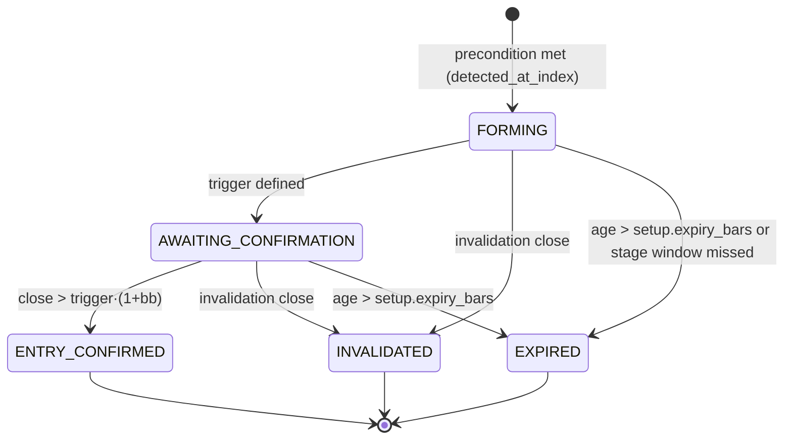

# Setup Detection Rules and Price Action Quality Score

| Field | Value |
|---|---|
| Document ID | TRD-04 |
| Version | 0.1.0 |
| Status | Specification ready (parameters and score weights are hypotheses) |
| Owner | Quant / Trading Engine Lead |
| Last updated | 2026-11-15 |
| Related | [TRD-01 Parameter Registry](01_TRADING_METHODOLOGY.md#6-ruleset-parameter-registry-authoritative) · [TRD-02](02_MARKET_STRUCTURE_RULES.md) · [TRD-03](03_SUPPORT_RESISTANCE_RULES.md) · [TRD-05](05_RISK_MANAGEMENT_RULES.md) · [TRD-08](08_TRADING_ENGINE_VALIDATION.md) |

## 1. Purpose

Defines the four MVP setups, their lifecycle, entry confirmation, invalidation, expiry, the derivation of entry/stop/target levels, the Price Action Quality Score, and the mapping from setup status to the trader-facing signal state.

## 2. Common lifecycle



Notation: `bb = setup.breakout_buffer_pct/100`, `rt = setup.retest_tolerance_pct/100`, `sb = risk.stop_buffer_pct/100`, `sbuf = structure.break_buffer_pct/100`.

Common rules:

| ID | Rule |
|---|---|
| SD-01 | All stage checks are evaluated on bar closes in chronological order. Within one bar, **invalidation is checked before confirmation**. A bar that both invalidates and confirms (impossible for longs since the invalidation level is below the trigger) is treated as invalidated. |
| SD-02 | `age = t − detected_at_index`. If `age > setup.expiry_bars` (default 20) and status is not terminal → `EXPIRED`. |
| SD-03 | `ENTRY_CONFIRMED` is terminal for detection. The confirmation applies to the **next session's open only** (`entry_window_bars = 1`). After that bar the setup is reported as `ENTRY_CONFIRMED` with `entry_window_open = false`. |
| SD-04 | Only one non-terminal setup of a given type per anchor level (zone id or pivot id) may exist. A new precondition on the same anchor while one is open is ignored. |
| SD-05 | Long setups are disallowed when structure state is `BEARISH`, **except** `LIQUIDITY_SWEEP_REVERSAL`, which is a counter-trend reversal setup and is penalised by the quality score (§9). |
| SD-06 | Bearish mirror setups are computed with direction `SHORT`, are flagged `informational = true`, never produce `BUY_WATCH`/`ENTRY_CONFIRMED` signals, and cannot be converted into trade plans (constraint C-12). |
| SD-07 | Reference entry price: while `AWAITING_CONFIRMATION`, `entry = trigger_price` (indicative: "a daily close above X"). Once `ENTRY_CONFIRMED` at bar `c`, `entry = C[c]` (reference). Execution simulation fills at `O[c+1]` subject to the gap rule ([TRD-05 §7](05_RISK_MANAGEMENT_RULES.md)). |

## 3. Setup 1 — BREAKOUT_RETEST (long)

**Idea:** price closes decisively above a resistance zone, returns to test it from above, holds, and resumes.

| Stage | Rule |
|---|---|
| Anchor | An `ACTIVE` resistance zone `Z` (TRD-03) with `touches ≥ 2`, formed at `formed_at_index < b`. |
| Breakout (→ FORMING) | Zone `Z` is broken upward per TRD-03 §5.1: `zone.break_confirm_closes` consecutive closes `> Z.high × (1 + bb)`. `detected_at_index = b` = last confirming close. |
| Retest (→ AWAITING_CONFIRMATION) | First bar `r` with `b < r ≤ b + setup.max_retest_wait_bars` and `L[r] ≤ Z.high × (1 + rt)` and `C[r] ≥ Z.low`. `trigger_price = H[r]`. If later retest bars occur before confirmation, `trigger_price` updates to the **latest** retest bar's high and the retest low updates to the lowest low among retest bars. |
| No retest | No qualifying `r` by `b + max_retest_wait_bars` → `EXPIRED` (reason `NO_RETEST`). |
| Confirmation (→ ENTRY_CONFIRMED) | Bar `c > r` with `C[c] > trigger_price × (1 + bb)`. |
| Invalidation | Any close after `b` with `C < Z.low × (1 − bb)` (reason `FAILED_BREAKOUT`), or a bearish CHoCH (reason `STRUCTURE_INVALIDATED`). |
| Stop | `min(lowest retest low, Z.low) × (1 − sb)`, rounded down to tick. |
| Target | §7.3 target ladder. |

## 4. Setup 2 — SUPPORT_REJECTION (long)

**Idea:** price tests an established support zone and prints a rejection candle (long lower wick, close in the upper half), then confirms.

| Stage | Rule |
|---|---|
| Context | Structure state ∈ {`BULLISH`, `SIDEWAYS`, `TRANSITION(UP)`}. |
| Anchor | Support zone `Z` (status `ACTIVE` or `BROKEN_FLIPPED` acting as support) with `touches ≥ 2`. |
| Rejection bar `r` (→ AWAITING_CONFIRMATION) | `L[r] ≤ Z.high` and `C[r] ≥ Z.low` and `H[r] > L[r]` and `lower_wick_ratio = (min(O[r],C[r]) − L[r]) / (H[r] − L[r]) ≥ setup.rejection_min_wick_ratio` (0.50) and `close_position = (C[r] − L[r]) / (H[r] − L[r]) ≥ 0.50`. `detected_at_index = r`, `trigger_price = H[r]`. This setup skips `FORMING`. |
| Confirmation | Bar `c > r` with `C[c] > trigger_price × (1 + bb)`. |
| Invalidation | Close `< Z.low × (1 − bb)` (reason `SUPPORT_BROKEN`). |
| Stop | `min(L[r], Z.low) × (1 − sb)`. |
| Target | §7.3. |

**Example.** Zone Z = [1,480.00, 1,486.00]. Rejection bar: O 1,489.0, H 1,494.0, L 1,481.5, C 1,492.0. Range 12.5; lower wick = 1,489.0 − 1,481.5 = 7.5 → ratio 0.60 ✔; close position (1,492 − 1,481.5)/12.5 = 0.84 ✔. Trigger 1,494.00 → confirmation requires a close > 1,494 × 1.001 = 1,495.49. Stop = min(1,481.5, 1,480.0) × 0.998 = 1,477.04 → rounded down to tick.

## 5. Setup 3 — TREND_PULLBACK (long)

**Idea:** in an established uptrend, after a bullish BOS, price pulls back and forms a confirmed higher low, then resumes.

| Stage | Rule |
|---|---|
| Context | State = `BULLISH` with latest bullish BOS at bar `b` breaking level `X`. |
| Pullback (→ FORMING) | After `b`, a bar closes below the prior bar's low. `detected_at_index` = that bar. |
| Higher low (→ AWAITING_CONFIRMATION) | A swing low `s` with `s.index > b`, `s.confirmed_at_index ≤ t`, label `HL` or `EQL`, and `s.price > protected_low × (1 + sbuf)`. `trigger_price = max(H[s.index .. s.confirmed_at_index])` (the minor high of the pivot's confirmation window). |
| Confirmation | Bar `c > s.confirmed_at_index` with `C[c] > trigger_price × (1 + bb)`. |
| Invalidation | Bearish CHoCH (close `< protected_low × (1 − sbuf)`), or a newer swing low labelled `LL` (reason `STRUCTURE_INVALIDATED`). |
| Stop | `s.price × (1 − sb)`. |
| Target | §7.3, where the impulse-leg high (highest high between `b` and `s.index`) is inserted as the first ladder candidate. |

## 6. Setup 4 — LIQUIDITY_SWEEP_REVERSAL (long)

**Idea:** price runs stops below an obvious level (swing low, equal lows, support zone low) with a wick, then reclaims the level.

| Stage | Rule |
|---|---|
| Liquidity level `Y` | Any of: confirmed unbroken swing low; `EQUAL_LOWS` pool level (TRD-03 §6); `Z.low` of an active support zone. Must be confirmed before bar `w`. |
| Sweep bar `w` (→ AWAITING_CONFIRMATION) | `L[w] < Y × (1 − sbuf)` and reclaim: either `C[w] ≥ Y` (same-bar reclaim) or, if `setup.sweep_max_reclaim_bars ≥ 1`, `C[w] < Y` and `C[w+1] ≥ Y` with `L[w+1] ≥ L[w] × (1 − sbuf)`. `detected_at_index` = reclaim bar; `sweep_low = min(L[w], L[w+1])`; `trigger_price` = high of the reclaim bar. Recorded as `liquidity_events.type = SWEEP_LOW`. |
| Confirmation | Close `> trigger_price × (1 + bb)`. |
| Invalidation | Close `< sweep_low` (reason `SWEEP_FAILED`). |
| Stop | `sweep_low × (1 − sb)`. |
| Target | §7.3; an `EQUAL_HIGHS` pool above entry is inserted as a ladder candidate. |

A wick below `Y` whose close is below `Y` and is not reclaimed in time is **not** a sweep; if the close is also below `Y × (1 − sbuf)` it is a structural break per TRD-02.

## 7. Levels

### 7.1 Entry

Per SD-07.

### 7.2 Stop-loss

Defined per setup above. All stops are **structural** (beyond the low that invalidates the idea) plus `risk.stop_buffer_pct`. Additional checks in [TRD-05 §4](05_RISK_MANAGEMENT_RULES.md) (`risk.max_stop_distance_pct`).

### 7.3 Target ladder

Candidates (above `entry`), evaluated in order; the **first candidate meeting `risk.min_rr` is the target**:

1. Setup-specific candidate (impulse high for TREND_PULLBACK; EQH pool for LIQUIDITY_SWEEP_REVERSAL).
2. Nearest resistance zone above entry: `target = zone.low` (exit *in front of* resistance).
3. Next resistance zones in ascending order (`zone.low`).
4. Highest confirmed swing high above entry in the lookback.
5. **Measured move** if no overhead structure exists (price at or near lookback highs): `target = anchor + base_height`.
   - BREAKOUT_RETEST: `anchor = Z.high`, `base_height = Z.high − min(L over the 20 bars before b)`.
   - Other setups: `anchor = entry`, `base_height` = height of the most recent completed swing leg (last confirmed swing high − the swing low preceding it).
   - A target derived from `entry + min_rr × risk` is **never** used, because it would make every setup pass the RR check by construction.

If no candidate meets `risk.min_rr`, the target is the **nearest** candidate, the setup is flagged `rr_below_min = true`, and the signal is `NO_TRADE` (reason `RR_BELOW_MINIMUM`). Candidates closer than 1 tick above entry are skipped. Targets round **down** to tick (conservative).

### 7.4 Risk/reward

```
risk_per_share   = entry − stop
reward_per_share = target − entry
rr               = reward_per_share / risk_per_share      (requires risk_per_share > 0)
```

## 8. Evidence

Each setup emits ordered evidence items: `{code, tone: SUPPORTING|CAUTION, title, detail, refs: [pivot/zone/event ids, bar dates]}`. Examples of codes: `STRUCTURE_BULLISH`, `ZONE_TOUCHES_3`, `RETEST_HELD_ABOVE_ZONE`, `REJECTION_WICK_0_60`, `RR_BELOW_MIN`, `COUNTER_TREND`, `VOLUME_ABOVE_MEDIAN` (evidence only: breakout/rejection bar volume vs 20-bar median volume; **not** scored and never a gate), `UNCONFIRMED_RECENT_BARS`. Evidence text is templated deterministically by the engine; the LLM may rephrase it but never add facts ([ARC-07](../architecture/07_AI_AND_LLM_ARCHITECTURE.md)).

## 9. Price Action Quality Score (PAQS)

> **Not a probability.** PAQS measures how completely a setup conforms to the ruleset's definition of a well-formed setup. It is not a win rate, expected return, or likelihood of success, and UI copy must not describe it as such.

Score version: `paqs-0.1.0` (bound to ruleset `pa-core 0.1.0`). Total = sum of five components, max 100.

| Component | Weight | Calculation |
|---|---|---|
| Market structure alignment | 25 | `BULLISH` 25 · `TRANSITION(UP)` 15 · `SIDEWAYS` 10 · `TRANSITION(DOWN)` 5 · `BEARISH` 0 |
| Key level quality | 20 | `round(anchor_zone.strength × 0.20)`. TREND_PULLBACK without a zone anchor: 14 if `s.price` is within `rt` of broken level `X`, else 8. LIQUIDITY_SWEEP_REVERSAL on an `EQUAL_LOWS` pool without a zone: 12. |
| Setup quality | 25 | Setup checklist (below) |
| Entry confirmation | 20 | `FORMING` 0 · `AWAITING_CONFIRMATION` 8 · `ENTRY_CONFIRMED` with confirmation close in upper half of its range 20, otherwise 15 |
| Risk/reward | 10 | `rr ≥ 3.0` 10 · `≥ 2.5` 8 · `≥ min_rr` 6 · `< min_rr` 0 |

Setup checklist (25 points each set):

| Setup | Criteria (points) |
|---|---|
| BREAKOUT_RETEST | Breakout bar closes in top 30% of its range (8) · every retest close ≥ `Z.high` (9) · retest within 5 bars of breakout (8) |
| SUPPORT_REJECTION | Wick ratio ≥ 0.66 (9) else ≥ 0.50 (5) · close position ≥ 0.67 (8) · zone touches ≥ 3 (8) |
| TREND_PULLBACK | Pullback depth 30–70% of impulse leg (9) · `s.price ≥ X` (HL held above broken level) (8) · pullback bar count ≤ impulse bar count (8) |
| LIQUIDITY_SWEEP_REVERSAL | Same-bar reclaim (9) · swept level is an `EQUAL_LOWS` pool or zone with ≥ 2 touches (8) · sweep depth `(Y − sweep_low)/Y ≤ 1%` (8) |

**Missing data behaviour:** a component that cannot be computed (e.g. no zone, no target) scores 0 and is returned with `missing = true` and a reason. The total is **not** re-normalised; a setup with missing components is penalised by design.

**Interpretation bands (hypothesis):** ≥ 75 high conformance · 60–74 moderate · < 60 low. `score.watch_threshold` (60) is the minimum for `BUY_WATCH`/`ENTRY_CONFIRMED` signals.

**Example.** BREAKOUT_RETEST, state BULLISH (25); zone strength 72 → 14; checklist 8+9+0 = 17; ENTRY_CONFIRMED upper half (20); rr 2.4 (6). PAQS = 25+14+17+20+6 = **82**.

**Versioning:** any change to weights, buckets or checklist creates a new `paqs-x.y.z` and therefore a new ruleset version. Scores from different versions are never compared in the same table without the version column.

The frontend `QualityFactor[]` maps one-to-one to these five components (`label`, `score` as a 0–100 percentage of the component weight, `note`).

## 10. Expiry

- Global: `setup.expiry_bars` (20) from `detected_at_index` (SD-02).
- BREAKOUT_RETEST: additionally `setup.max_retest_wait_bars` (10) from breakout to first retest.
- An `ENTRY_CONFIRMED` setup whose entry window has passed is not expired but is **stale** for new plans (SD-03).

## 11. Signal state mapping

The analysis run selects one **primary setup**: the non-terminal (or just-confirmed on bar `T`) `LONG` setup with the highest status priority (`ENTRY_CONFIRMED` on `T` > `AWAITING_CONFIRMATION` > `FORMING`), then highest PAQS, then most recent `detected_at_index`, then the setup type order listed in TRD-01 §7.

| Condition on primary setup | Signal |
|---|---|
| None, or only `SHORT`/informational setups | `NO_TRADE` |
| `FORMING` or `AWAITING_CONFIRMATION`, PAQS ≥ `score.watch_threshold`, not `rr_below_min` | `BUY_WATCH` |
| `ENTRY_CONFIRMED` with confirmation bar = `T`, PAQS ≥ threshold, not `rr_below_min` | `ENTRY_CONFIRMED` |
| Any other case (low score, RR below minimum, stale) | `NO_TRADE` with reason codes |

`HOLD` and `EXIT` are produced only by the paper-trade/actual-trade monitor ([TRD-07](07_PAPER_TRADING_SPECIFICATION.md)).

## 12. Frontend vocabulary reconciliation

The current frontend mock (`frontend/src/types/analysis.ts`) uses a different setup vocabulary. Canonical mapping (to be applied in M7, see discrepancy register in [ENG-02 §9](../engineering/02_FRONTEND_ARCHITECTURE.md)):

| Frontend `SetupType` | Canonical | Notes |
|---|---|---|
| `breakout-retest` | `BREAKOUT_RETEST` (LONG) | |
| `pullback-to-support` | `SUPPORT_REJECTION` or `TREND_PULLBACK` | Depends on anchor; mock conflates them |
| `trend-continuation` | `TREND_PULLBACK` | |
| `range-breakout` | `BREAKOUT_RETEST` from a range-top zone | No separate type in 0.1.0 |
| `breakdown-retest` | `BREAKOUT_RETEST` (SHORT, informational) | |
| `range-bound` | *(not a setup)* — structure `SIDEWAYS`, signal `NO_TRADE` | |

| Frontend `SetupStatus` | Canonical |
|---|---|
| `detected` | `FORMING` |
| `awaiting-confirmation` | `AWAITING_CONFIRMATION` |
| `entry-confirmed` | `ENTRY_CONFIRMED` |
| `invalidated` | `INVALIDATED` |
| *(missing)* | `EXPIRED` — must be added |

## 13. Open questions

| ID | Question |
|---|---|
| OQ-SD-01 | Should a separate `RANGE_BREAKOUT` type be reinstated to match the existing UI/backtest strategy list? |
| OQ-SD-02 | Entry convention: close-confirmation + next open (chosen) vs. buy-stop above trigger intraday. The latter needs intraday data and is deferred. |
| OQ-SD-03 | Is `entry_window_bars = 1` too strict for end-of-day users who review the next evening? |
| OQ-SD-04 | Should PAQS thresholds differ per setup type? |
