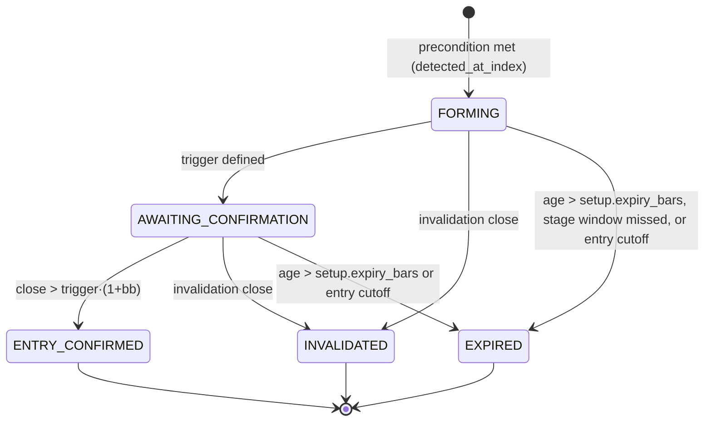

# Setup Detection Rules and Price Action Quality Score

| Field | Value |
|---|---|
| Document ID | TRD-04 |
| Version | 0.2.0 |
| Status | Specification ready for intraday (ADR-014, `pa-intraday 0.1.0`); parameters and score weights are hypotheses |
| Owner | Quant / Trading Engine Lead |
| Last updated | 2026-11-17 |
| Related | [TRD-01 Parameter Registry](01_TRADING_METHODOLOGY.md#6-ruleset-parameter-registry-authoritative) · [TRD-01 §4.1 Sessions](01_TRADING_METHODOLOGY.md#41-session-conventions) · [TRD-02](02_MARKET_STRUCTURE_RULES.md) · [TRD-03](03_SUPPORT_RESISTANCE_RULES.md) · [TRD-05](05_RISK_MANAGEMENT_RULES.md) · [TRD-08](08_TRADING_ENGINE_VALIDATION.md) |

## 1. Purpose

Defines the intraday setups of `pa-intraday 0.1.0`, their lifecycle, entry confirmation, invalidation, expiry, the derivation of entry/stop/target levels, the Price Action Quality Score (`paqs-intraday-0.1.0`), and the mapping from setup status to the trader-facing signal state.

All setups are evaluated on **closed 5m bars** of the current session, with 15m structure as context (TRD-02 §9) and session reference levels from TRD-03 §8.

| Setup | MVP | Direction |
|---|---|---|
| `OPENING_RANGE_BREAKOUT` (§3) | Yes | LONG; the downside mirror is SHORT, informational |
| `PREV_DAY_HIGH_BREAK` (§4) | Yes | LONG |
| `PREV_DAY_LOW_BREAK` (§4.1) | Yes | SHORT, informational |
| `BREAKOUT_RETEST` (§5) | Yes | LONG; the breakdown mirror is SHORT, informational |
| `TREND_CONTINUATION` (§6) | After validation of the MVP setups | LONG |
| `LIQUIDITY_SWEEP_REVERSAL` (§7) | Implemented; enabled only in `pa-intraday 0.2.0` (exploration, not validated) | LONG |

`SUPPORT_REJECTION` and `TREND_PULLBACK` belonged to `pa-core` and are retired (TRD-01 Appendix A). Setups marked "after validation" are fully specified but disabled in `pa-intraday 0.1.0`; enabling them is a new ruleset version. `LIQUIDITY_SWEEP_REVERSAL` is built and switched on by `setup.liquidity_sweep_enabled` in `pa-intraday 0.2.0` (ruleset registry delta: TRD-01 Appendix B); `pa-intraday 0.1.0` is unchanged and never emits it.

## 2. Common lifecycle



Notation: `bb = setup.breakout_buffer_pct/100`, `rt = setup.retest_tolerance_pct/100`, `sb = risk.stop_buffer_pct/100`, `sbuf = structure.break_buffer_pct_5m/100`, `prox = zone.proximity_pct/100`. Indexes are 5m bar indexes; `E(t)` is the end time of 5m bar `t`.

Common rules:

| ID | Rule |
|---|---|
| SD-01 | All stage checks are evaluated on 5m closes in chronological order. Within one bar, **invalidation is checked before confirmation**. A bar that both invalidates and confirms is treated as invalidated. |
| SD-02 | `age = t − detected_at_index` (5m bars). If `age > setup.expiry_bars` (default 12, one hour) and status is not terminal → `EXPIRED` (reason `AGED_OUT`). |
| SD-03 | `ENTRY_CONFIRMED` is terminal for detection. The confirmation applies to the **next 5m bar's open only** (`entry_window_bars = 1`). After that bar the setup is reported as `ENTRY_CONFIRMED` with `entry_window_open = false`. |
| SD-04 | Only one non-terminal setup of a given type per anchor (zone id, pivot id or reference level of the session) may exist. A new precondition on the same anchor while one is open is ignored. |
| SD-05 | **15m context filter.** A LONG setup can only reach `AWAITING_CONFIRMATION` or `ENTRY_CONFIRMED` while the aligned 15m state (TRD-02 §9) is `BULLISH`, `SIDEWAYS` or `TRANSITION(UP)`. If the 15m state becomes `BEARISH` or `TRANSITION(DOWN)`, an open LONG setup is `INVALIDATED` (reason `HTF_AGAINST`). Exception: `LIQUIDITY_SWEEP_REVERSAL` (§7), which is penalised by the score instead. |
| SD-06 | Bearish mirror setups are computed with direction `SHORT`, are flagged `informational = true`, never produce `BUY_WATCH`/`ENTRY_CONFIRMED` signals, and cannot be converted into trade plans (constraint C-12). |
| SD-07 | Reference entry price: while `AWAITING_CONFIRMATION`, `entry = trigger_price` (indicative: "a 5m close above X"). Once `ENTRY_CONFIRMED` at bar `c`, `entry = C[c]` (reference). Execution simulation fills at `O[c+1]` subject to the entry-gap rule ([TRD-05 §7](05_RISK_MANAGEMENT_RULES.md)). |
| SD-08 | **Session-bounded.** Setups are detected only from bars of the current session and never carry into the next session. A setup that has not reached `ENTRY_CONFIRMED` by the entry cutoff (TRD-01 §4.1) is `EXPIRED` (reason `SESSION_CUTOFF`). No setup can be confirmed by a bar that ends after the cutoff. |
| SD-09 | Setups that need a session reference level (opening range, previous-day levels) cannot form before that level exists (TRD-03 §8). A missing level gives `NO_TRADE` with reason `MISSING_CONTEXT`. |

## 3. Setup 1 — OPENING_RANGE_BREAKOUT (long)

**Idea:** the first minutes of the session define a range; a decisive close above it, with supportive 15m context, starts a move.

| Stage | Rule |
|---|---|
| Opening range | `OR_HIGH`, `OR_LOW` per TRD-03 §8, complete at the close of the last opening-range bar `o`. `or_width_pct = (OR_HIGH − OR_LOW) / OR_LOW × 100`. |
| Width gate | `setup.opening_range_min_pct ≤ or_width_pct ≤ setup.opening_range_max_pct`. Outside the band no setup is created; the run reports `NO_TRADE` evidence `OR_TOO_NARROW` or `OR_TOO_WIDE`. |
| Detection (→ AWAITING_CONFIRMATION) | At bar `o`, if the width gate passes and SD-05 allows. `detected_at_index = o`, `trigger_price = OR_HIGH`. This setup skips `FORMING`. |
| Confirmation (→ ENTRY_CONFIRMED) | First bar `c > o` with `C[c] > OR_HIGH × (1 + bb)`. |
| Invalidation | A close `< OR_LOW × (1 − bb)` before confirmation (reason `OR_LOW_BROKEN`). |
| Stop | `OR_LOW × (1 − sb)`, rounded down to tick. |
| Target | §8.3 ladder; setup-specific candidate: measured move `OR_HIGH + (OR_HIGH − OR_LOW)`. |

**Example** (opening range 15 minutes, buffers 0.05%). 5m bars ending 09:20, 09:25, 09:30 have highs 1,494.0 / 1,496.5 / 1,495.0 and lows 1,486.0 / 1,488.0 / 1,489.5. `OR_HIGH = 1,496.50`, `OR_LOW = 1,486.00`, width = 10.5 / 1,486 = 0.71% (inside 0.30–2.00%). Detected at the 09:30 close with trigger 1,496.50. The 09:45 bar closes at 1,498.10 > 1,496.50 × 1.0005 = 1,497.25 → `ENTRY_CONFIRMED`, reference entry 1,498.10, fill at the open of the bar ending 09:50. Stop = 1,486.00 × 0.9995 = 1,485.257 → 1,485.25 (tick 0.05). Measured-move candidate = 1,496.50 + 10.50 = 1,507.00, which gives rr = (1,507.00 − 1,498.10) / (1,498.10 − 1,485.25) = 0.69 < 2.0, so the ladder moves on; with a resistance zone whose low is 1,529.00 the target is 1,529.00 and rr = 30.90 / 12.85 = 2.40.

**Bearish mirror** (informational): a close `< OR_LOW × (1 − bb)` with SD-05 mirrored; direction `SHORT`.

## 4. Setup 2 — PREV_DAY_HIGH_BREAK (long)

**Idea:** a session that opens below the previous day's high and then closes above it with supportive context.

| Stage | Rule |
|---|---|
| Precondition | `PDH` exists and the session's first 5m bar opened below it: `O[first] < PDH`. A session that opens at or above `PDH` does not create this setup (reason `OPENED_ABOVE_LEVEL`). |
| Approach (→ AWAITING_CONFIRMATION) | First bar `a` with `C[a] ≥ PDH × (1 − prox)` and `C[a] ≤ PDH × (1 + bb)`, and SD-05 allows. `detected_at_index = a`, `trigger_price = PDH`. This setup skips `FORMING`. |
| Confirmation | First bar `c ≥ a` with `C[c] > PDH × (1 + bb)`. A bar that both approaches and closes beyond the buffer is detected and confirmed on the same bar (`c = a`). |
| Invalidation | A bearish CHoCH on the 5m series (reason `STRUCTURE_INVALIDATED`), or SD-05 (`HTF_AGAINST`). |
| Stop | The most recent confirmed 5m swing low of the current session below the reference entry, else `SESSION_LOW`; then `× (1 − sb)`, rounded down to tick. |
| Target | §8.3 ladder. |

### 4.1 PREV_DAY_LOW_BREAK (short, informational)

Mirror of §4 around `PDL`: the session opened above `PDL`, approaches it from above and closes `< PDL × (1 − bb)`. Direction `SHORT`, informational (SD-06). Recorded so the scanner can show breakdowns; never a plan.

## 5. Setup 3 — BREAKOUT_RETEST (long)

**Idea:** price closes decisively above a resistance zone or a session reference level, returns to test it from above, holds, and resumes.

| Stage | Rule |
|---|---|
| Anchor | Either an `ACTIVE` resistance zone `Z` (TRD-03) with `touches ≥ 2`, or a session reference level `PDH` or `OR_HIGH` treated as a zone of minimum width (`zone.min_width_pct`) around the level. `formed_at_index < b`. |
| Breakout (→ FORMING) | Zone `Z` is broken upward per TRD-03 §5.1 (one 5m close `> Z.high × (1 + bb)`). `detected_at_index = b`. |
| Retest (→ AWAITING_CONFIRMATION) | First bar `r` with `b < r ≤ b + setup.max_retest_wait_bars` and `L[r] ≤ Z.high × (1 + rt)` and `C[r] ≥ Z.low`. `trigger_price = H[r]`. If later retest bars occur before confirmation, `trigger_price` updates to the **latest** retest bar's high and the retest low updates to the lowest low among retest bars. |
| No retest | No qualifying `r` by `b + max_retest_wait_bars` → `EXPIRED` (reason `NO_RETEST`). |
| Confirmation (→ ENTRY_CONFIRMED) | Bar `c > r` with `C[c] > trigger_price × (1 + bb)`. |
| Invalidation | Any close after `b` with `C < Z.low × (1 − bb)` (reason `FAILED_BREAKOUT`), a bearish CHoCH on the 5m series (`STRUCTURE_INVALIDATED`), or SD-05 (`HTF_AGAINST`). |
| Stop | `min(lowest retest low, Z.low) × (1 − sb)`, rounded down to tick. |
| Target | §8.3 ladder. |

When the anchor is `OR_HIGH` or `PDH` and both an `OPENING_RANGE_BREAKOUT`/`PREV_DAY_HIGH_BREAK` and a `BREAKOUT_RETEST` exist on the same level, both are reported; the primary-setup rule (§12) picks one.

**Bearish mirror** (informational): breakdown below a support zone or `OR_LOW`/`PDL`, retest from below.

## 6. Setup 4 — TREND_CONTINUATION (long, after validation)

**Idea:** within a bullish 15m context, after a bullish 5m BOS, price pulls back, forms a confirmed 5m higher low, and resumes.

| Stage | Rule |
|---|---|
| Context | 15m state `BULLISH`; 5m state `BULLISH` with latest bullish BOS at bar `b` breaking level `X`, `b` in the current session. |
| Pullback (→ FORMING) | After `b`, a bar closes below the prior bar's low. `detected_at_index` = that bar. |
| Higher low (→ AWAITING_CONFIRMATION) | A 5m swing low `s` with `s.index > b`, `s.confirmed_at_index ≤ t`, label `HL` or `EQL`, and `s.price > protected_low × (1 + sbuf)`. `trigger_price = max(H[s.index .. s.confirmed_at_index])`. |
| Confirmation | Bar `c > s.confirmed_at_index` with `C[c] > trigger_price × (1 + bb)`. |
| Invalidation | Bearish 5m CHoCH, a newer 5m swing low labelled `LL` (reason `STRUCTURE_INVALIDATED`), or SD-05. |
| Stop | `s.price × (1 − sb)`. |
| Target | §8.3, with the impulse-leg high (highest high between `b` and `s.index`) as the setup-specific candidate. |

## 7. Setup 5 — LIQUIDITY_SWEEP_REVERSAL (long; `pa-intraday 0.2.0`)

**Idea:** price runs stops below an obvious level with a wick, then reclaims it.

| Stage | Rule |
|---|---|
| Liquidity level `Y` | Any of: confirmed unbroken 5m or 15m swing low; `EQUAL_LOWS` pool (TRD-03 §6); `Z.low` of an active support zone; `PDL`; `OR_LOW`. Known before bar `w`. |
| Sweep bar `w` (→ AWAITING_CONFIRMATION) | `L[w] < Y × (1 − sbuf)` and reclaim: `C[w] ≥ Y` (same bar), or `C[w] < Y` and `C[w+1] ≥ Y` with `L[w+1] ≥ L[w] × (1 − sbuf)`. `detected_at_index` = reclaim bar; `sweep_low = min(L[w], L[w+1])`; `trigger_price` = high of the reclaim bar. Recorded as `liquidity_events.type = SWEEP_LOW`. |
| Confirmation | Close `> trigger_price × (1 + bb)`. |
| Invalidation | Close `< sweep_low` (reason `SWEEP_FAILED`). |
| Stop | `sweep_low × (1 − sb)`. |
| Target | §8.3; an `EQUAL_HIGHS` pool above entry is the setup-specific candidate. |

A wick below `Y` whose close stays below `Y` without a timely reclaim is not a sweep; a close below `Y × (1 − sbuf)` is a structural break per TRD-02. "Unbroken" for a level means no close below `Y × (1 − sbuf)` since it formed and before bar `w`. The setup is exempt from the 15m context filter (SD-05: no `HTF_AGAINST` invalidation; the score gives structure alignment 0). Implementation: `python-engine/app/domain/setups/liquidity_sweep.py`; choices where this section is silent are OQ-SD-07 and OQ-SD-08.

## 8. Levels

### 8.1 Entry

Per SD-07.

### 8.2 Stop-loss

Defined per setup above. All stops are **structural** plus `risk.stop_buffer_pct`. A stop is never guaranteed: execution assumptions (slippage, gaps through the stop) are in TRD-05 §7 and TRD-06. Distance checks (`risk.min_stop_distance_pct`, `risk.max_stop_distance_pct`) are in [TRD-05 §4](05_RISK_MANAGEMENT_RULES.md).

### 8.3 Target ladder

Candidates (above `entry`), evaluated in order; the **first candidate meeting `risk.min_rr` is the target**:

1. Setup-specific candidate (§3–§7).
2. Session reference levels above entry, nearest first: `PDH`, `SESSION_HIGH`, `OR_HIGH` (when above entry).
3. Resistance zones above entry, nearest first: `target = zone.low` (exit *in front of* resistance).
4. Highest confirmed 15m swing high above entry in the lookback.
5. **Measured move** if no overhead structure exists: `anchor + base_height`, where `base_height` is the height of the most recent completed 5m swing leg (last confirmed swing high − the swing low before it) and `anchor = entry` (for `BREAKOUT_RETEST`: `Z.high`).

A target derived from `entry + min_rr × risk` is **never** used. If no candidate meets `risk.min_rr`, the target is the **nearest** candidate, the setup is flagged `rr_below_min = true`, and the signal is `NO_TRADE` (reason `RR_BELOW_MINIMUM`). Candidates closer than 1 tick above entry are skipped. Targets round **down** to tick. The session-end exit (TRD-01 §4.1) is a time stop that applies whatever the target.

### 8.4 Risk/reward

```
risk_per_share   = entry − stop
reward_per_share = target − entry
rr               = reward_per_share / risk_per_share      (requires risk_per_share > 0)
```

## 9. Evidence

Each setup emits ordered evidence items: `{code, tone: SUPPORTING|CAUTION, title, detail, refs: [pivot/zone/event ids, bar timestamps]}`. Example codes: `HTF_BULLISH`, `HTF_SIDEWAYS`, `STRUCTURE_BULLISH_5M`, `OR_WIDTH_0_71`, `OPENED_BELOW_PDH`, `ZONE_TOUCHES_3`, `REF_LEVEL_CONFLUENCE`, `RETEST_HELD_ABOVE_ZONE`, `RR_BELOW_MIN`, `NEAR_ENTRY_CUTOFF` (within 3 bars of the cutoff), `VOLUME_ABOVE_SESSION_MEDIAN` (evidence only: breakout bar volume vs the median 5m volume of the same time-of-day over `analysis.lookback_sessions`; **not** scored and never a gate), `UNCONFIRMED_RECENT_BARS`. Evidence text is templated deterministically by the engine.

## 10. Price Action Quality Score (PAQS)

> **Not a probability.** PAQS measures how completely a setup conforms to the ruleset's definition of a well-formed setup. It is not a win rate, expected return, or likelihood of success, and UI copy must not describe it as such.

Score version: `paqs-intraday-0.1.0` (bound to ruleset `pa-intraday 0.1.0`). Total = sum of five components, max 100.

| Component | Weight | Calculation |
|---|---|---|
| Structure alignment | 25 | 15m `BULLISH` and 5m `BULLISH` 25 · 15m `BULLISH`, 5m other 18 · 15m `SIDEWAYS`/`TRANSITION(UP)` and 5m `BULLISH` 15 · other allowed combinations 8 · 15m against (sweep setup only) 0 |
| Key level quality | 20 | Zone anchor: `round(zone.strength × 0.20)`. Reference-level anchor: `PDH` 16, `OR_HIGH` 14; +4 if the level is confluent with a zone (TRD-03 §8); capped at 20. Trend continuation without a level: 14 if `s.price` is within `rt` of broken level `X`, else 8. |
| Setup quality | 25 | Setup checklist (below) |
| Entry confirmation | 20 | `FORMING` 0 · `AWAITING_CONFIRMATION` 8 · `ENTRY_CONFIRMED` with the confirmation close in the upper half of its range 20, otherwise 15 |
| Risk/reward | 10 | `rr ≥ 3.0` 10 · `≥ 2.5` 8 · `≥ min_rr` 6 · `< min_rr` 0 |

Setup checklist (25 points per setup):

| Setup | Criteria (points) |
|---|---|
| OPENING_RANGE_BREAKOUT | OR width 0.50–1.50% (9) · breakout bar closes in the top 30% of its range (8) · confirmation within 24 bars of the session open (8) |
| PREV_DAY_HIGH_BREAK | Session opened ≥ 0.30% below PDH (8) · breakout bar closes in the top 30% of its range (9) · 5m state `BULLISH` at confirmation (8) |
| BREAKOUT_RETEST | Breakout bar closes in the top 30% of its range (8) · every retest close ≥ `Z.high` (9) · retest within 3 bars of the breakout (8) |
| TREND_CONTINUATION | Pullback depth 30–70% of the impulse leg (9) · `s.price ≥ X` (8) · pullback bar count ≤ impulse bar count (8) |
| LIQUIDITY_SWEEP_REVERSAL | Same-bar reclaim (9) · swept level is `PDL`, `OR_LOW`, an `EQUAL_LOWS` pool or a zone with ≥ 2 touches (8) · sweep depth `(Y − sweep_low)/Y ≤ 0.30%` (8) |

**Missing data behaviour:** a component that cannot be computed scores 0 and is returned with `missing = true` and a reason. The total is **not** re-normalised.

**Interpretation bands (hypothesis):** ≥ 75 high conformance · 60–74 moderate · < 60 low. `score.watch_threshold` (60) is the minimum for `BUY_WATCH`/`ENTRY_CONFIRMED` signals.

**Example.** The §3 opening range breakout: 15m `BULLISH`, 5m `BULLISH` (25); anchor `OR_HIGH` without zone confluence (14); checklist: width 0.71% (9) + breakout bar in its top 30% (8) + confirmation at 09:45, 6 bars after the open (8) = 25; `ENTRY_CONFIRMED` with close in the upper half (20); rr 2.40 against the 1,529.00 zone target (6). PAQS = 25 + 14 + 25 + 20 + 6 = **90**.

**Versioning:** any change to weights, buckets or checklist creates a new `paqs-*` version and therefore a new ruleset version.

## 11. Expiry

- Global: `setup.expiry_bars` (12 five-minute bars) from `detected_at_index` (SD-02).
- Session: every non-terminal setup expires at the entry cutoff (SD-08).
- `BREAKOUT_RETEST`: additionally `setup.max_retest_wait_bars` (6) from breakout to first retest.
- An `ENTRY_CONFIRMED` setup whose entry window has passed is not expired but is **stale** for new plans (SD-03).

## 12. Signal state mapping

The analysis run selects one **primary setup**: the non-terminal (or just-confirmed on bar `T`) `LONG` setup with the highest status priority (`ENTRY_CONFIRMED` on `T` > `AWAITING_CONFIRMATION` > `FORMING`), then highest PAQS, then most recent `detected_at_index`, then the setup type order listed in TRD-01 §7.

| Condition on primary setup | Signal |
|---|---|
| None, or only `SHORT`/informational setups | `NO_TRADE` |
| `FORMING` or `AWAITING_CONFIRMATION`, PAQS ≥ `score.watch_threshold`, not `rr_below_min` | `BUY_WATCH` |
| `ENTRY_CONFIRMED` with confirmation bar = `T`, PAQS ≥ threshold, not `rr_below_min` | `ENTRY_CONFIRMED` |
| Any other case (low score, RR below minimum, stale, after the entry cutoff) | `NO_TRADE` with reason codes |

Every signal carries `signal_at = E(T)` and `valid_until`: for `BUY_WATCH`, the earlier of the setup's expiry bar end and the entry cutoff; for `ENTRY_CONFIRMED`, the end of bar `T+1` (the entry window). `HOLD` and `EXIT` are produced only by the paper-trade/actual-trade monitor ([TRD-07](07_PAPER_TRADING_SPECIFICATION.md)).

## 13. Frontend vocabulary reconciliation

The Phase 1 frontend mock (`frontend/src/types/analysis.ts`) uses a daily setup vocabulary. The intraday UI (milestone I6) uses the canonical names; until then:

| Frontend `SetupType` | Canonical | Notes |
|---|---|---|
| `breakout-retest` | `BREAKOUT_RETEST` (LONG) | |
| `range-breakout` | `OPENING_RANGE_BREAKOUT` when the range is the opening range; otherwise `BREAKOUT_RETEST` from a range-top zone | |
| `trend-continuation` | `TREND_CONTINUATION` (after validation) | |
| `pullback-to-support` | *(retired)* | `SUPPORT_REJECTION`/`TREND_PULLBACK` belong to `pa-core` |
| `breakdown-retest` | `BREAKOUT_RETEST` (SHORT, informational) | |
| `range-bound` | *(not a setup)* — structure `SIDEWAYS`, signal `NO_TRADE` | |
| *(missing)* | `PREV_DAY_HIGH_BREAK`, `PREV_DAY_LOW_BREAK` | Must be added in I6 |

| Frontend `SetupStatus` | Canonical |
|---|---|
| `detected` | `FORMING` |
| `awaiting-confirmation` | `AWAITING_CONFIRMATION` |
| `entry-confirmed` | `ENTRY_CONFIRMED` |
| `invalidated` | `INVALIDATED` |
| *(missing)* | `EXPIRED` — must be added |

## 14. Open questions

| ID | Question |
|---|---|
| OQ-SD-01 | Should a separate `RANGE_BREAKOUT` type (intraday range other than the opening range) be added? |
| OQ-SD-02 | Entry convention: close confirmation + next 5m open (chosen) vs. a buy-stop above the trigger. A buy-stop needs 1m or tick data and is deferred. |
| OQ-SD-03 | Resolved for `pa-intraday`: the entry window is one 5m bar. Revisit if forward logging shows the window is too short for manual execution. |
| OQ-SD-04 | Should PAQS thresholds differ per setup type? |
| OQ-SD-06 | Implementation choices where TRD-04 is silent (T-I40..T-I45): no 15m context counts as "against"; one `BREAKOUT_RETEST` per level anchor per session; zone anchors use the zone as built at the bar before the breakout (resistance or inside, `touches ≥ 2`); a bar ending exactly at the entry cutoff may still confirm; the `SESSION_HIGH` rung of the target ladder includes the confirmation bar's own high, so it is often the nearest candidate and flags `rr_below_min`; the breakdown-retest SHORT mirror is not implemented; PAQS checklist thresholds are code constants. Confirm or amend. |
| OQ-SD-07 | `LIQUIDITY_SWEEP_REVERSAL` key-level quality (TRD-04 §10 gives points only for a zone anchor): what should a sweep of `PDL`, `OR_LOW`, an `EQUAL_LOWS` pool or a swing low earn (the long setups give `PDH` 16, `OR_HIGH` 14, +4 zone confluence)? Until decided these anchors score 0 with `missing = true`, so a sweep's PAQS is capped at 80. |
| OQ-SD-08 | `LIQUIDITY_SWEEP_REVERSAL` implementation choices where §7 is silent: one setup per sweep bar, for the highest level reclaimed on it (ties by anchor order `PDL`, `OR_LOW`, `EQUAL_LOWS`, `ZONE`, `SWING_LOW_5M`, `SWING_LOW_15M`); a level (anchor and price) is used once per session (SD-04); a zone level is `Z.low` of an `ACTIVE` zone that is `SUPPORT` at the close of bar `w − 1`; a close of `w` below `Y × (1 − sbuf)` rules out the two-bar reclaim; a bar whose low is deeper than `L[w] × (1 − sbuf)` on the reclaim bar is itself a same-bar sweep; no CHoCH invalidation. |
| OQ-SD-05 | Should `PREV_DAY_HIGH_BREAK` require a follow-through close (a second close above PDH) before confirmation? Decide from intraday backtests. |
