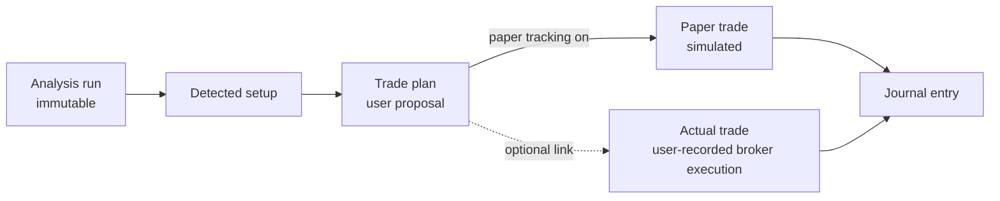
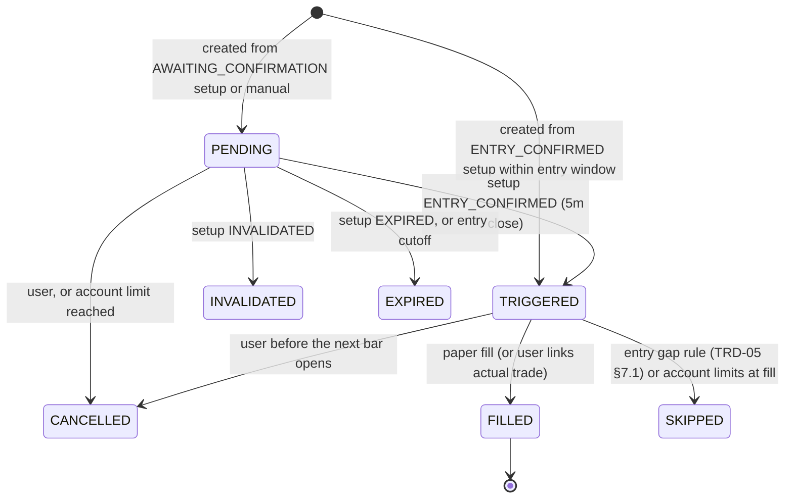

# Paper Trading Specification

| Field | Value |
|---|---|
| Document ID | TRD-07 |
| Version | 0.2.0 |
| Status | Specification ready for intraday (ADR-014) |
| Owner | Product Manager + Trading Engine Lead |
| Last updated | 2026-11-17 |
| Related | [TRD-04](04_SETUP_DETECTION_RULES.md) · [TRD-05](05_RISK_MANAGEMENT_RULES.md) · [TRD-06 Execution model](06_BACKTESTING_METHODOLOGY.md#4-execution-model) · [ARC-03](../architecture/03_DATABASE_DESIGN.md) · [ENG-05 §12](../engineering/05_DATA_INGESTION_SPECIFICATION.md#12-intraday-ingestion-adr-015) · [PRD](../product/03_PRD.md) |

## 1. Purpose

Defines how trade plans are created, how paper trades are simulated **at each 5m close during the session** from them, and how paper trades, actual (manually executed) trades and journal entries relate. Paper trading uses **the same execution rules as backtesting** (TRD-06 §4) applied forward in time. It is also the forward, unseen-data validation of the rules (TRD-06 §9).

## 2. Core entities and separation



| Entity | What it is | Who creates it | Can it place orders? |
|---|---|---|---|
| Trade plan | A proposal: entry/stop/target/qty derived from a setup or entered manually | User | No |
| Paper trade | A simulated position generated by the paper engine from a plan | System (bar-close job) | No |
| Actual trade | A record of a real execution the owner performed on the broker platform | User (manual entry); broker sync is future scope | No |
| Journal entry | Reflection attached to a closed paper or actual trade | User (auto-drafted by system) | No |

Constraint C-11: plans, paper trades and actual trades are stored in **separate tables** and never merged into one "trades" table.

## 3. Trade plan lifecycle



| Status | Meaning |
|---|---|
| `PENDING` | Waiting for the entry trigger |
| `TRIGGERED` | Trigger met at a 5m close; fill evaluated at the next 5m open |
| `FILLED` | At least one paper or actual trade is linked; plan is frozen. Open/closed is a property of the linked trade. |
| `SKIPPED` | Entry not filled because of the gap rule, degraded RR, the entry cutoff or an account limit |
| `INVALIDATED` | Setup failed before entry |
| `EXPIRED` | Setup expired before entry, or the entry cutoff passed |
| `CANCELLED` | Withdrawn by the user, or cancelled because the book reached the daily loss or losing-streak limit (`status_reason = ACCOUNT_LIMIT`) |

Plans never survive the session: at the entry cutoff every `PENDING` plan becomes `EXPIRED` and every unfilled `TRIGGERED` plan `SKIPPED` (`SKIPPED_SESSION_CUTOFF`).

### 3.1 Plan creation rules

| ID | Rule |
|---|---|
| PL-01 | A plan references `analysis_run_id` and optionally `detected_setup_id`. Manual plans (no setup) are allowed but flagged `source = MANUAL` and trigger on a 5m close above the planned entry. |
| PL-02 | Only `LONG` setups can become plans (C-12). |
| PL-03 | Levels default to the engine levels. Edits are validated by TRD-05 §4–5 and recorded in `levels_overridden` with the original engine values preserved. |
| PL-04 | Quantity and risk values are computed by the engine risk function at creation (TRD-05 §3) and stored, after the account limits pass (TRD-05 §8). |
| PL-05 | A plan for an `ENTRY_CONFIRMED` setup can only be created while its entry window is open (TRD-04 SD-03, one 5m bar); otherwise `ENTRY_WINDOW_ELAPSED`. |
| PL-06 | `paper_tracking` defaults to `true`. Turning it off makes the plan a pure manual-execution checklist. |
| PL-07 | Plans are editable only in `PENDING`. Every edit writes an audit log entry. |
| PL-08 | No plan can be created at or after the entry cutoff (`ENTRY_CUTOFF_PASSED`) or outside the session (`SESSION_CLOSED`). |

## 4. Bar-close processing

Runs at every 5m close during the session, after the bar-close ingestion for the universe is complete and the analysis batch for that close has been persisted ([ENG-05 §12](../engineering/05_DATA_INGESTION_SPECIFICATION.md#12-intraday-ingestion-adr-015)). It is idempotent per `(data_source, bar close)`.

```mermaid
sequenceDiagram
  participant M as Market-data process
  participant A as Analysis worker
  participant P as Paper engine
  participant L as Laravel (notifications)
  M->>M: fetch completed 5m bars (close t)
  M->>A: analyse universe as of t
  A-->>P: analysis runs persisted
  P->>P: 1. fills for plans TRIGGERED at close t−1 (open of bar t)
  P->>P: 2. stop/target/structure exits on bar t
  P->>P: 3. session-end exit if bar t+1 starts at the exit time
  P->>P: 4. update PENDING plans from setup states at close t; cutoff expiry
  P-->>L: events (TRIGGERED, FILLED, SKIPPED, EXIT, INVALIDATED, EXPIRED, ACCOUNT_LIMIT)
  L->>L: create notifications
```

Ordering prevents look-ahead: fills for plans triggered at close `t−1` use the open of bar `t`; then bar `t`'s range is evaluated for exits; only then are new triggers from close `t` recorded (they fill at the open of bar `t+1`). If the bar is late or missing for an instrument, that instrument's step waits until the session-end reconciliation and is flagged.

After the close, a **session-end pass** re-runs steps 1–4 for any bar that was reconciled late, closes anything still open with `SESSION_END` at the exit-time bar's open, and drafts journal entries.

## 5. Paper trade simulation

| Step | Rule |
|---|---|
| Fill | TRD-05 §7.1 at the next 5m open + slippage (`backtest.slippage_pct`). Creates a `paper_trades` row `OPEN` with `entry_at`, `entry_fill`, `qty`, `initial_stop`, `target`, costs. |
| Stop and target | TRD-06 §4.2 (gap through stop → open; collision → stop first). |
| Structure exit | If `exit.structure_exit_enabled` and a bearish 5m CHoCH closes on bar `t`, the signal becomes `EXIT` at close `t`; simulated exit at the next open. |
| Session-end exit | At the open of the 5m bar starting `session.exit_minutes_before_close` before the close (reason `SESSION_END`). |
| Stop adjustment | The user may move a paper trade's stop **up** only (never down), effective from the next bar — recorded as a `paper_trade_events` entry. |
| Manual close | The user can close a paper trade; it exits at the **next** 5m open (no hindsight closes). |
| Costs | Intraday cost schedule of TRD-06 §5. |
| P&L | `gross = (exit − entry) × qty`; `net = gross − charges`; `R = net / (initial risk × qty)`. Closed net P&L feeds the account state (TRD-05 §8.1). |

Signal states on open positions: `HOLD` while open and no exit condition; `EXIT` when an exit condition has been met and the exit is pending at the next open. Unrealised P&L in the UI uses the current price from the cache (ENG-05 §12) for display only; simulation decisions use closed bars only.

## 6. Paper account

The owner has one paper account with `starting_capital` (defaults to the risk-profile capital, ₹1,00,000) and computed `cash`, `invested`, `open_risk`, `realized_pnl`, `unrealized_pnl`, plus today's account state (TRD-05 §8.1). Reset is allowed and archives prior paper trades with a `reset_generation` number; it never deletes them.

The `/portfolio` page shows the paper book or the actual book via an explicit toggle; values are never summed across books.

## 7. Actual trades (manual execution record)

- Created by the owner after executing on the broker platform — fields: instrument, side (BUY/SELL), qty, price, executed_at (timestamp), optional broker order id, optional plan link, fees (manual or estimated from TRD-06 §5).
- Actual trades consist of fills (`actual_trade_fills`) so partial exits are supported; position status derives from net quantity.
- Intraday expectations: the app warns from the entry cutoff when an actual position is still open and again at the session-end exit time. It does not close it (ADR-010); an actual position still open after the close is flagged `CARRIED_OVER` for the owner to resolve.
- Live unrealised P&L for open actual positions uses the current-price cache (display only).

### 7.1 Signal on open actual positions (position monitor)

The monitor gives each open actual position `HOLD` or `EXIT` from **closed 5m bars** only, with the owner's own stop and target (either may be absent: an absent level is never hit). It is decision support: `EXIT` means an exit condition has been met and the exit is due now; the owner exits on the broker platform (ADR-010).

Only bars that start at or after the position's entry time count (the entry bar itself is partly before the fill). Each bar is judged by the same function as the backtest ([exit execution specification](exit-execution-specification.md), `evaluate_bar_exit`), and the first bar with a condition wins:

| Order on a bar | Condition | Reason |
|---|---|---|
| 1 | `open <= stop` (gap through the stop), or `low <= stop` (also wins a bar that touches both) | `STOP` |
| 2 | `open >= target` (gap through the target; checked before the low, so it beats a stop touched later in the bar) | `TARGET` |
| 3 | the bar starts at or after the session-end exit time and `exit.session_end_exit_enabled` (beats an intrabar stop or target on that bar) | `SESSION_END` |
| 4 | `high >= target` | `TARGET` |
| after a bar | a bearish 5m CHoCH closed on it and `exit.structure_exit_enabled` | `STRUCTURE_EXIT` |
| after the last bar | the latest bar ended at or after the session-end exit time | `SESSION_END` |

Otherwise `HOLD`. A symbol with no stored bars has no signal (`null`), never a guessed one. Test vectors: [TRD-08](08_TRADING_ENGINE_VALIDATION.md) TV-MON-01..09.
- Broker order/trade sync is **future scope** (read-only import, never order placement).

## 8. Journal integration

- When a paper or actual trade closes, the system creates a **draft** journal entry with prefilled facts: setup type, PAQS, planned vs actual entry and exit (price and time), slippage vs plan, R gross and net, exit reason, minutes held, and `followed_plan` (filled within the entry window and exited at the plan's stop, target, structure rule or session end).
- The owner adds notes, tags, mistakes and emotions, and marks the entry complete. Screenshot upload is planned for milestone I7.
- Journal statistics (win rate, profit factor, average R, plan adherence, net P&L per session) are computed server-side with `trade_kind` filter `PAPER | ACTUAL`, never mixed by default.

## 9. Edge cases

| Case | Behaviour |
|---|---|
| Bar late or missing for an instrument | That instrument's processing for the bar waits; the session-end pass catches up; the UI shows "Data delayed" with the last bar time. |
| Provider outage for several bars | No fills or exits are invented; the session-end pass processes the reconciled bars in order. |
| Instrument halted / no bars | No fills or exits; flagged. Open paper positions exit at the next available open or at `SESSION_END`. |
| User edits the risk profile during the session | Existing plans keep stored quantities; new plans use the new profile; account state recomputed. |
| Account limit reached | Further plans blocked; pending and triggered plans cancelled with `ACCOUNT_LIMIT` (TRD-05 §8). |

## 10. Open questions

| ID | Question |
|---|---|
| OQ-PT-01 | Should paper fills optionally use a limit price at `entry_ref` instead of the next open? |
| OQ-PT-02 | Should the owner be allowed multiple paper accounts (e.g. per setup type)? |
| OQ-PT-03 | Resolved for intraday: processing runs at each 5m close plus a session-end pass, instead of an end-of-day job. |
