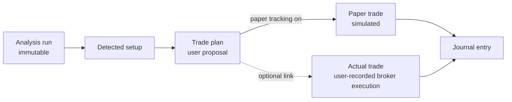
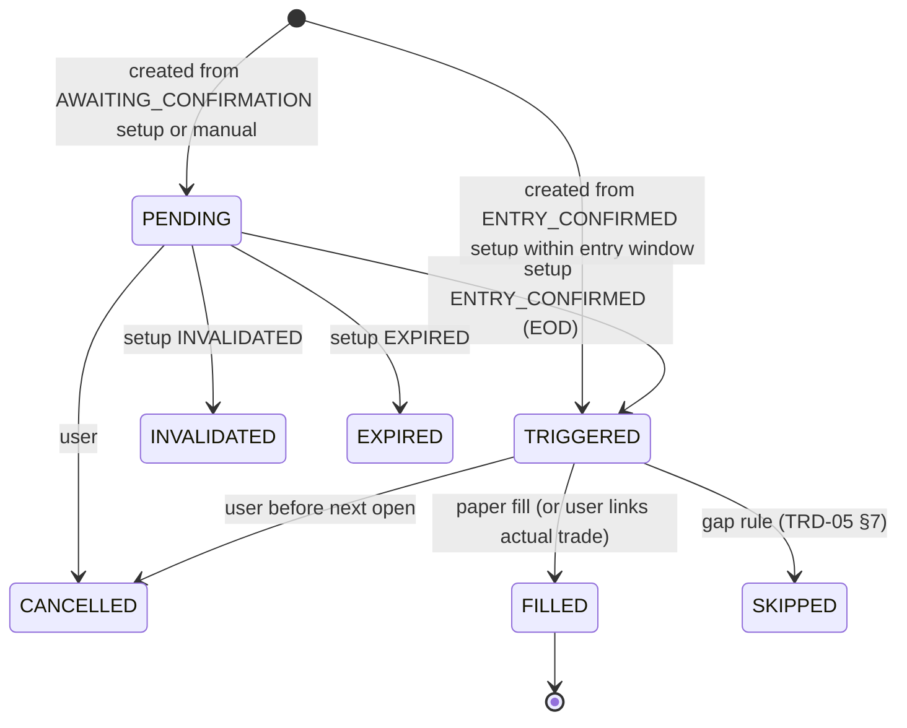
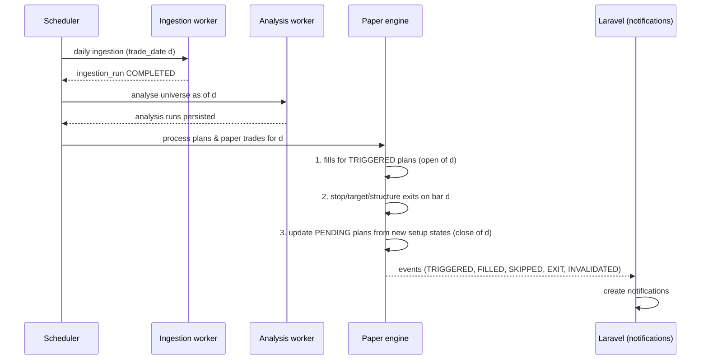

# Paper Trading Specification

| Field | Value |
|---|---|
| Document ID | TRD-07 |
| Version | 0.1.0 |
| Status | Specification ready |
| Owner | Product Manager + Trading Engine Lead |
| Last updated | 2026-11-15 |
| Related | [TRD-04](04_SETUP_DETECTION_RULES.md) · [TRD-05](05_RISK_MANAGEMENT_RULES.md) · [TRD-06 Execution model](06_BACKTESTING_METHODOLOGY.md#4-execution-model) · [ARC-03](../architecture/03_DATABASE_DESIGN.md) · [PRD](../product/03_PRD.md) |

## 1. Purpose

Defines how trade plans are created, how paper trades are simulated end-of-day from them, and how paper trades, actual (manually executed) trades and journal entries relate. Paper trading uses **the same execution rules as backtesting** (TRD-06 §4) applied forward in time.

## 2. Core entities and separation

| Entity | What it is | Who creates it | Can it place orders? |
|---|---|---|---|
| Trade plan | A proposal: entry/stop/target/qty derived from a setup or entered manually | User | No |
| Paper trade | A simulated position generated by the paper engine from a plan | System (EOD job) | No |
| Actual trade | A record of a real execution the user performed on their broker platform | User (manual entry); broker sync is future scope | No |
| Journal entry | Reflection attached to a closed paper or actual trade | User (auto-drafted by system) | No |

Constraint C-11: plans, paper trades and actual trades are stored in **separate tables** and never merged into one "trades" table.

## 3. Trade plan lifecycle

| Status | Frontend label (current mock) | Meaning |
|---|---|---|
| `PENDING` | Pending | Waiting for entry trigger |
| `TRIGGERED` | Entry confirmed | Trigger met at close; fill evaluated at next open |
| `FILLED` | Active / Completed | At least one paper or actual trade is linked; plan is frozen. Open/closed is a property of the linked trade, not of the plan. |
| `SKIPPED` | *(missing)* | Entry not filled because of gap or degraded RR |
| `INVALIDATED` | Invalidated | Setup failed before entry |
| `EXPIRED` | *(missing)* | Setup expired before entry |
| `CANCELLED` | Cancelled | Withdrawn by user |

### 3.1 Plan creation rules

| ID | Rule |
|---|---|
| PL-01 | A plan references `analysis_run_id` and optionally `detected_setup_id`. Manual plans (no setup) are allowed but flagged `source = MANUAL` and are not auto-triggered by setup state; they trigger on `C[t] > entry` (close above planned entry). |
| PL-02 | Only `LONG` setups can become plans (C-12). |
| PL-03 | Levels default to the engine levels. Edits are validated by TRD-05 §4–5 and recorded in `levels_overridden` with the original engine values preserved. |
| PL-04 | Quantity and risk values are computed by the engine risk function at creation (TRD-05 §3) and stored. |
| PL-05 | A plan for an `ENTRY_CONFIRMED` setup can only be created while the entry window is open (TRD-04 SD-03); otherwise `ENTRY_WINDOW_ELAPSED`. |
| PL-06 | `paper_tracking` defaults to `true`. Turning it off makes the plan a pure manual-execution checklist. |
| PL-07 | Plans are editable only in `PENDING`. Every edit writes an audit log entry. |

## 4. End-of-day processing

Runs once per trading day after the daily candle ingestion for the universe completes successfully ([ENG-05 §5](../engineering/05_DATA_INGESTION_SPECIFICATION.md)). It is idempotent per `(trade_date)`.

Ordering within a day matters to prevent look-ahead: fills for plans triggered at close `d−1` use `O[d]`; then bar `d`'s range is evaluated for exits; only then are new triggers from close `d` recorded (they fill at `O[d+1]`).

## 5. Paper trade simulation

| Step | Rule |
|---|---|
| Fill | TRD-05 §7 gap rules at `O[d]` + slippage (`backtest.slippage_pct`, same default). Creates `paper_trades` row `OPEN` with `entry_fill`, `qty`, `initial_stop`, `target`, costs. |
| Stop monitoring | TRD-06 §4.2 (gap through stop → open; collision → stop first). |
| Target monitoring | TRD-06 §4.2. |
| Structure exit | If `exit.structure_exit_enabled` and a bearish CHoCH closes on bar `d`, signal `EXIT` (advisory) at close `d`; simulated exit at `O[d+1]`. |
| Stop adjustment | User may move a paper trade's stop **up** only (never down) — recorded as a `paper_trade_events` entry. Trailing automation is future scope. |
| Manual close | User can close a paper trade; it exits at the **next** open (no same-day hindsight closes). |
| Costs | Cost schedule of TRD-06 §5. |
| P&L | `gross = (exit − entry) × qty`; `net = gross − charges`; `R = net / (initial risk × qty)`. |

Signal states on open positions: `HOLD` while open and no exit condition; `EXIT` when an exit condition has been met and the exit is pending at next open.

## 6. Paper account

Each user has one paper account per tenant with `starting_capital` (defaults to the risk-profile capital at onboarding) and computed `cash`, `invested`, `open_heat`, `realized_pnl`, `unrealized_pnl` (mark-to-market at latest close). Reset is allowed and archives prior paper trades with a `reset_generation` number; it never deletes them.

The `/portfolio` page shows the paper book or the actual book via an explicit toggle; values are never summed across books.

## 7. Actual trades (manual execution record)

- Created by the user after executing on their broker (Kite) — fields: instrument, side (BUY/SELL), qty, price, executed_at, optional broker order id, optional plan link, fees (optional manual or estimated).
- Actual trades consist of fills (`actual_trade_fills`) so partial exits are supported; position status derives from net quantity.
- Broker order/trade sync from Kite is **future scope** (requires additional consent scopes and is a read-only import, never order placement).

## 8. Journal integration

- When a paper or actual trade closes, the system creates a **draft** journal entry with prefilled facts (setup type, PAQS, planned vs actual entry/exit, R, exit reason, days held, `followed_plan` computed as: filled within entry window and exited at plan stop/target/structure rule).
- The user adds notes, tags, emotions/mistakes (free tags) and marks the entry complete. Screenshot upload is future scope (frontend currently toasts "not available").
- Journal statistics (win rate, profit factor, avg R, plan adherence) are computed server-side with `trade_kind` filter `PAPER | ACTUAL`, never mixed by default.

## 9. Edge cases

| Case | Behaviour |
|---|---|
| Ingestion missing for day `d` | EOD processing for `d` does not run; plans stay in prior state; UI shows "Data delayed". |
| Instrument suspended / no candle on `d` | No fills or exits for that instrument on `d`; flagged. |
| Corporate action on open paper trade | TRD-06 §7 rules. |
| User edits risk profile after plan creation | Existing plans keep stored quantities; new plans use new profile. |
| Max positions reached at trigger | Plan → `SKIPPED` with reason `MAX_POSITIONS_REACHED`. |

## 10. Open questions

| ID | Question |
|---|---|
| OQ-PT-01 | Should paper fills optionally use a limit price at `entry_ref` instead of the open? |
| OQ-PT-02 | Should users be allowed multiple paper accounts (e.g. per strategy)? |
| OQ-PT-03 | Timing of EOD job — proposed 18:30 IST to allow for late data corrections; confirm against provider data availability. |
